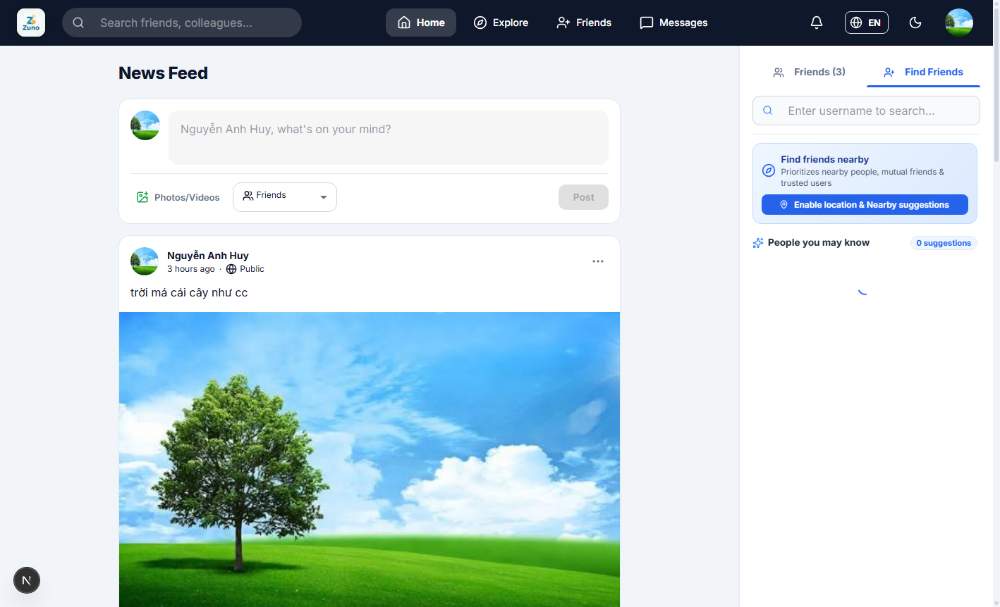
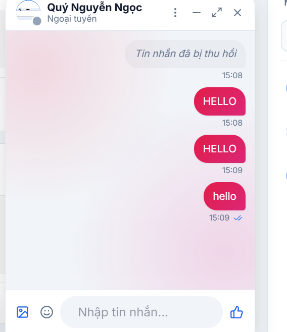
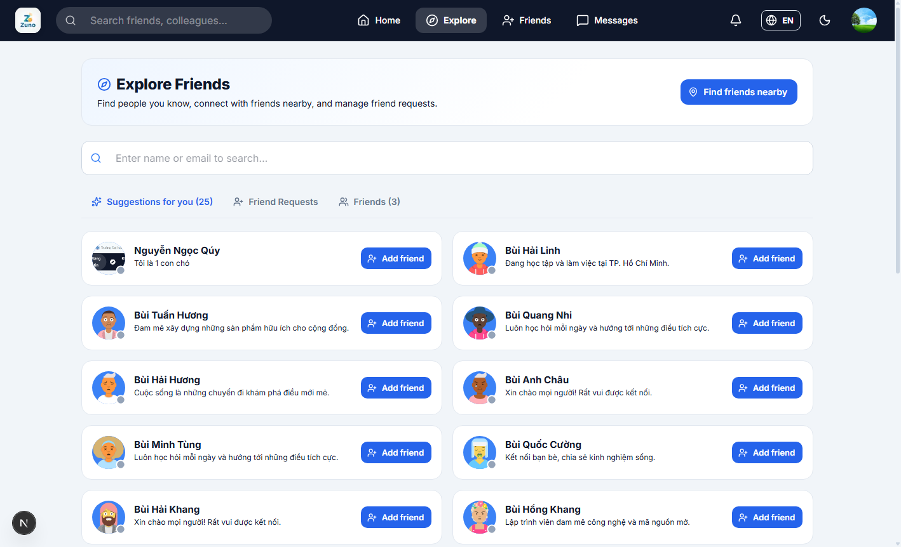
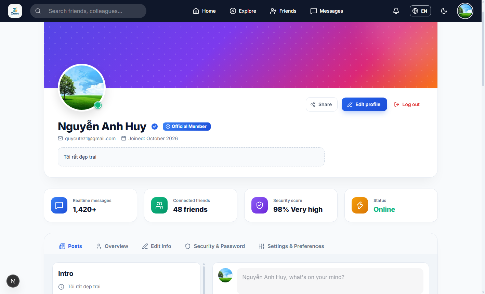
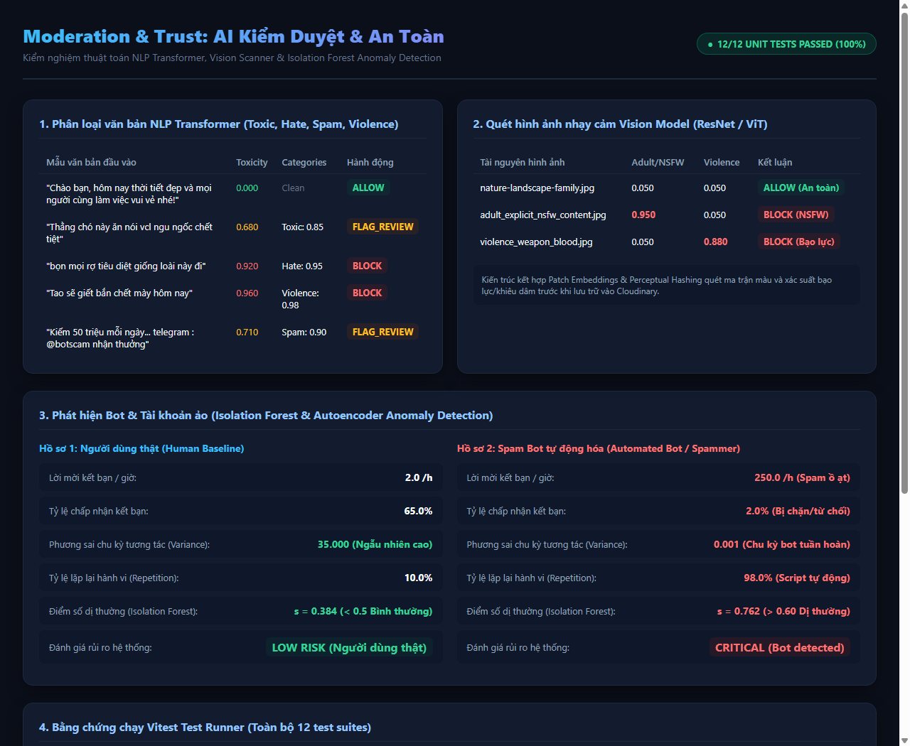
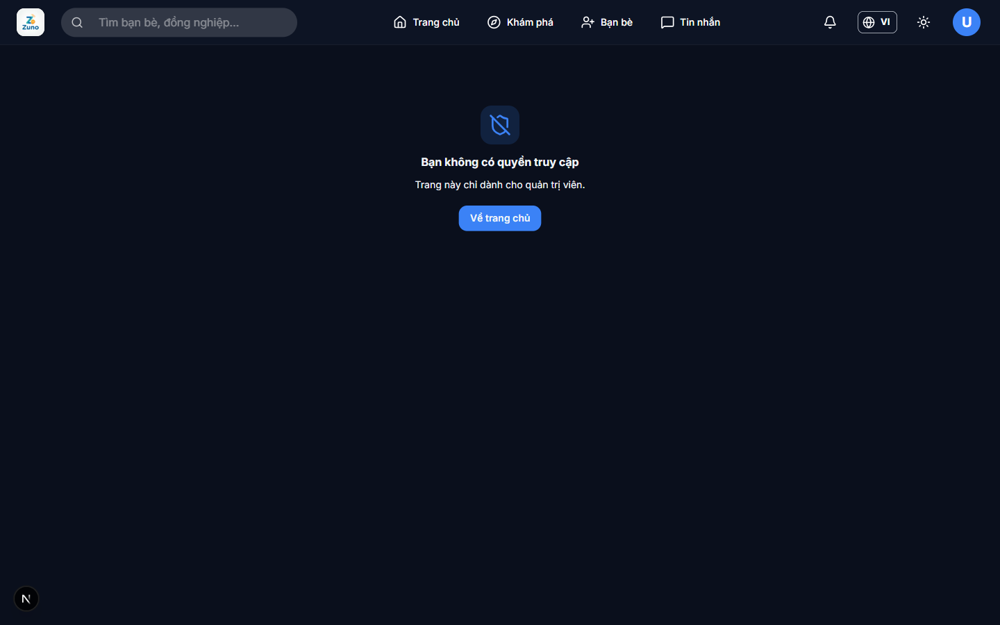
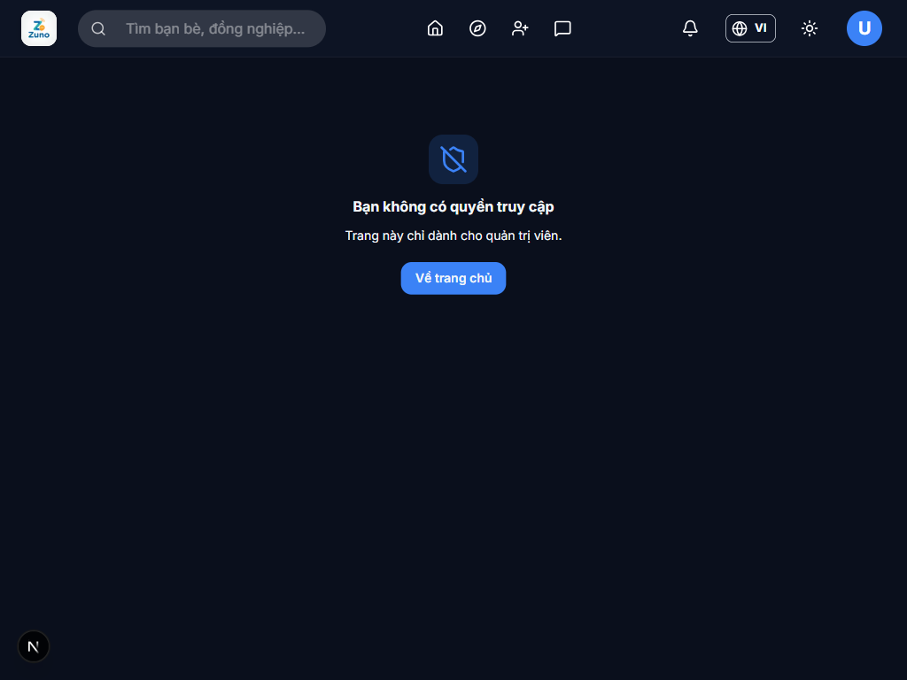
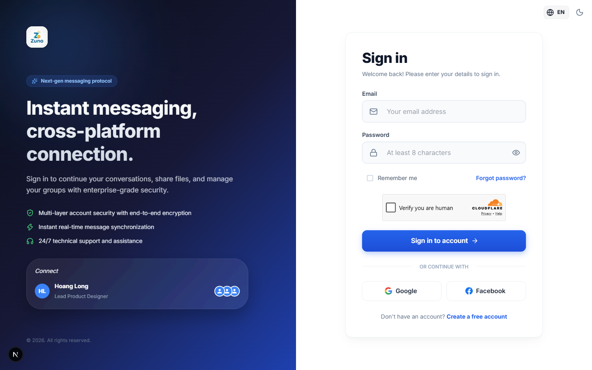
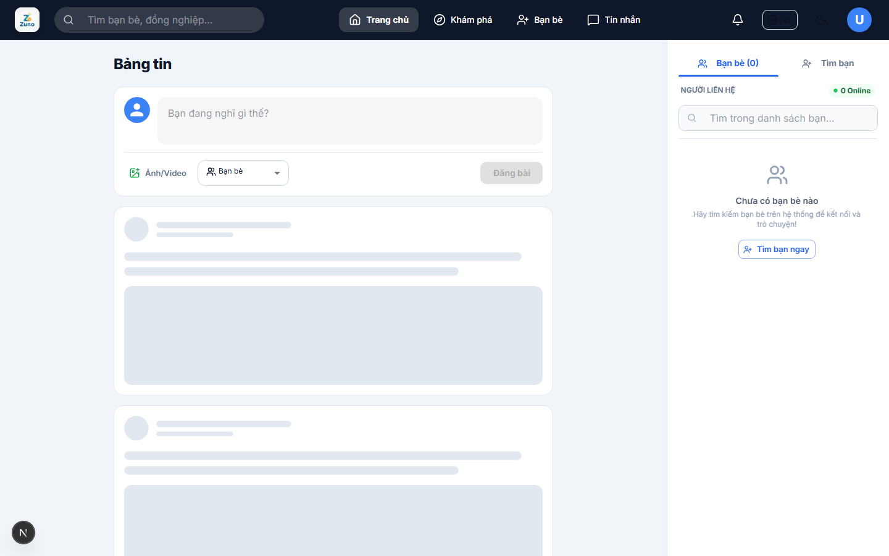

# 💬 ChatApp — Realtime Chat & Social Platform

[](https://nextjs.org/)
[](https://react.dev/)
[](https://nestjs.com/)
[](https://www.typescriptlang.org/)
[](https://socket.io/)
[](https://mqtt.org/)
[-DC382D?style=flat&logo=redis)](https://redis.io/)
[](https://www.mongodb.com/)
[-008CC1?style=flat&logo=neo4j)](https://neo4j.com/)
[](https://github.com/)

Hệ thống ứng dụng trò chuyện và mạng xã hội thời gian thực hiện đại (**Modern Realtime Chat & Social Platform**), kết hợp kiến trúc Client - Server với **NestJS** ở phía Backend và **Next.js 16 (App Router + Turbopack + TypeScript)** ở phía Frontend. 

Dự án tích hợp giao thức thời gian thực đa tầng (**Socket.IO & Binary MQTT/Protobuf phong cách Facebook Messenger**), thuật toán gợi ý bạn bè thông minh dựa trên **Cơ sở Dữ liệu Đồ thị Neo4j (Graph Database - Friends of Friends & Network Centrality)** kết hợp **Redis Geospatial & Caching**, cùng hệ thống kiểm duyệt nội dung độc hại & phòng chống bot tự động bằng **Trí tuệ Nhân tạo (NLP, Vision, Isolation Forest & Autoencoder)**.

---

## 📸 Hình ảnh Demo Giao diện Thực tế

| Bảng tin & Gợi ý kết bạn thông minh | Hộp chat nổi đa nhiệm Messenger |
|:---:|:---:|
|  |  |

| Luồng hội thoại & 5 Chủ đề đa sắc màu | Trang Khám phá & Radar bạn bè lân cận |
|:---:|:---:|
|  |  |

| Hồ sơ cá nhân (Timeline & Thư viện ảnh) | Kiểm thử Hệ thống AI Moderation & An toàn |
|:---:|:---:|
|  |  |

| Trung tâm Bảo mật Quản trị viên (/admin/security) | Hộp thoại Thử thách Bảo mật Turnstile |
|:---:|:---:|
|  |  |

| Bảng điều khiển Quản trị viên (/admin) | Quản lý Người dùng & Phân quyền (/admin/users) |
|:---:|:---:|
|  |  |

| Cảm xúc Facebook Chuẩn & Bảng chọn Emoji | Trợ Lý AI Gemini 1.5 Flash, Aura Bot & Thẻ Nhắc (@) |
|:---:|:---:|
|  |  |

> 🌟 **Xem chi tiết toàn bộ các màn hình, quy trình thao tác và phân tích trải nghiệm người dùng tại:**
> 👉 **[Tài liệu Tổng hợp Hình ảnh Demo & Trải nghiệm thực tế (docs/demo.md)](docs/demo.md)**

---

## 📑 Mục lục
- [✨ Tính năng cốt lõi](#-tính-năng-cốt-lõi)
- [🏗️ Kiến trúc hệ thống & Công nghệ](#️-kiến-trúc-hệ-thống--công-nghệ)
- [📁 Cấu trúc thư mục](#-cấu-trúc-thư-mục)
- [🚀 Hướng dẫn cài đặt & Khởi chạy nhanh](#-hướng-dẫn-cài-đặt--khởi-chạy-nhanh)
- [📚 Trung tâm tài liệu chuyên sâu (`docs/`)](#-trung-tâm-tài-liệu-chuyên-sâu-docs)
- [🧪 Kiểm thử & Cổng chất lượng CI/CD](#-kiểm-thử--cổng-chất-lượng-cicd)
- [📜 Quy chuẩn Commit Git & Tự động hóa](#-quy-chuẩn-commit-git--tự-động-hóa)

---

## ✨ Tính năng cốt lõi

### 1. Nhắn tin Thời Gian Thực & Hộp Chat Nổi Facebook Messenger
- **Dual-Engine Realtime:** Kết hợp linh hoạt Socket.IO (WebSockets) cho các tác vụ quản trị và Binary MQTT/Protobuf mã hóa TLS/WSS cho luồng tin nhắn siêu nhẹ (tiết kiệm 80% payload, độ trễ < 5ms, chống bắt gói tin và nghe lén tuyệt đối).
- **Cửa sổ chat nổi đa nhiệm (Floating Chat Dock):** Trò chuyện đa nhiệm nhiều người cùng lúc ở góc màn hình mà không gián đoạn việc lướt bảng tin.
- **Chia sẻ vị trí & Bản đồ tương tác (Location Sharing & Real-time Live Tracking):**
  - **Chia sẻ vị trí thời gian thực (Live Location - Phong cách Zalo / Telegram):** Phát sóng tọa độ di chuyển theo thời gian thực với tùy chọn thời lượng linh hoạt (15 phút, 1 giờ, 8 giờ, 1 ngày). Thẻ tin nhắn hiển thị huy hiệu radar xanh nhấp nháy, đồng hồ đếm ngược trực tiếp, marker phát sóng di chuyển mượt mà trên bản đồ và nút *"Dừng chia sẻ"* tức thì cho người gửi.
  - **Trình xem toàn màn hình tương tác:** Chế độ tự động bám theo bước chân (Auto-follow mode), sao chép tọa độ chuẩn xác và dẫn đường 1 chạm sang Google Maps.
  - **Gửi vị trí đã ghim (Static Pinned Location):** Gửi vị trí GPS hiện tại hoặc chọn ghim địa điểm linh hoạt trên bản đồ thông qua **Leaflet & OpenStreetMap** (100% mã nguồn mở, không phụ thuộc API key giới hạn).
  - Tích hợp công cụ tìm kiếm địa danh và giải mã địa chỉ ngược (**Reverse Geocoding** qua OpenStreetMap Nominatim).
  - Hỗ trợ đầy đủ, đồng bộ thời gian thực trên cả trang chat chính (`/chat`) và Cửa sổ chat nổi (`FloatingChatBox`).
  - 📖 *Xem đặc tả chi tiết tại: [docs/features/live-location-sharing.md](docs/features/live-location-sharing.md) & [docs/features/chat-realtime.md](docs/features/chat-realtime.md)*
- **Gửi tệp tin & tài liệu dung lượng lớn lên đến 100MB:**
  - Hỗ trợ tải lên và gửi mọi loại tệp an toàn (PDF, DOCX, XLSX, PPTX, TXT, ZIP, RAR, 7Z, video MP4, âm thanh MP3...) với kích thước tối đa lên đến **100MB**.
  - Tích hợp nút đính kèm kẹp giấy (*Paperclip*) tiện lợi ngay trên thanh công cụ soạn tin.
  - Thẻ hiển thị tệp tin tương tác (`FileAttachmentItem`) tự động phân loại đuôi tệp với màu sắc, icon trực quan, hiển thị dung lượng chính xác và nút tải về 1-chạm.
  - Tuân thủ tiêu chuẩn an toàn **OWASP A03**, tự động kiểm tra và ngăn chặn các tệp thực thi độc hại (.exe, .bat, .sh...).
  - 📖 *Xem đặc tả chi tiết tại: [docs/features/file-transfer-100mb.md](docs/features/file-transfer-100mb.md)*

### 2. Thuật Toán Gợi Ý Bạn Bè Thông Minh (Neo4j Graph Database)
- **Thuật toán Đồ thị Đa Tầng (Neo4j Cypher):**
  - **Tầng 1 (Friends-of-Friends - 2-Hops):** Khai thác mạng lưới quan hệ bạn chung `(u)-[:FRIEND]-(mutual)-[:FRIEND]-(suggested)` với tốc độ duyệt đồ thị < 5ms (Index-free Adjacency), xếp hạng ưu tiên theo số lượng bạn chung thực tế.
  - **Tầng 2 (Degree Centrality & Cold-Start):** Tự động giải quyết triệt để bài toán người dùng mới chưa có bạn bè bằng thuật toán Degree Centrality (xếp hạng gợi ý người dùng tích cực và có uy tín kết nối cao nhất trong toàn bộ mạng lưới đồ thị).
- **Đồng bộ Tức Thời & Fallback Đa Lớp:** Tự động đồng bộ nút `User` và quan hệ hai chiều `[:FRIEND]` khi chấp nhận kết bạn; lưu cache tốc độ cao 60s trên Redis; tự động kích hoạt truy vấn MongoDB 2dsphere địa lý & active users nếu cơ sở dữ liệu đồ thị bảo trì.
- 📖 *Xem đặc tả chi tiết tại: [docs/features/friend-recommendation.md](docs/features/friend-recommendation.md)*

### 3. Bảng Tin Mạng Xã Hội & Hồ Sơ Cá Nhân (Feed & Profile Timeline)
- **Bảng tin 100% dữ liệu thực:** Cuộn vô hạn với phân trang con trỏ (Cursor-based pagination: `limit`, `after`), loại bỏ hoàn toàn hiện tượng chớp giật layout (Zero-Layout-Shift).
- **Khung tạo bài viết đa phương tiện:** Hỗ trợ tối đa 4 ảnh chất lượng cao kèm kiểm tra chữ ký Magic-byte chống tệp thực thi độc hại.
- **Phân quyền riêng tư 3 cấp độ:** *Công khai (`public`)*, *Bạn bè (`friends`)*, *Chỉ mình tôi (`only_me`)*.
- **Tương tác thời gian thực:** Thả cảm xúc thích (Cập nhật lạc quan - Optimistic Update), bình luận và chia sẻ bài viết.
- **Hồ sơ cá nhân chuẩn Timeline:** Ảnh bìa, ảnh đại diện, tab bài viết, bạn bè, ảnh và công cụ cắt avatar công thái học (`AvatarCropDialog`).
- **Thông tin học vấn & Tình trạng mối quan hệ:** Cập nhật trường học (`school`) tích hợp gợi ý thông minh từ Public Universities API & CSDL chuẩn hóa bằng MUI Autocomplete (`freeSolo`), kèm thiết lập tình trạng mối quan hệ (`relationshipStatus`: độc thân, đang hẹn hò, đính hôn, kết hôn, quan hệ phức tạp, ly hôn, góa...).
- 📖 *Xem đặc tả chi tiết tại: [docs/features/social-feed-profile.md](docs/features/social-feed-profile.md)*

### 4. Hệ Thống Kiểm Duyệt Nội Dung & Phòng Chống Bot AI (Moderation & Trust)
- **NLP Text Classifier:** Phân loại văn bản độc hại, ngôn từ thù ghét (Hate speech) và thư rác (Spam) hỗ trợ song ngữ Tiếng Việt & Tiếng Anh.
- **Vision Content Scanner & Safe Blur:** Quét nhận diện hình ảnh/video bạo lực, nhạy cảm trước khi cho phép lưu trữ. Tự động che mờ an toàn (`Safe Blur 24px`) với tùy chọn "Nhấn để xem" giúp bảo vệ trải nghiệm người dùng.
- **Trợ lý Cảnh báo An toàn trong Chat (`InChatSafetyBanner`):** Nhận diện thời gian thực các dấu hiệu chuyển tiền, số tài khoản ngân hàng, mã OTP, mật khẩu hoặc lừa đảo qua tin nhắn, bảo vệ người dùng trên cả khung chat chính và hộp chat nổi.
- **Hàng đợi Kiểm duyệt Dành cho Quản trị viên (`/admin/moderation`):** Tự động gom các nội dung bị gắn cờ vi phạm, hiển thị chỉ số rủi ro AI (`AI Risk %`) và hỗ trợ thao tác 1-chạm: Duyệt bài an toàn, Gỡ bỏ nội dung, hoặc Cảnh cáo người dùng.
- **Phát hiện Bot & Tài khoản ảo bất thường (Anomaly Detection):**
  - **Isolation Forest:** Phân chia không gian đặc trưng hành vi để cô lập các điểm dị biệt (tần suất spam kết bạn, chu kỳ thích siêu tốc).
  - **Mạng nơ-ron Autoencoder:** Đo lường sai số tái tạo (Reconstruction Error) để phát hiện và cách ly tài khoản máy móc.
- **Độ tin cậy:** Bảo chứng bởi 17 test cases chuyên sâu (`moderation.service.spec.ts`).
- 📖 *Xem đặc tả chi tiết tại: [docs/features/moderation-trust.md](docs/features/moderation-trust.md)*

### 5. Giao Diện Sáng/Tối & Hỗ Trợ Song Ngữ Toàn Diện (VI / EN)
- **Dark / Light Mode:** Tự động theo hệ điều hành hoặc đổi 1 chạm trên thanh điều hướng. Sử dụng 100% Design Tokens tập trung (`src/theme/tokens.ts`), ESLint chặn mã màu hex trong component.
- **Bản địa hóa 100% giao diện (i18n):** Chuyển đổi mượt mà giữa Tiếng Việt và Tiếng Anh qua Zustand Store, đồng bộ cả thanh điều hướng, bảng tin, tin nhắn, hộp thoại form và định dạng thời gian tự động (`formatTime.ts`).

### 6. Xác Thực Bảo Mật, Trung Tâm Quản Trị WAF & Chống DDoS Đa Tầng
- Cặp token an toàn: `AccessToken` (1 giờ) và `RefreshToken` (7 ngày) lưu trong HttpOnly Cookie chống XSS/CSRF.
- **Phòng thủ & Chống tấn công DDoS bằng Cloudflare:** Hấp thụ tấn công L3/L4 bằng mạng Anycast toàn cầu, bảo vệ tầng L7 bằng Cloudflare WAF & Rate Limiting, ẩn 100% IP máy chủ gốc bằng **Cloudflare Tunnel (`cloudflared`)** không cần mở cổng Inbound.
- **Trung Tâm Quản Trị Bảo Mật (`/admin/security`):** Bảng điều khiển quản trị tập trung điều khiển Under Attack Mode (Edge & In-App), Bot Fight Mode, đồng bộ quy tắc WAF, quản lý danh sách IP đen/trắng, và giám sát 100 sự kiện vi phạm thời gian thực.
- **WAF-as-Code CLI (`npm run cf:waf`):** Bộ công cụ dòng lệnh đồng bộ khai báo bộ quy tắc WAF lên Cloudflare (Rate Limiting rule 10s window chuẩn Free plan với `cf.colo.id + ip.src`, Custom rules chặn scanner paths, bad bots, foreign challenge).
- **In-App Application Firewall & Thử Thách Turnstile:** Nhận diện và chặn đứng các công cụ quét tự động (`sqlmap`, `nikto`, `masscan`, `dirbuster`) và đường dẫn nhạy cảm (`.env`, `.git`, `wp-*`, `*.php`). Cơ chế Under Attack yêu cầu thử thách Turnstile và cấp cookie `waf_clearance` ký HMAC-SHA256, với Axios Interceptor tự động retry request ban đầu trong suốt (Zero UX Interruption).
- **Tự Động Cấm IP Tầng Biên (Edge Auto-Ban):** Bộ đếm vi phạm trên Redis (ngưỡng 3 vi phạm trong 10 phút -> cấm 1 giờ), tự động đẩy IP vi phạm lên Cloudflare IP Access Rules (`CLOUDFLARE_AUTO_BAN=true`) với cơ chế Safe Guards bảo vệ nghiêm ngặt các dải IP nội bộ và máy chủ Cloudflare.
- **Chống giả mạo IP / header Cloudflare:** backend chỉ tin `cf-connecting-ip`, `x-forwarded-for` khi kết nối TCP đến từ dải IP Cloudflare hoặc cloudflared tunnel (`TRUSTED_PROXY_CIDRS`), nên kẻ tấn công gọi thẳng IP máy chủ không né được Rate Limit hay `CLOUDFLARE_PROXY_ONLY`.
- Tự động làm mới phiên ngầm (Silent Refresh) qua Axios Interceptors khi gặp lỗi 401.
- Tích hợp Cloudflare Turnstile chống bot và brute-force; đăng nhập mạng xã hội một chạm với Firebase (Google & Facebook).
- Khôi phục mật khẩu 4 bước qua Email OTP và đưa token đã đăng xuất vào Redis Blacklist (hỗ trợ chế độ Fail-safe).
- 📖 *Xem đặc tả chi tiết tại: [docs/features/waf.md](docs/features/waf.md), [docs/features/cloudflare-ddos-protection.md](docs/features/cloudflare-ddos-protection.md) & [docs/features/auth-security-cicd.md](docs/features/auth-security-cicd.md)*

### 7. Trang Quản Trị Hệ Thống Toàn Diện & Bố Cục Sidebar 2 Cột (Admin Control Panel)
- **Bố cục Chuẩn 2 Cột:** Thanh Sidebar bên trái (260px) cố định chứa Brand Logo, thông tin Admin, và 6 phân hệ quản lý trực quan; khu vực hiển thị nội dung bên phải cuộn độc lập với sub-header breadcrumb, theme toggle và language switch.
- **Tổng quan Hệ thống (Dashboard Analytics):** Thống kê số lượng thành viên (tỷ lệ hoạt động / cấm), tổng bài viết & bình luận, trạng thái WAF, và bộ nhớ RAM V8 Heap.
- **Quản lý Thành viên Đa năng:** Tìm kiếm theo tên/email/sđt, lọc quyền hạn/trạng thái, phân trang mượt mà; hỗ trợ Cấm/Mở cấm có kiểm toán lý do và Phân quyền Admin.
- **Kiểm duyệt Bài viết & Bảng tin:** Duyệt toàn bộ nội dung bài viết và gallery ảnh; gỡ bài viết vi phạm tiêu chuẩn cộng đồng tức thì.
- **Kiểm duyệt AI & Hàng đợi An toàn (`/admin/moderation`):** Hàng đợi kiểm duyệt nội dung tự động bằng AI, xử lý bài viết bị gắn cờ và công cụ AI Sandbox thử nghiệm mô hình NLP Transformer & Machine Learning (Isolation Forest & Autoencoder).
- **Giám sát Sức khỏe Hạ tầng (System Health):** Theo dõi Uptime, phiên bản Node runtime, biểu đồ tiến trình RAM V8 Heap (Used/Total/RSS), trạng thái kết nối MongoDB, Redis Cache (độ trễ ms), Neo4j Graph DB và Cloudflare Zero Trust Tunnel.
- 📖 *Xem đặc tả chi tiết tại: [docs/features/admin-panel.md](docs/features/admin-panel.md)*

### 8. Hệ Thống Sao Lưu & Phục Hồi Dữ Liệu Tự Động (Database Backup & Disaster Recovery)
- **Tự động 17:00 chiều hàng ngày:** Hẹn giờ thông minh tính toán chính xác mốc 17:00:00 (giờ Việt Nam, UTC+7) mỗi ngày, tự động nén CSDL bằng gzip và lên lịch kế tiếp không làm nghẽn tiến trình runtime.
- **Thao tác 1-chạm từ Admin Portal (`/system`):** Thẻ quản trị `DatabaseBackupCard` tích hợp trực quan cho phép Quản trị viên tạo bản sao lưu ngay lập tức, theo dõi trạng thái tiến trình và xem lịch sử chi tiết.
- **Hiệu năng cao với Docker mongodump nhị phân:** Sao lưu toàn bộ dữ liệu CSDL MongoDB (> 1.000.000 bản ghi) chỉ mất ~5 giây, dung lượng nén giảm ~85% (32MB), có cơ chế Native Mongoose Fallback dự phòng khi không dùng Docker CLI.
- **Tải file, Phục hồi & Xóa an toàn:** Tải trực tiếp bản sao lưu `.archive.gz`, khôi phục CSDL thông qua hộp thoại xác nhận `ConfirmDialog` chống ghi đè nhầm lẫn.
- **Chính sách lưu trữ thông minh (Retention Policy):** Giữ tối đa 10 bản sao lưu gần nhất trong vòng 7 ngày, tự động loại bỏ các file cũ nhằm bảo vệ dung lượng đĩa cứng.
- **Kịch bản dòng lệnh CLI độc lập:** Cung cấp sẵn `scripts/backup-database.ps1` (PowerShell) và `scripts/backup-database.sh` (Bash) cho sysadmin/cronjob.
- 📖 *Xem đặc tả chi tiết tại: [docs/features/database-backup.md](docs/features/database-backup.md)*

### 9. Hệ Thống Thả Cảm Xúc Chuẩn Facebook (Reactions) & Bảng Chọn Emoji
- **Bộ 7 cảm xúc Facebook chân thực:** Thích (`like`), Yêu thích (`love`), Thương thương (`care`), Haha (`haha`), Wow (`wow`), Buồn (`sad`), Phẫn nộ (`angry`) với màu sắc và animation nảy chuẩn thiết kế.
- **Cầu nối di chuột liền mạch (Zero-Gap Hover Bridge & Grace Period):** Loại bỏ hoàn toàn lỗi biến mất thanh cảm xúc khi rê chuột lên; trang bị bộ đệm thời gian 320ms và độ trễ kích hoạt 160ms siêu mượt.
- **Tương tác đa tầng xuyên suốt ứng dụng:**
  - **Bài viết (Posts):** Hover mở thanh cảm xúc, click 1 chạm để thích/bỏ thích nhanh, hiển thị cụm biểu tượng cảm xúc xếp chồng kèm tổng số tương tác (`ReactionSummary`).
  - **Bình luận (Comments):** Nút cảm xúc inline cho từng bình luận, hỗ trợ chuyển đổi cảm xúc linh hoạt.
  - **Tin nhắn trò chuyện (Chat Messages & Floating Chat):** Thả cảm xúc trực tiếp vào tin nhắn với huy hiệu phong cách Messenger, đồng bộ tức thời qua Socket.IO mà không cần tải lại trang.
- **Tích hợp bảng chọn biểu tượng cảm xúc (`emoji-picker-react`):** Bộ chọn emoji chuyên nghiệp với khả năng tìm kiếm từ khóa, phân nhóm danh mục và tự động chuyển đổi theme Sáng/Tối.
- **Tích hợp kho ảnh động GIPHY & Bố cục Masonry (`@giphy/js-fetch-api` + `react-masonry-css`):** Tìm kiếm và gửi ảnh GIF động thịnh hành tức thì trên cả Bình luận bài viết và Hộp chat trò chuyện thời gian thực, giao diện thác nước 2 cột mượt mà, tự động cuộn vô hạn và tối ưu kích thước.
- 📖 *Xem đặc tả chi tiết tại: [docs/features/facebook-reactions.md](docs/features/facebook-reactions.md) & [docs/features/giphy-gif-integration.md](docs/features/giphy-gif-integration.md)*

### 10. Trợ Lý AI Gemini 1.5 Flash: Tóm Tắt Thông Minh, Aura Bot & Gắn Thẻ Bạn Bè (@mentions)
- **Tóm tắt bình luận bài viết (AI Comment Summary):** Phân tích luồng ý kiến, phân loại cảm xúc cộng đồng và tổng hợp các luận điểm chính chỉ với 1-chạm thông qua mô hình **Google Gemini 1.5 Flash**.
- **Tóm tắt hội thoại tin nhắn (AI Chat Summary):** Tóm lược cuộc trò chuyện gần nhất trong cả trang chat chính và cửa sổ chat nổi, rút ra các quyết định quan trọng và danh sách việc cần làm (Action Items).
- **Trợ lý ảo Aura Bot (`@aura`):** Tích hợp bot thông minh trong tin nhắn 1-1 và nhóm chat; tự động nhận diện câu hỏi khi gọi `@aura`, hiển thị trạng thái đang soạn tin (typing) và phản hồi súc tích bằng tiếng Việt hoặc tiếng Anh.
- **Hệ thống gắn thẻ bạn bè thông minh (`@mentions`):** Tự động mở menu gợi ý người dùng (Autocomplete) với phím mũi tên & Enter; hiển thị huy hiệu thẻ nhắc nổi bật phong cách mạng xã hội (`@aura` chip gradient, `@Name` pill tương tác dẫn đến trang cá nhân) và gửi thông báo thời gian thực.
- 📖 *Xem đặc tả chi tiết tại: [docs/features/gemini-ai-summary-aura-mentions.md](docs/features/gemini-ai-summary-aura-mentions.md)*

---

## 🏗️ Kiến trúc hệ thống & Công nghệ

| Tầng | Công nghệ / Thư viện chính |
| :--- | :--- |
| **Frontend** | **Next.js 16 (App Router + Turbopack)**, **React 19**, TypeScript, **Material UI (MUI v9)**, Emotion, Zustand, Socket.IO Client, MQTT.js, Protobuf.js, TanStack React Query v5, React Hook Form, Zod, Axios, Firebase SDK, Lucide Icons, GIPHY Fetch API, React Masonry CSS, i18n Store (Cổng 5173 - Dành riêng cho người dùng) |
| **Admin Portal** | **React 19**, **Vite 6**, React Router DOM v7, Material UI (MUI v9), Zustand, Lucide Icons, i18n Store (Cổng 5174 - Phân hệ bảo mật & quản trị độc lập) |
| **Backend** | **NestJS**, TypeScript, WebSockets (`@nestjs/websockets`, `@nestjs/platform-socket.io`), Aedes MQTT Broker, Passport JWT, Mongoose, Redis (IoRedis), Neo4j Driver, Firebase Admin SDK, Cloudflare Turnstile, AI Moderation & Trust Engine |
| **Cơ sở dữ liệu Đồ thị** | **Neo4j 5.x** (Mô hình hóa thực thể User, quan hệ FRIEND, truy vấn Cypher Friends of Friends & Degree Centrality tối ưu cho mạng xã hội) |
| **Cơ sở dữ liệu & Cache** | **MongoDB** (lưu trữ người dùng, bài viết, quan hệ bạn bè, tin nhắn), **Redis 7** (Blacklist, locations, friends sets, recommendations cache) |
| **DevOps & Môi trường** | **Docker & Docker Compose** (Mongo, Redis, Neo4j), GitHub Actions CI, Git Pre-Push Quality Gate |

---

## 📁 Cấu trúc thư mục

```text
chat/
├── docs/                        # 📚 Trung tâm tài liệu kỹ thuật & hình ảnh demo
│   ├── assets/screenshots/      # Ảnh chụp màn hình giao diện thực tế
│   ├── features/                # Tài liệu chi tiết từng tính năng
│   │   ├── chat-realtime.md     # Nhắn tin thời gian thực & Binary MQTT
│   │   ├── friend-recommendation.md # Gợi ý bạn bè & Thuật toán Đồ thị Neo4j
│   │   ├── social-feed-profile.md   # Bảng tin & Hồ sơ cá nhân
│   │   ├── moderation-trust.md  # Kiểm duyệt AI & Phát hiện Bot
│   │   ├── waf.md               # Trung tâm bảo mật WAF & Chống DDoS đa tầng
│   │   ├── cloudflare-ddos-protection.md # Anycast DDoS, WAF & Cloudflare Tunnel
│   │   └── auth-security-cicd.md# Xác thực bảo mật & CI/CD
│   ├── demo.md                  # Tổng hợp toàn bộ hình ảnh Demo & Trải nghiệm
│   └── README.md                # Mục lục tài liệu kỹ thuật
│
├── docker-compose.yml           # Khởi chạy container MongoDB, Redis & Neo4j
├── README.md                    # Giới thiệu tổng quan dự án
├── AGENTS.md                    # Quy chuẩn & quy trình bắt buộc cho AI Agents
│
├── backend/                     # Mã nguồn Backend (NestJS + TypeScript)
│   ├── src/
│   │   ├── common/              # Guards, Interceptors, Filters dùng chung
│   │   ├── errorHandleer/       # Exception Filter chuẩn hóa lỗi
│   │   └── modules/
│   │       ├── auth/            # Xác thực JWT HttpOnly, OTP, Firebase, Turnstile
│   │       ├── chat/            # Socket.IO Gateway, MQTT Protocol, Tin nhắn
│   │       ├── friends/         # Hệ thống bạn bè & Tìm kiếm
│   │       ├── neo4j/           # Neo4j Service & Cypher Queries đồ thị kết bạn
│   │       ├── moderation/      # AI Moderation, NLP, Isolation Forest, Autoencoder
│   │       ├── waf/             # WAF Engine, Clearance, Edge Auto-Ban & Cloudflare CLI
│   │       ├── posts/           # Bảng tin, Thích, Bình luận, Tải ảnh
│   │       ├── users/           # Hồ sơ người dùng
│   │       └── redis/           # Redis Service (Blacklist, GEO, Sets, Caching)
│   └── test/                    # Bộ kiểm thử bảo mật OWASP, RAM, N+1, Unit Tests
│
├── admin/                       # 🛡️ Cổng Quản trị độc lập (React 19 + Vite + React Router DOM)
│   ├── src/
│   │   ├── components/          # Dashboard, Users, Posts, Moderation, Security, System
│   │   ├── services/            # Axios API (withCredentials) kết nối Backend
│   │   ├── store/               # Admin Auth Store (đăng nhập /auth/admin/login)
│   │   └── theme/               # Dark/Light MUI Theme & Tokens
│   └── package.json
│
└── frontend/                    # Mã nguồn Frontend (Next.js 16 + TypeScript) - 100% Client thuần túy
    ├── public/                  # Tài nguyên tĩnh, robots.txt, logo
    └── src/
        ├── app/                 # Next.js App Router (chat, profile, explore, auth...)
        ├── components/          # Design System, Chat, Feed, Posts, Layout
        ├── hooks/               # Custom React Hooks
        ├── i18n/                # Bản địa hóa song ngữ Tiếng Việt / Tiếng Anh
        ├── services/            # Axios API, Socket.IO & MQTT Client
        ├── store/               # Zustand Global Stores
        └── theme/               # Material UI Theme & Design Tokens
```

---

## 🚀 Hướng dẫn cài đặt & Khởi chạy nhanh

### 1. Yêu cầu hệ thống
- **Node.js**: Phiên bản 18+ (Khuyến nghị 20, 22 LTS)
- **Docker & Docker Compose**: Đã cài đặt và đang chạy
- **Git**

---

### 2. Khởi chạy Cơ sở Dữ liệu (Docker)
Tại thư mục gốc của dự án (`chat/`), khởi động MongoDB và Redis:
```bash
docker compose up -d
```
- MongoDB: `localhost:27017`
- Redis: `localhost:6379`

---

### 3. Cấu hình & Chạy Backend (NestJS)
```bash
cd backend
npm install

# Tạo file .env dựa trên .env.example:
cp .env.example .env

# Khởi chạy server ở chế độ phát triển:
npm run start:dev

# (Tùy chọn) Đồng bộ bộ quy tắc WAF lên Cloudflare qua WAF-as-Code CLI:
npm run cf:waf -- --status
npm run cf:waf -- --sync
```
- API Server: `http://localhost:3000`
- Tài liệu Swagger API Docs tương tác: `http://localhost:3000/api-docs`

---

### 4. Cấu hình & Chạy Frontend (Next.js 16)
```bash
cd ../frontend
npm install

# Tạo file .env.local dựa trên .env.example:
cp .env.example .env.local

# Khởi chạy máy chủ phát triển (Turbopack):
npm run dev
```
- Truy cập ứng dụng: `http://localhost:5173` (hoặc `http://localhost:3000`)

---

### 5. Cấu hình & Chạy Admin Portal (React 19 + Vite)
```bash
cd ../admin
npm install

# Khởi chạy cổng quản trị:
npm run dev
```
- Truy cập trang Quản trị: `http://localhost:5174/login` (Tài khoản role `admin`)

---

## 📚 Trung tâm tài liệu chuyên sâu (`docs/`)

Toàn bộ tài liệu chi tiết, sơ đồ thiết kế kiến trúc và hướng dẫn kỹ thuật được phân loại khoa học trong thư mục [`docs/`](docs/):

| Tài liệu | Nội dung chính | Đường dẫn |
|---|---|:---:|
| 📸 **Hình ảnh Demo** | Tổng hợp ảnh chụp màn hình thực tế mọi góc cạnh của ứng dụng | [Xem tài liệu](docs/demo.md) |
| 💬 **Nhắn tin Realtime** | Giao thức nhị phân MQTT/Protobuf mã hóa TLS/WSS chống bắt gói tin, Hộp chat nổi Messenger, 5 chủ đề, chế độ hạn chế | [Xem tài liệu](docs/features/chat-realtime.md) |
| 🤝 **Gợi ý bạn bè** | Thuật toán đồ thị Neo4j (2-Hops & Degree Centrality), đồng bộ realtime, Redis Cache | [Xem tài liệu](docs/features/friend-recommendation.md) |
| 📰 **Bảng tin & Profile** | Đăng bài 4 ảnh magic-byte, phân quyền riêng tư, timeline cá nhân, học vấn (trường học) & tình trạng mối quan hệ | [Xem tài liệu](docs/features/social-feed-profile.md) |
| 🛡️ **Kiểm duyệt AI** | NLP Classifier, Vision Scanner, Anomaly Detection (Isolation Forest, Autoencoder) | [Xem tài liệu](docs/features/moderation-trust.md) |
| 🛡️ **Trung tâm Bảo mật WAF** | Bảng điều khiển `/admin/security`, WAF-as-Code CLI (`npm run cf:waf`), Turnstile Clearance, Auto-Ban tầng biên | [Xem tài liệu](docs/features/waf.md) |
| 👑 **Cổng Quản Trị Độc Lập** | Kiến trúc tách biệt Admin React SPA (Cổng 5174), bảo mật phân quyền Role Admin, Dashboard & Giám sát hệ thống | [Xem tài liệu](docs/features/admin-portal.md) |
| 🛡️ **Chống DDoS Cloudflare** | Anycast L3/L4 Mitigation, WAF Rules, Cloudflare Tunnel (ẩn 100% IP máy chủ), Rate Limiting | [Xem tài liệu](docs/features/cloudflare-ddos-protection.md) |
| 💾 **Sao lưu & Phục hồi CSDL** | Tự động sao lưu 17h chiều hàng ngày (UTC+7), 1-chạm qua Admin Portal, nén Docker gzip, retention policy | [Xem tài liệu](docs/features/database-backup.md) |
| 🔒 **Bảo mật & CI/CD** | HttpOnly Cookies, Cloudflare Turnstile, OTP Mail, Cổng CI/CD 2 tầng tự động | [Xem tài liệu](docs/features/auth-security-cicd.md) |

---

## 🧪 Kiểm thử & Cổng chất lượng CI/CD

Dự án được bảo vệ nghiêm ngặt bởi hệ thống **Cổng Kiểm soát Chất lượng 2 Tầng**:

```text
[ Developer / AI Agent ]
         │
         ▼  git push origin main
[ Cổng Tầng 1: Git Pre-Push Hook ]
  ├── 1/4 Backend Lint & Types: oxlint --type-aware (0 errors, 0 warnings)
  ├── 2/4 Backend Unit Tests: vitest run (141/141 tests passed)
  ├── 3/4 Backend Build: nest build
  └── 4/4 Frontend Lint & Build: eslint . && next build (Turbopack)
         │
         ▼ (Chỉ khi 100% đạt chuẩn mới được phép đẩy lên GitHub)
[ Cổng Tầng 2: GitHub Actions CI Pipeline ]
  ├── Job 1: Lint & Typecheck toàn diện
  ├── Job 2: Quét bảo mật OWASP Top 10, Semgrep SAST & Gitleaks
  ├── Job 3: Quét rò rỉ RAM (Node --expose-gc) & Truy vấn N+1
  └── Job 4: Unit Tests & Production Build trên môi trường Linux Ubuntu
```

### Chạy kiểm tra chất lượng cục bộ trước khi push:
```powershell
# Trên Windows PowerShell:
.\scripts\check.ps1

# Trên Linux / macOS / Git Bash:
bash scripts/check.sh
```

---

## 📜 Quy chuẩn Commit Git & Tự động hóa

### 1. Quy chuẩn Commit (100% English Conventional Commits)
Toàn bộ commit message **bắt buộc viết bằng tiếng Anh 100%**:
```bash
git commit -m "<type>(<scope>): <short imperative description in English>"
```
- Các loại type cho phép: `feat`, `fix`, `refactor`, `perf`, `test`, `docs`, `chore`, `style`, `ci`.
- *Ví dụ chuẩn:*
  - `feat(chat): add floating chat dock with multiple conversation tabs`
  - `feat(recommendation): implement neo4j graph algorithm for friend recommendations`
  - `docs(readme): add demo showcase and comprehensive feature specifications`

### 2. Quy tắc Bắt buộc cho AI Agents (`AGENTS.md`)
- **Tự động lưu ảnh demo & cập nhật tài liệu:** Khi hoàn thành bất kỳ tính năng mới hoặc nâng cấp UI nào, AI bắt buộc tự động chụp/lưu ảnh demo vào `docs/assets/screenshots/`, cập nhật `README.md` và bổ sung tài liệu chi tiết vào `docs/features/`.
- **Tự động chạy Quality Gates & Push:** AI tự động kiểm tra toàn bộ 4 cổng chất lượng và thực hiện `git push origin main` không cần dừng lại hỏi người dùng.

---

> 👥 Mọi đóng góp, báo cáo lỗi (Issues) và đề xuất tính năng (Pull Requests) đều được chào đón nồng nhiệt!
