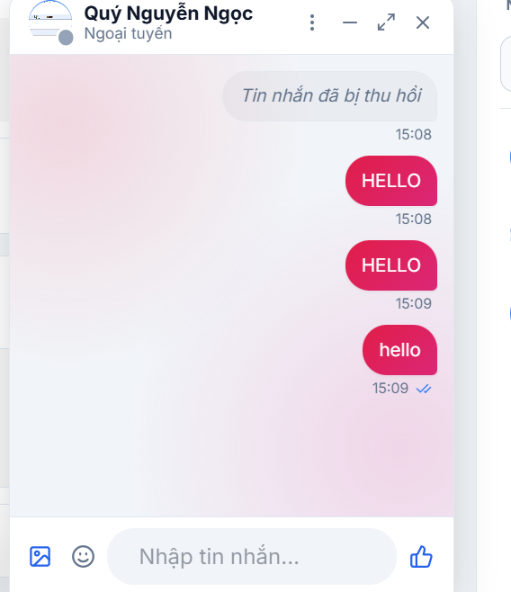
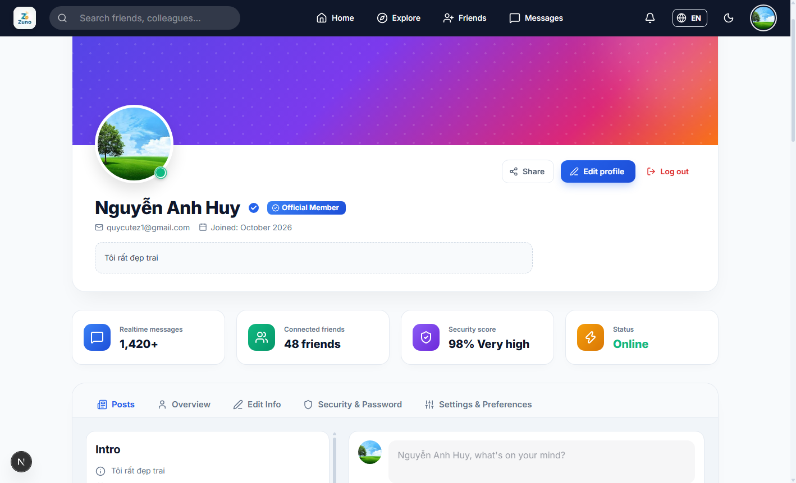
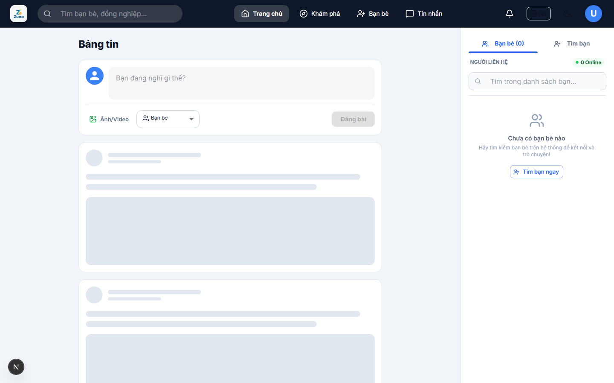

# 📸 TỔNG HỢP HÌNH ẢNH DEMO & TRẢI NGHIỆM THỰC TẾ (DEMO SHOWCASE)

> Tài liệu này tổng hợp toàn bộ hình ảnh giao diện thực tế (Screenshots) của hệ thống **ChatApp & Social Platform**, minh họa chi tiết từng tính năng, luồng tương tác và trải nghiệm người dùng.

---

## 📑 MỤC LỤC DEMO

1. [Bảng Tin (Social Feed) & Widget Gợi Ý Kết Bạn](#1-bảng-tin-social-feed--widget-gợi-ý-kết-bạn)
2. [Hệ Thống Nhắn Tin Thời Gian Thực & Hộp Chat Nổi Facebook Messenger](#2-hệ-thống-nhắn-tin-thời-gian-thực--hộp-chat-nổi-facebook-messenger)
3. [Trang Khám Phá (Explore) & Radar Gợi Ý Bạn Bè Thông Minh](#3-trang-khám-phá-explore--radar-gợi-ý-bạn-bè-thông-minh)
4. [Hồ Sơ Cá Nhân (Profile Timeline, Bạn Bè & Thư Viện Ảnh)](#4-hồ-sơ-cá-nhân-profile-timeline-bạn-bè--thư-viện-ảnh)
5. [Hệ Thống Kiểm Duyệt Nội Dung & Phòng Chống Bot AI (Moderation & Trust)](#5-hệ-thống-kiểm-duyệt-nội-dung--phòng-chống-bot-ai-moderation--trust)
6. [Thiết Kế Đa Chế Độ Sáng/Tối & Song Ngữ Toàn Diện (VI / EN)](#6-thiết-kế-đa-chế-độ-sángtối--song-ngữ-toàn-diện-vi--en)
7. [Trung Tâm Bảo Mật & Hệ Thống WAF Chống DDoS Đa Tầng (Admin Security Center & Turnstile Challenge)](#7-trung-tâm-bảo-mật--hệ-thống-waf-chống-ddos-đa-tầng-admin-security-center--turnstile-challenge)
8. [Trang Quản Trị Hệ Thống Toàn Diện & Cổng React SPA Độc Lập](#8-trang-quản-trị-hệ-thống-toàn-diện--bố-cục-sidebar-2-cột-admin-control-panel)
9. [Hệ Thống Sao Lưu & Phục Hồi Dữ Liệu Tự Động (Database Backup & Disaster Recovery)](#9-hệ-thống-sao-lưu--phục-hồi-dữ-liệu-tự-động-database-backup--disaster-recovery)
10. [Hệ Thống Thả Cảm Xúc Chuẩn Facebook & Bảng Chọn Emoji](#10-hệ-thống-thả-cảm-xúc-chuẩn-facebook--bảng-chọn-emoji)
11. [Tích Hợp GIPHY GIF Động & Bố Cục Thác Nước Masonry](#11-tích-hợp-giphy-gif-động--bố-cục-thác-nước-masonry)
12. [Trợ Lý AI Llama 3.3 (Groq), Aura Bot (@aura) & Gắn Thẻ Bạn Bè (@mentions)](#12-trợ-lý-ai-llama-33-groq-aura-bot-aura--gắn-thẻ-bạn-bè-mentions)

---

## 1. Bảng Tin (Social Feed) & Widget Gợi Ý Kết Bạn

Bảng tin trung tâm hiển thị các bài viết thời gian thực của người dùng và bạn bè, hỗ trợ cuộn vô hạn (Infinite Scroll bằng cursor), đăng bài viết kèm tối đa 4 hình ảnh, tương tác thả cảm xúc (lạc quan) và bình luận. Bên cột phải tích hợp trực tiếp **Widget Gợi ý kết bạn thông minh**.

### Điểm nổi bật:
- **Khung tạo bài viết "Bạn đang nghĩ gì?":** Hỗ trợ đính kèm nhiều ảnh chất lượng cao, chọn quyền riêng tư linh hoạt (*Công khai / Bạn bè / Chỉ mình tôi*).
- **Thanh cuộn vô hạn mượt mà:** Tự động nạp dữ liệu khi cuộn đến cuối trang, chống giật layout (Zero-Layout-Shift).
- **Sidebar Gợi ý kết bạn:** Hiển thị danh sách ứng cử viên có độ kết nối cao nhất được tính toán từ đồ thị Neo4j (Friends of Friends & Degree Centrality) kết hợp Redis Cache.

---

## 2. Hệ Thống Nhắn Tin Thời Gian Thực & Hộp Chat Nổi Facebook Messenger

Mô phỏng hoàn hảo trải nghiệm Facebook Messenger với cả 3 hình thức hiển thị:
1. **Dropdown Tin nhắn nhanh trên Header (AppBar):** Tìm kiếm hội thoại, lọc tin chưa đọc, menu ngữ cảnh thao tác nhanh.
2. **Hộp chat nổi đa nhiệm (Floating Chat Dock):** Cho phép người dùng vừa đọc bảng tin hoặc lướt trang cá nhân vừa trò chuyện với nhiều người cùng lúc ở góc dưới màn hình.
3. **Trang Chat chuyên biệt (`/chat`):** Toàn màn hình với đầy đủ công cụ quản lý đoạn chat.

### 2.1. Cửa sổ chat nổi đa nhiệm (Floating Chat Window)

### 2.2. Luồng hội thoại & Tin nhắn đa sắc màu
Hỗ trợ đổi 5 chủ đề phong phú (*Mặc định, Hẹn hò lãng mạn, Bầu trời trong xanh, Bóng đêm huyền bí, Biển cả tươi mát*), chỉ báo đối phương đang gõ (Typing Indicator), trạng thái đã xem (Seen) và thu hồi tin nhắn tức thì.

### 2.3. Menu thả xuống Danh sách đoạn chat (Messenger Dropdown Popover)

### 2.4. Chia sẻ Vị trí & Bản đồ thời gian thực (Leaflet & OpenStreetMap Live Tracking)
- **Chia sẻ vị trí trực tiếp (Live Location kiểu Zalo / Telegram):** Phát sóng di chuyển liên tục theo thời gian thực (15 phút, 1 giờ, 8 giờ, 1 ngày), thẻ tin nhắn nhấp nháy radar xanh sinh động, đếm ngược tự động và nút "Dừng chia sẻ" tức thì.
- **Gửi vị trí ghim (Static Location):** Chọn vị trí GPS hiện tại hoặc chọn ghim trên bản đồ tương tác với Reverse Geocoding tự động xác định tên đường phố, quận huyện.
- **Trình xem toàn màn hình tương tác:** Hỗ trợ tính năng tự động bám theo (Auto-follow mode), sao chép tọa độ chuẩn xác và dẫn đường 1 chạm sang Google Maps.
- *Xem chi tiết: [docs/features/live-location-sharing.md](features/live-location-sharing.md)*

### 2.5. Gửi Tệp Tin & Tài Liệu Đa Phương Tiện Lên Đến 100MB
- **Hạn mức truyền tải 100MB:** Hỗ trợ tải lên và gửi tệp tin dung lượng lớn (PDF, DOCX, XLSX, PPTX, ZIP, RAR, MP4, MP3...) trong cả khung chat chính và khung chat nổi.
- **Thẻ hiển thị tệp tin tương tác (`FileAttachmentItem`):** Tự động nhận diện định dạng file, hiển thị icon màu sắc trực quan, tên tệp, dung lượng và nút tải xuống 1-chạm.
- **Bảo mật OWASP A03:** Kiểm soát chặt chẽ danh mục mở rộng, chặn triệt để tệp thực thi nguy hiểm (.exe, .bat, .sh...).
- *Xem chi tiết: [docs/features/file-transfer-100mb.md](features/file-transfer-100mb.md)*

---

## 3. Trang Khám Phá (Explore) & Radar Gợi Ý Bạn Bè Thông Minh

Trang `/explore` và tab "Tìm bạn" trên thanh điều hướng bên cạnh giúp kết nối người dùng thông qua thuật toán đa chiều:
- **Bạn chung & Đồ thị quan hệ (Neo4j Graph):** Duyệt quan hệ 2-hops `(u)-[:FRIEND]-(mutual)-[:FRIEND]-(suggested)` với độ trễ < 5ms và xếp hạng theo số bạn chung.
- **Vị trí lân cận (Redis Geospatial):** Truy vấn khoảng cách địa lý km thực tế giữa hai người dùng (`users:locations`).
- **Khắc phục Cold-Start (Degree Centrality):** Người dùng mới được gợi ý các tài khoản uy tín có mật độ kết nối cao nhất trên đồ thị Neo4j.

### Thao tác trực tiếp:
- Thẻ ứng cử viên hiển thị rõ ràng: Avatar, Tên, Số bạn chung, Khoảng cách km lân cận và Badge độ tương thích.
- Thao tác nhanh: Nút "Kết bạn", "Hủy lời mời", "Nhắn tin" cập nhật trạng thái lạc quan ngay trên giao diện mà không cần tải lại trang.

---

## 4. Hồ Sơ Cá Nhân (Profile Timeline, Bạn Bè & Thư Viện Ảnh)

Trang cá nhân (`/profile` và `/profile/[id]`) được thiết kế chuẩn mực theo mô hình Facebook Timeline:
- **Ảnh bìa & Avatar:** Tích hợp bộ công cụ cắt ảnh đại diện trực tiếp (`AvatarCropDialog`) đảm bảo tỷ lệ chuẩn.
- **Thanh tab điều hướng:** Dễ dàng chuyển đổi giữa Bài viết, Bạn bè, Ảnh và Giới thiệu.
- **Cột thông tin bên trái:** Tóm tắt tiểu sử, nơi sống, mối quan hệ và lưới ảnh thu nhỏ.

---

## 5. Hệ Thống Kiểm Duyệt Nội Dung & Phòng Chống Bot AI (Moderation & Trust)

Hệ thống được trang bị bộ máy kiểm soát an toàn chủ động kết hợp giữa NLP Transformer song ngữ, Thị giác máy tính (Vision Models) và 2 mô hình học máy phát hiện dị biệt:
- **Isolation Forest:** Phát hiện các hành vi bất thường cày kết bạn hoặc spam tin nhắn.
- **Autoencoder Neural Network:** Đo lường sai số tái tạo để nhận diện tài khoản giả mạo (Clone/Bot).

### Độ tin cậy:
- 100% các bài test bảo mật, chống rò rỉ dữ liệu và kiểm duyệt nội dung đều vượt qua với 141+ test cases tự động (`vitest run`).

---

## 6. Thiết Kế Đa Chế Độ Sáng/Tối & Song Ngữ Toàn Diện (VI / EN)

- **Chế độ Sáng / Tối (Dark / Light Mode):** Tự động thích ứng theo tùy chọn hệ thống của người dùng hoặc chuyển đổi thủ công với 1 cú click trên thanh điều hướng. Sử dụng hệ thống token màu tập trung, loại bỏ hoàn toàn mã màu hex cố định.
- **Song ngữ Tiếng Việt & Tiếng Anh:** Quản lý bằng Zustand i18n Store, phản ứng tức thời toàn bộ nhãn giao diện, thông báo lỗi Zod, và định dạng thời gian tự động (`vừa xong` ↔ `just now`).

---

## 7. Trung Tâm Bảo Mật & Hệ Thống WAF Chống DDoS Đa Tầng (Admin Security Center & Turnstile Challenge)

Giao diện quản trị bảo mật cấp doanh nghiệp (`/admin/security`) kết hợp phòng thủ 2 tầng: **Cloudflare Edge** và **NestJS In-App Application Firewall**, bảo vệ ứng dụng trước các đợt tấn công từ chối dịch vụ (DDoS L7), quét lỗ hổng botnet và brute-force tài khoản.

### 7.1. Bảng điều khiển Trung tâm Bảo mật (Admin Security Dashboard)
Trang quản trị toàn diện dành cho Quản trị viên hệ thống để theo dõi và kích hoạt các biện pháp phòng vệ tức thì:

#### Các tính năng chính:
- **Điều khiển Under Attack Mode tức thì:** Chuyển đổi trạng thái phòng thủ khẩn cấp ở cả tầng Cloudflare Edge (áp dụng JavaScript Challenge toàn cầu) và tầng In-App NestJS (yêu cầu Turnstile clearance cookie cho mọi thao tác ghi dữ liệu).
- **Đồng bộ Quy tắc WAF (WAF-as-Code CLI & API):** Quản lý trạng thái Bot Fight Mode, Rate Limiting Rule (chuẩn Free plan 10s window với tổ hợp `cf.colo.id + ip.src`), và Custom Rules chặn các đường dẫn quét lỗ hổng (`.env`, `.git`, `wp-*`, `*.php`).
- **Quản lý Danh sách IP Đen / Trắng (IP Access Control):** Thêm và gỡ bỏ IP bị cấm hoặc IP ưu tiên với cơ chế bảo vệ Safe Guard chống chặn nhầm loopback, dải IP nội bộ RFC1918 và hạ tầng Cloudflare.
- **Giám sát Sự kiện Vi phạm Thời gian Thực:** Hiển thị 100 sự kiện vi phạm WAF gần nhất kèm dấu thời gian, IP nguồn, quốc gia, loại vi phạm, URL đích và User Agent kẻ tấn công.

### 7.2. Hộp thoại Thử thách Bảo mật Turnstile (Under Attack Challenge Flow)
Khi hệ thống kích hoạt chế độ Under Attack hoặc phát hiện dấu hiệu vi phạm, người dùng được yêu cầu xác minh bảo mật thông qua Cloudflare Turnstile trong suốt và bảo mật:

#### Cơ chế vận hành tự động:
- **Xác minh bảo mật bằng Turnstile:** Người dùng xác nhận "Tôi là con người", frontend gửi token đến endpoint `POST /waf/clearance`.
- **Cấp Cookie WAF Clearance:** Backend kiểm tra tính hợp lệ với máy chủ Cloudflare và cấp cookie `waf_clearance` (HttpOnly, SameSite, ký điện tử HMAC-SHA256).
- **Tự động gửi lại Request (Zero Disruption):** Axios Response Interceptor tự động nhận diện mã lỗi `403 WAF_CHALLENGE_REQUIRED`, mở hộp thoại thử thách và tự động gửi lại request ban đầu sau khi có clearance mà không làm gián đoạn luồng làm việc của người dùng.

---

## 8. Trang Quản Trị Hệ Thống Toàn Diện & Bố Cục Sidebar 2 Cột (Admin Control Panel)

Hệ thống quản trị trung tâm được tái thiết kế chuyên nghiệp theo bố cục 2 cột tiêu chuẩn: **Thanh Sidebar bên trái (260px)** hiển thị thương hiệu, avatar presence và danh sách 6 phân hệ quản lý, cùng **Khu vực nội dung bên phải** hiển thị các báo cáo và công cụ vận hành.

### 8.1. Bảng Điều Khiển Tổng Quan (Admin Dashboard)
Tập hợp các chỉ số cốt lõi về người dùng, bài viết, an ninh tường lửa WAF và tài nguyên máy chủ NestJS thời gian thực.

### 8.2. Phân Hệ Quản Lý Người Dùng & Phân Quyền (Users Management)
Hỗ trợ tìm kiếm theo họ tên, email, số điện thoại, lọc trạng thái và thực hiện các tác vụ: Cấm/Mở khóa tài khoản (có lý do kiểm duyệt) và Phân quyền Admin.

### 8.3. Giám Sát Tài Nguyên & Sức Khỏe Dịch Vụ (System Health & V8 Memory)
Đo lường bộ nhớ RAM (V8 Heap Used / Total, RSS), thời gian hoạt động liên tục (Uptime), phiên bản Node.js và tình trạng kết nối vi dịch vụ MongoDB, Redis và Neo4j.

---

## 9. Hệ Thống Sao Lưu & Phục Hồi Dữ Liệu Tự Động (Database Backup & Disaster Recovery)

Hệ thống cung cấp giải pháp sao lưu và phục hồi cơ sở dữ liệu MongoDB toàn diện, bảo vệ dữ liệu trước mọi sự cố hoặc lỗi thao tác:
- **Tự động 17:00 chiều hàng ngày:** Hẹn giờ chính xác theo múi giờ Việt Nam (`Asia/Ho_Chi_Minh` UTC+7), tự động nén `gzip` và lập lịch kế tiếp.
- **Thao tác 1-chạm từ Admin Portal:** Thẻ quản trị `DatabaseBackupCard` tại tab `/system` cho phép kích hoạt sao lưu tức thời, theo dõi dung lượng và thời gian tạo.
- **Tải file, Phục hồi & Xóa an toàn:** Tải trực tiếp bản nén nhị phân `.archive.gz`, khôi phục CSDL với hộp thoại xác nhận `ConfirmDialog` chống ghi đè nhầm lẫn.
- **Chính sách Retention Policy:** Giữ tối đa 10 bản sao lưu mới nhất trong vòng 7 ngày, tự động dọn dẹp file cũ chống cạn kiệt tài nguyên ổ đĩa.
- **Kịch bản dòng lệnh CLI độc lập:** Tích hợp `scripts/backup-database.ps1` và `scripts/backup-database.sh` cho các tác vụ Cronjob hoặc hạ tầng máy chủ.

---

## 10. Hệ Thống Thả Cảm Xúc Chuẩn Facebook & Bảng Chọn Emoji

Mang lại trải nghiệm biểu cảm phong phú, tương tác đa chiều chuẩn Facebook và Facebook Messenger trên toàn bộ hệ thống:

### Điểm nổi bật:
- **Bộ 7 cảm xúc Facebook:** Thích (Like 👍), Yêu thích (Love ❤️), Thương thương (Care 🥰), Haha (😆), Wow (😮), Buồn (Sad 😢), Phẫn nộ (Angry 😡).
- **Cầu nối di chuột liền mạch (Zero-gap Hover Bridge):** Khắc phục triệt để hiện tượng mất thanh popover khi rê chuột lên với đệm thời gian 320ms và độ trễ kích hoạt 160ms.
- **Thống kê cảm xúc xếp chồng (`ReactionSummary`):** Hiển thị các icon phổ biến nhất kèm tổng lượt tương tác trên từng bài viết.
- **Cảm xúc tin nhắn thời gian thực:** Thả cảm xúc trực tiếp vào bong bóng chat, đồng bộ Socket.IO tức thì giữa các người dùng.
- **Bảng chọn Emoji thông minh (`emoji-picker-react`):** Tích hợp vào ô soạn tin nhắn và Floating Chat Box, hỗ trợ tìm kiếm và tự động chuyển đổi theme Sáng/Tối.

---

## 11. Tích Hợp GIPHY GIF Động & Bố Cục Thác Nước Masonry

Mang lại trải nghiệm giao tiếp sinh động, hài hước và giàu cảm xúc với kho ảnh động GIF khổng lồ từ GIPHY tích hợp trực tiếp vào **Bình luận bài viết (Comments)** và **Hộp chat trực tuyến (Chat Messages & Floating Chat)**:

### Điểm nổi bật:
- **Hộp chọn GIF thông minh (`AppGiphyPicker`):** Tìm kiếm tức thì với debounce 350ms, tự động nạp ảnh thịnh hành và hỗ trợ hàng loạt danh mục cảm xúc hot (Xu hướng, Haha, Yêu thích, Dễ thương, Biểu cảm, Nhảy múa, Mèo...).
- **Bố cục thác nước đa cột (`react-masonry-css`):** Hiển thị danh sách ảnh GIF 2 cột mượt mà, tự động co giãn theo tỷ lệ khung hình thực tế và hỗ trợ cuộn tải vô hạn (Infinite Scroll).
- **Bình luận bài viết sinh động:** Đính kèm ảnh GIF ngay trong khung soạn thảo (`CommentComposer`) với xem trước và hủy đính kèm trực quan. Hiển thị ảnh GIF động trong bình luận kèm huy hiệu `GIF` và hỗ trợ phóng to toàn màn hình.
- **Gửi tin nhắn GIF 1 chạm:** Chọn ảnh GIF gửi tức thì trong cả trang chat chính và Floating Chat Box, tự động nhận diện URL GIPHY và kết hợp mượt mà cùng hệ thống 7 cảm xúc Facebook.

---

## 12. Trợ Lý AI Llama 3.3 (Groq), Aura Bot (@aura) & Gắn Thẻ Bạn Bè (@mentions)

Hệ thống tích hợp trực tiếp trí tuệ nhân tạo **Llama 3.3 70B (Groq Cloud)** cùng tính năng thẻ nhắc bạn bè thông minh, nâng cao tương tác và trải nghiệm người dùng trên toàn bộ ứng dụng:

### Điểm nổi bật:
- **Tóm tắt bình luận bài viết (`AiCommentSummaryBox`):** Tự động đọc và tóm lược ý kiến của hàng chục bình luận dưới bài viết, phân loại tâm trạng và sắc thái thảo luận chỉ sau một nút bấm.
- **Tóm tắt hội thoại tin nhắn (`AiChatSummaryDialog`):** Tổng hợp nhanh 50-100 tin nhắn gần nhất với các luận điểm chính và đầu việc cần làm (Action Items).
- **Trợ lý ảo Aura Bot (`@aura`) & Trò chuyện Vui với RAG:** Tự động phản hồi mọi câu hỏi trong chat bằng mô hình Llama 3.3 (Groq) kết hợp kỹ thuật **RAG** trích xuất lịch sử tin nhắn thực tế, thống kê cạ cứng và kho tri thức ChatApp. Đi kèm thanh chip gợi ý 1-chạm (`AuraPromptSuggestions`), nút Sparkles ✨ và huy hiệu nhận diện `Aura AI • RAG ⚡`.
- **Menu gợi ý thẻ nhắc (@mentions):** Gõ `@` để mở popup gợi ý bạn bè và Aura Bot, hỗ trợ duyệt bằng bàn phím (Mũi tên Lên / Xuống, Enter) và gửi thông báo nhắc tên tức thì.
- 📖 *Xem chi tiết: [docs/features/groq-ai-summary-aura-mentions.md](features/groq-ai-summary-aura-mentions.md)*

---

> 💡 **Khám phá thêm tài liệu chi tiết tại thư mục [docs/features/](features/):**
> - [Trợ Lý AI Llama 3.3 (Groq), Aura Bot & Gắn Thẻ Bạn Bè](features/groq-ai-summary-aura-mentions.md)
> - [Hệ Thống Thả Cảm Xúc Facebook & Bảng Chọn Emoji (Reactions)](features/facebook-reactions.md)
> - [Tích Hợp GIPHY GIF & Bố Cục Masonry Trong Bình Luận & Tin Nhắn](features/giphy-gif-integration.md)
> - [Sao Lưu & Phục Hồi Dữ Liệu Tự Động (Database Backup)](features/database-backup.md)
> - [Cổng Quản trị Độc lập React SPA (Admin Portal)](features/admin-portal.md)
> - [Trang Quản trị Hệ thống Toàn diện (Admin Control Panel)](features/admin-panel.md)
> - [Trung tâm Bảo mật WAF & Phòng chống DDoS Đa tầng](features/waf.md)
> - [Phòng thủ & Chống tấn công DDoS bằng Cloudflare (Anycast, WAF & Tunnel)](features/cloudflare-ddos-protection.md)
> - [Nhắn tin thời gian thực & Giao thức nhị phân MQTT](features/chat-realtime.md)
> - [Thuật toán Gợi ý bạn bè thông minh bằng Đồ thị Neo4j](features/friend-recommendation.md)
> - [Bảng tin Mạng xã hội & Hồ sơ cá nhân](features/social-feed-profile.md)
> - [Hệ thống Kiểm duyệt AI & Phòng chống Bot](features/moderation-trust.md)
> - [Xác thực Bảo mật & Cổng CI/CD](features/auth-security-cicd.md)
> - [Chia sẻ vị trí thời gian thực (Live Location Sharing)](features/live-location-sharing.md)
> - [Truyền tải tệp tin dung lượng lớn lên đến 100MB](features/file-transfer-100mb.md)

