# 📸 TỔNG HỢP HÌNH ẢNH DEMO & TRẢI NGHIỆM THỰC TẾ (DEMO SHOWCASE)

> Tài liệu này tổng hợp toàn bộ hình ảnh giao diện thực tế (Screenshots) của hệ thống **ChatApp & Social Platform**, minh họa chi tiết từng tính năng, luồng tương tác và trải nghiệm người dùng.

---

## 📑 MỤC LỤC DEMO

1. [Bảng Tin (Social Feed) & Widget Gợi Ý Kết Bạn](#1-bảng-tin-social-feed--widget-gợi-ý-kết-bạn)
2. [Hệ Thống Nhắn Tin Thời Gian Thực & Hộp Chat Nổi Facebook Messenger](#2-hệ-thống-nhắn-tin-thời-gian-thực--hộp-chat-nổi-facebook-messenger)
3. [Trang Khám Phá (Explore) & Radar Gợi Ý Bạn Bè Thông Minh](#3-trang-khám-phá-explore--radar-gợi-ý-bạn-bè-thông-minh)
4. [Hồ Sơ Cá Nhân (Profile Timeline, Bạn Bè & Thư Viện Ảnh)](#4-hồ-sơ-cá-nhân-profile-timeline-bạn-bè--thư-viện-ảnh)
5. [Hệ Thống Kiểm Duyệt Nội Dung & Phòng Chống Bot AI (Moderation & Trust)](#5-hệ-thống-kiểm-duyệt-nội-dung--phòng-chống-bot-ai-moderation--trust)
6. [Thiết Kế Đa Chế Độ Sáng/Tối & Song Ngữ Toàn Diện (VI / EN)](#6-thiết-kế-đa-chế-độ-sángtối--song-ngữ-toàn-diện-vi--en)
7. [Trung Tâm Bảo Mật & Hệ Thống WAF Chống DDoS Đa Tầng (Admin Security Center & Turnstile Challenge)](#7-trung-tâm-bảo-mật--hệ-thống-waf-chống-ddos-đa-tầng-admin-security-center--turnstile-challenge)
8. [Trang Quản Trị Hệ Thống Toàn Diện & Cổng React SPA Độc Lập](#8-trang-quản-trị-hệ-thống-toàn-diện--bố-cục-sidebar-2-cột-admin-control-panel)
9. [Hệ Thống Sao Lưu & Phục Hồi Dữ Liệu Tự Động (Database Backup & Disaster Recovery)](#9-hệ-thống-sao-lưu--phục-hồi-dữ-liệu-tự-động-database-backup--disaster-recovery)
10. [Hệ Thống Thả Cảm Xúc Chuẩn Facebook & Bảng Chọn Emoji](#10-hệ-thống-thả-cảm-xúc-chuẩn-facebook--bảng-chọn-emoji)
11. [Tích Hợp GIPHY GIF Động & Bố Cục Thác Nước Masonry](#11-tích-hợp-giphy-gif-động--bố-cục-thác-nước-masonry)
12. [Trợ Lý AI Llama 3.3 (Groq), Aura Bot (@aura) & Gắn Thẻ Bạn Bè (@mentions)](#12-trợ-lý-ai-llama-33-groq-aura-bot-aura--gắn-thẻ-bạn-bè-mentions)
13. [Trợ Lý Ảo Aura AI Phong Cách Meta AI (Direct Bot Chat, Tích Xanh & Đánh Giá 👍/👎)](#13-trợ-lý-ảo-aura-ai-phong-cách-meta-ai-direct-bot-chat-tích-xanh--đánh-giá-)
14. [Nhóm Trò Chuyện & Gọi Thoại/Video Nhóm WebRTC Tối Ưu Băng Thông (Group Chat & Mesh-Lite Call)](#14-nhóm-trò-chuyện--gọi-thoạivideo-nhóm-webrtc-tối-ưu-băng-thông-group-chat--mesh-lite-call)
15. [Trang Fanpage & Hội Nhóm Cộng Đồng (Fanpages & Community Groups with Feed)](#15-trang-fanpage--hội-nhóm-cộng-đồng-fanpages--community-groups-with-feed)
16. [Bố Cục Cột Điều Hướng Trái Chuẩn Facebook & Tối Ưu Thanh Header (Facebook-Style Left Sidebar & Header)](#16-bố-cục-cột-điều-hướng-trái-chuẩn-facebook--tối-ưu-thanh-header-facebook-style-left-sidebar--header)
17. [Gắn Thẻ Bạn Bè Chuẩn Facebook & Tự Động Gợi Ý Mention (Facebook-Style Friend Tagging & Mention Link)](#17-gắn-thẻ-bạn-bè-chuẩn-facebook--tự-động-gợi-ý-mention-facebook-style-friend-tagging--mention-link)
18. [Hệ Thống Đa Ngôn Ngữ Mở Rộng 6 Thứ Tiếng (VI, EN, 简体中文, 繁體中文, 한국어, ไทย)](#18-hệ-thống-đa-ngôn-ngữ-mở-rộng-6-thứ-tiếng-vi-en-简体中文-繁體中文-한국어-ไทย)
19. [Phân Quyền Quản Trị Viên, Phó Nhóm & Câu Hỏi Xét Duyệt Tham Gia Nhóm](#19-phân-quyền-quản-trị-viên-phó-nhóm--câu-hỏi-xét-duyệt-tham-gia-nhóm)
20. [Đóng Gói Docker Containerization Toàn Bộ Hệ Thống (Frontend, Backend, Admin, CSDL)](#20-đóng-gói-docker-containerization-toàn-bộ-hệ-thống-frontend-backend-admin-csdl)
21. [Bảo Vệ Hạn Mức & Chống Spam AI Đa Tầng (Aura AI Rate Limiting & Token Quota Protection)](#21-bảo-vệ-hạn-mức--chống-spam-ai-đa-tầng-aura-ai-rate-limiting--token-quota-protection)
22. [Kiểm Thử Tự Động Hóa Giao Diện Đa Thiết Bị Bằng Playwright (Mobile, iPad & Desktop)](#22-kiểm-thử-tự-động-hóa-giao-diện-đa-thiết-bị-bằng-playwright-mobile-ipad--desktop)
23. [Tái Thiết Kế Hội Nhóm Chuẩn Facebook & Kiến Trúc Module Hóa (< 250 Dòng)](#23-tái-thiết-kế-hội-nhóm-chuẩn-facebook--kiến-trúc-module-hóa--250-dòng)

---

## 1. Bảng Tin (Social Feed) & Widget Gợi Ý Kết Bạn

Bảng tin trung tâm hiển thị các bài viết thời gian thực của người dùng và bạn bè, hỗ trợ cuộn vô hạn (Infinite Scroll bằng cursor), đăng bài viết kèm tối đa 4 hình ảnh, tương tác thả cảm xúc (lạc quan) và bình luận. Bên cột phải tích hợp trực tiếp **Widget Gợi ý kết bạn thông minh**.

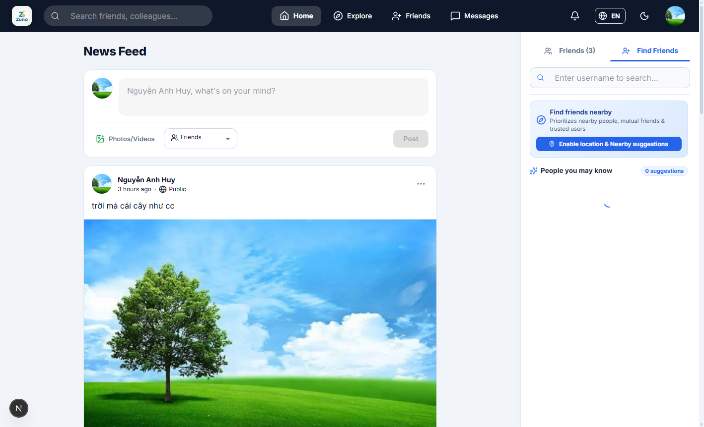

### Điểm nổi bật:
- **Khung tạo bài viết "Bạn đang nghĩ gì?":** Hỗ trợ đính kèm nhiều ảnh chất lượng cao, chọn quyền riêng tư linh hoạt (*Công khai / Bạn bè / Chỉ mình tôi*).
- **Thanh cuộn vô hạn mượt mà:** Tự động nạp dữ liệu khi cuộn đến cuối trang, chống giật layout (Zero-Layout-Shift).
- **Sidebar Gợi ý kết bạn:** Hiển thị danh sách ứng cử viên có độ kết nối cao nhất được tính toán từ đồ thị Neo4j (Friends of Friends & Degree Centrality) kết hợp Redis Cache.

---

## 2. Hệ Thống Nhắn Tin Thời Gian Thực & Hộp Chat Nổi Facebook Messenger

Mô phỏng hoàn hảo trải nghiệm Facebook Messenger với cả 3 hình thức hiển thị:
1. **Dropdown Tin nhắn nhanh trên Header (AppBar):** Tìm kiếm hội thoại, lọc tin chưa đọc, menu ngữ cảnh thao tác nhanh.
2. **Hộp chat nổi đa nhiệm (Floating Chat Dock):** Cho phép người dùng vừa đọc bảng tin hoặc lướt trang cá nhân vừa trò chuyện với nhiều người cùng lúc ở góc dưới màn hình.
3. **Trang Chat chuyên biệt (`/chat`):** Toàn màn hình với đầy đủ công cụ quản lý đoạn chat.

### 2.1. Cửa sổ chat nổi đa nhiệm (Floating Chat Window)

### 2.2. Luồng hội thoại & Tin nhắn đa sắc màu
Hỗ trợ đổi 5 chủ đề phong phú (*Mặc định, Hẹn hò lãng mạn, Bầu trời trong xanh, Bóng đêm huyền bí, Biển cả tươi mát*), chỉ báo đối phương đang gõ (Typing Indicator), trạng thái đã xem (Seen) và thu hồi tin nhắn tức thì.

### 2.3. Menu thả xuống Danh sách đoạn chat (Messenger Dropdown Popover)

### 2.4. Chia sẻ Vị trí & Bản đồ thời gian thực (Leaflet & OpenStreetMap Live Tracking)
- **Chia sẻ vị trí trực tiếp (Live Location kiểu Zalo / Telegram):** Phát sóng di chuyển liên tục theo thời gian thực (15 phút, 1 giờ, 8 giờ, 1 ngày), thẻ tin nhắn nhấp nháy radar xanh sinh động, đếm ngược tự động và nút "Dừng chia sẻ" tức thì.
- **Gửi vị trí ghim (Static Location):** Chọn vị trí GPS hiện tại hoặc chọn ghim trên bản đồ tương tác với Reverse Geocoding tự động xác định tên đường phố, quận huyện.
- **Trình xem toàn màn hình tương tác:** Hỗ trợ tính năng tự động bám theo (Auto-follow mode), sao chép tọa độ chuẩn xác và dẫn đường 1 chạm sang Google Maps.
- *Xem chi tiết: [docs/features/live-location-sharing.md](features/live-location-sharing.md)*

### 2.5. Gửi Tệp Tin & Tài Liệu Đa Phương Tiện Lên Đến 100MB
- **Hạn mức truyền tải 100MB:** Hỗ trợ tải lên và gửi tệp tin dung lượng lớn (PDF, DOCX, XLSX, PPTX, ZIP, RAR, MP4, MP3...) trong cả khung chat chính và khung chat nổi.
- **Thẻ hiển thị tệp tin tương tác (`FileAttachmentItem`):** Tự động nhận diện định dạng file, hiển thị icon màu sắc trực quan, tên tệp, dung lượng và nút tải xuống 1-chạm.
- **Bảo mật OWASP A03:** Kiểm soát chặt chẽ danh mục mở rộng, chặn triệt để tệp thực thi nguy hiểm (.exe, .bat, .sh...).
- *Xem chi tiết: [docs/features/file-transfer-100mb.md](features/file-transfer-100mb.md)*

---

## 3. Trang Khám Phá (Explore) & Radar Gợi Ý Bạn Bè Thông Minh

Trang `/explore` và tab "Tìm bạn" trên thanh điều hướng bên cạnh giúp kết nối người dùng thông qua thuật toán đa chiều:
- **Bạn chung & Đồ thị quan hệ (Neo4j Graph):** Duyệt quan hệ 2-hops `(u)-[:FRIEND]-(mutual)-[:FRIEND]-(suggested)` với độ trễ < 5ms và xếp hạng theo số bạn chung.
- **Vị trí lân cận (Redis Geospatial):** Truy vấn khoảng cách địa lý km thực tế giữa hai người dùng (`users:locations`).
- **Khắc phục Cold-Start (Degree Centrality):** Người dùng mới được gợi ý các tài khoản uy tín có mật độ kết nối cao nhất trên đồ thị Neo4j.

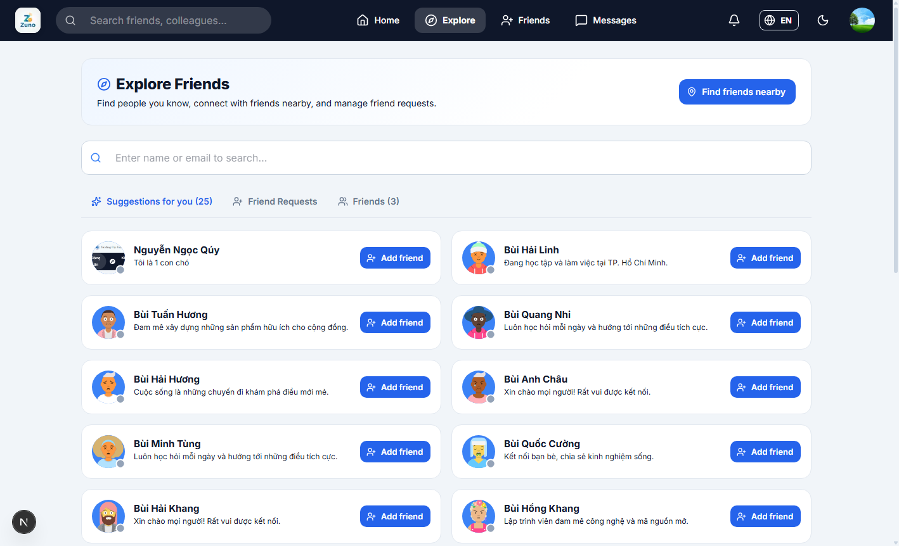

### Thao tác trực tiếp:
- Thẻ ứng cử viên hiển thị rõ ràng: Avatar, Tên, Số bạn chung, Khoảng cách km lân cận và Badge độ tương thích.
- Thao tác nhanh: Nút "Kết bạn", "Hủy lời mời", "Nhắn tin" cập nhật trạng thái lạc quan ngay trên giao diện mà không cần tải lại trang.

---

## 4. Hồ Sơ Cá Nhân (Profile Timeline, Bạn Bè & Thư Viện Ảnh)

Trang cá nhân (`/profile` và `/profile/[id]`) được thiết kế chuẩn mực theo mô hình Facebook Timeline:
- **Ảnh bìa & Avatar:** Tích hợp bộ công cụ cắt ảnh đại diện trực tiếp (`AvatarCropDialog`) đảm bảo tỷ lệ chuẩn.
- **Thanh tab điều hướng:** Dễ dàng chuyển đổi giữa Bài viết, Bạn bè, Ảnh và Giới thiệu.
- **Cột thông tin bên trái:** Tóm tắt tiểu sử, nơi sống, mối quan hệ và lưới ảnh thu nhỏ.

---

## 5. Hệ Thống Kiểm Duyệt Nội Dung & Phòng Chống Bot AI (Moderation & Trust)

Hệ thống được trang bị bộ máy kiểm soát an toàn chủ động kết hợp giữa NLP Transformer song ngữ, Thị giác máy tính (Vision Models) và 2 mô hình học máy phát hiện dị biệt:
- **Isolation Forest:** Phát hiện các hành vi bất thường cày kết bạn hoặc spam tin nhắn.
- **Autoencoder Neural Network:** Đo lường sai số tái tạo để nhận diện tài khoản giả mạo (Clone/Bot).

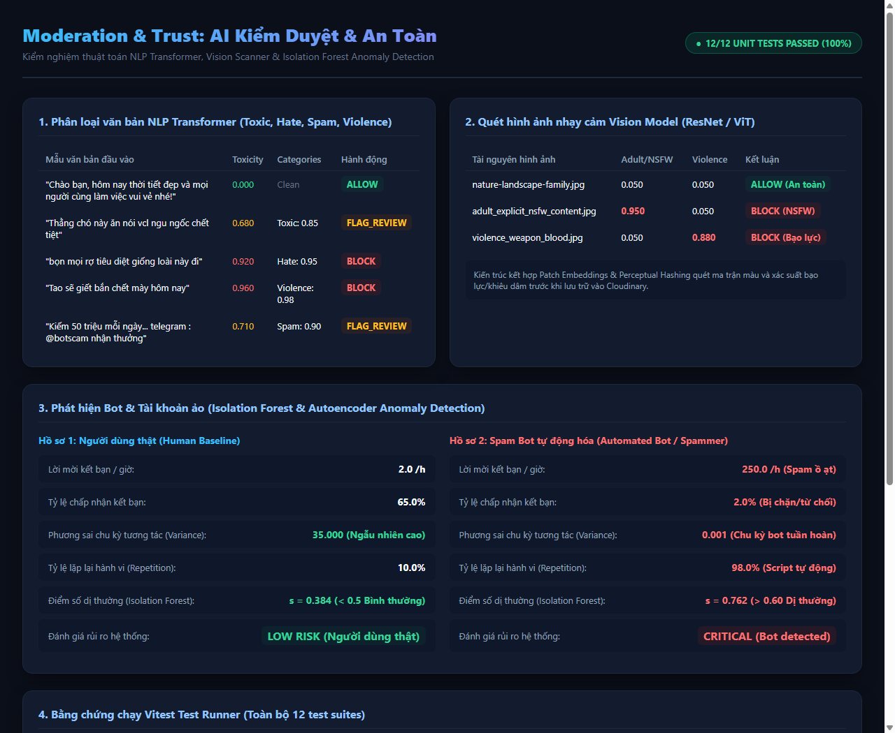

### Độ tin cậy:
- 100% các bài test bảo mật, chống rò rỉ dữ liệu và kiểm duyệt nội dung đều vượt qua với 141+ test cases tự động (`vitest run`).

---

## 6. Thiết Kế Đa Chế Độ Sáng/Tối & Song Ngữ Toàn Diện (VI / EN)

- **Chế độ Sáng / Tối (Dark / Light Mode):** Tự động thích ứng theo tùy chọn hệ thống của người dùng hoặc chuyển đổi thủ công với 1 cú click trên thanh điều hướng. Sử dụng hệ thống token màu tập trung, loại bỏ hoàn toàn mã màu hex cố định.
- **Song ngữ Tiếng Việt & Tiếng Anh:** Quản lý bằng Zustand i18n Store, phản ứng tức thời toàn bộ nhãn giao diện, thông báo lỗi Zod, và định dạng thời gian tự động (`vừa xong` ↔ `just now`).

---

## 7. Trung Tâm Bảo Mật & Hệ Thống WAF Chống DDoS Đa Tầng (Admin Security Center & Turnstile Challenge)

Giao diện quản trị bảo mật cấp doanh nghiệp (`/admin/security`) kết hợp phòng thủ 2 tầng: **Cloudflare Edge** và **NestJS In-App Application Firewall**, bảo vệ ứng dụng trước các đợt tấn công từ chối dịch vụ (DDoS L7), quét lỗ hổng botnet và brute-force tài khoản.

### 7.1. Bảng điều khiển Trung tâm Bảo mật (Admin Security Dashboard)
Trang quản trị toàn diện dành cho Quản trị viên hệ thống để theo dõi và kích hoạt các biện pháp phòng vệ tức thì:

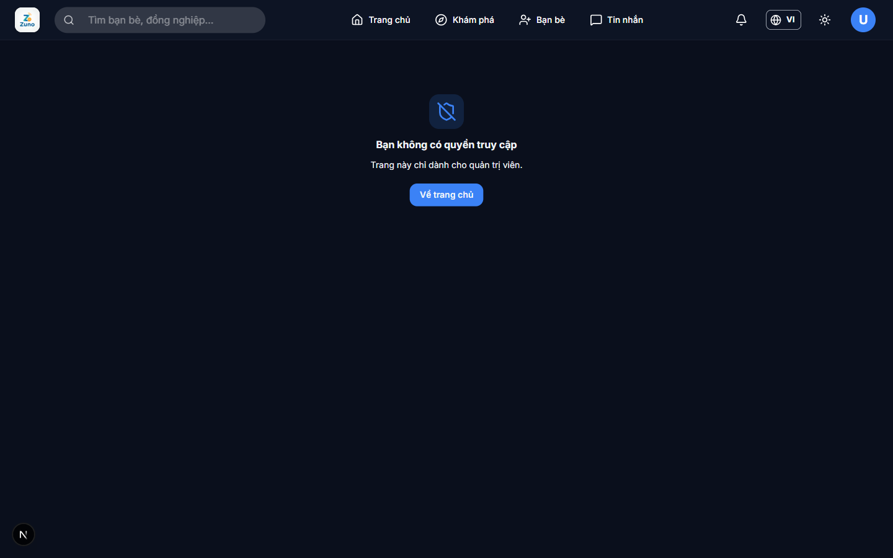

#### Các tính năng chính:
- **Điều khiển Under Attack Mode tức thì:** Chuyển đổi trạng thái phòng thủ khẩn cấp ở cả tầng Cloudflare Edge (áp dụng JavaScript Challenge toàn cầu) và tầng In-App NestJS (yêu cầu Turnstile clearance cookie cho mọi thao tác ghi dữ liệu).
- **Đồng bộ Quy tắc WAF (WAF-as-Code CLI & API):** Quản lý trạng thái Bot Fight Mode, Rate Limiting Rule (chuẩn Free plan 10s window với tổ hợp `cf.colo.id + ip.src`), và Custom Rules chặn các đường dẫn quét lỗ hổng (`.env`, `.git`, `wp-*`, `*.php`).
- **Quản lý Danh sách IP Đen / Trắng (IP Access Control):** Thêm và gỡ bỏ IP bị cấm hoặc IP ưu tiên với cơ chế bảo vệ Safe Guard chống chặn nhầm loopback, dải IP nội bộ RFC1918 và hạ tầng Cloudflare.
- **Giám sát Sự kiện Vi phạm Thời gian Thực:** Hiển thị 100 sự kiện vi phạm WAF gần nhất kèm dấu thời gian, IP nguồn, quốc gia, loại vi phạm, URL đích và User Agent kẻ tấn công.

### 7.2. Hộp thoại Thử thách Bảo mật Turnstile (Under Attack Challenge Flow)
Khi hệ thống kích hoạt chế độ Under Attack hoặc phát hiện dấu hiệu vi phạm, người dùng được yêu cầu xác minh bảo mật thông qua Cloudflare Turnstile trong suốt và bảo mật:

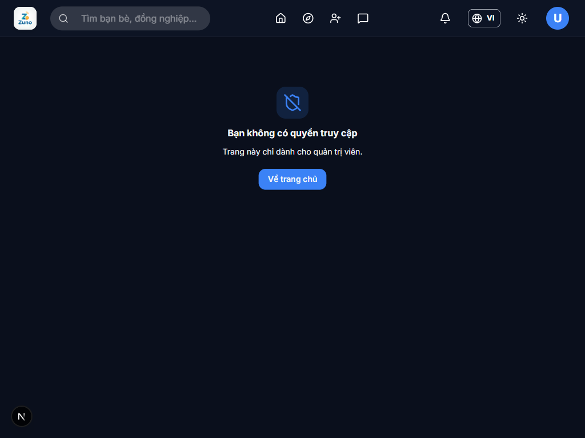

#### Cơ chế vận hành tự động:
- **Xác minh bảo mật bằng Turnstile:** Người dùng xác nhận "Tôi là con người", frontend gửi token đến endpoint `POST /waf/clearance`.
- **Cấp Cookie WAF Clearance:** Backend kiểm tra tính hợp lệ với máy chủ Cloudflare và cấp cookie `waf_clearance` (HttpOnly, SameSite, ký điện tử HMAC-SHA256).
- **Tự động gửi lại Request (Zero Disruption):** Axios Response Interceptor tự động nhận diện mã lỗi `403 WAF_CHALLENGE_REQUIRED`, mở hộp thoại thử thách và tự động gửi lại request ban đầu sau khi có clearance mà không làm gián đoạn luồng làm việc của người dùng.

---

## 8. Trang Quản Trị Hệ Thống Toàn Diện & Bố Cục Sidebar 2 Cột (Admin Control Panel)

Hệ thống quản trị trung tâm được tái thiết kế chuyên nghiệp theo bố cục 2 cột tiêu chuẩn: **Thanh Sidebar bên trái (260px)** hiển thị thương hiệu, avatar presence và danh sách 6 phân hệ quản lý, cùng **Khu vực nội dung bên phải** hiển thị các báo cáo và công cụ vận hành.

### 8.1. Bảng Điều Khiển Tổng Quan (Admin Dashboard)
Tập hợp các chỉ số cốt lõi về người dùng, bài viết, an ninh tường lửa WAF và tài nguyên máy chủ NestJS thời gian thực.

### 8.2. Phân Hệ Quản Lý Người Dùng & Phân Quyền (Users Management)
Hỗ trợ tìm kiếm theo họ tên, email, số điện thoại, lọc trạng thái và thực hiện các tác vụ: Cấm/Mở khóa tài khoản (có lý do kiểm duyệt) và Phân quyền Admin.

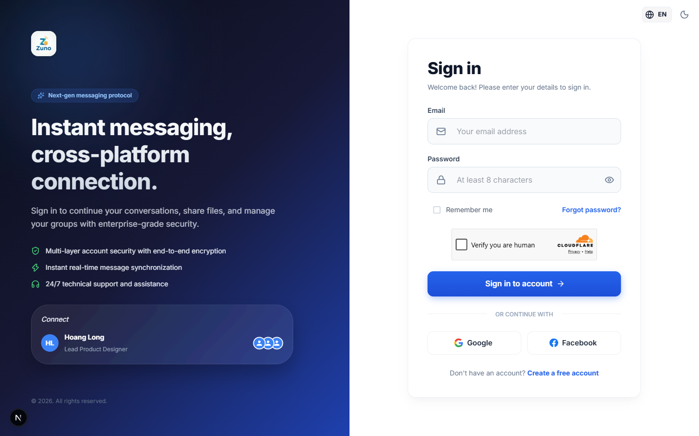

### 8.3. Giám Sát Tài Nguyên & Sức Khỏe Dịch Vụ (System Health & V8 Memory)
Đo lường bộ nhớ RAM (V8 Heap Used / Total, RSS), thời gian hoạt động liên tục (Uptime), phiên bản Node.js và tình trạng kết nối vi dịch vụ MongoDB, Redis và Neo4j.

---

## 9. Hệ Thống Sao Lưu & Phục Hồi Dữ Liệu Tự Động (Database Backup & Disaster Recovery)

Hệ thống cung cấp giải pháp sao lưu và phục hồi cơ sở dữ liệu MongoDB toàn diện, bảo vệ dữ liệu trước mọi sự cố hoặc lỗi thao tác:
- **Tự động 17:00 chiều hàng ngày:** Hẹn giờ chính xác theo múi giờ Việt Nam (`Asia/Ho_Chi_Minh` UTC+7), tự động nén `gzip` và lập lịch kế tiếp.
- **Thao tác 1-chạm từ Admin Portal:** Thẻ quản trị `DatabaseBackupCard` tại tab `/system` cho phép kích hoạt sao lưu tức thời, theo dõi dung lượng và thời gian tạo.
- **Tải file, Phục hồi & Xóa an toàn:** Tải trực tiếp bản nén nhị phân `.archive.gz`, khôi phục CSDL với hộp thoại xác nhận `ConfirmDialog` chống ghi đè nhầm lẫn.
- **Chính sách Retention Policy:** Giữ tối đa 10 bản sao lưu mới nhất trong vòng 7 ngày, tự động dọn dẹp file cũ chống cạn kiệt tài nguyên ổ đĩa.
- **Kịch bản dòng lệnh CLI độc lập:** Tích hợp `scripts/backup-database.ps1` và `scripts/backup-database.sh` cho các tác vụ Cronjob hoặc hạ tầng máy chủ.

---

## 10. Hệ Thống Thả Cảm Xúc Chuẩn Facebook & Bảng Chọn Emoji

Mang lại trải nghiệm biểu cảm phong phú, tương tác đa chiều chuẩn Facebook và Facebook Messenger trên toàn bộ hệ thống:

### Điểm nổi bật:
- **Bộ 7 cảm xúc Facebook:** Thích (Like 👍), Yêu thích (Love ❤️), Thương thương (Care 🥰), Haha (😆), Wow (😮), Buồn (Sad 😢), Phẫn nộ (Angry 😡).
- **Cầu nối di chuột liền mạch (Zero-gap Hover Bridge):** Khắc phục triệt để hiện tượng mất thanh popover khi rê chuột lên với đệm thời gian 320ms và độ trễ kích hoạt 160ms.
- **Thống kê cảm xúc xếp chồng (`ReactionSummary`):** Hiển thị các icon phổ biến nhất kèm tổng lượt tương tác trên từng bài viết.
- **Cảm xúc tin nhắn thời gian thực:** Thả cảm xúc trực tiếp vào bong bóng chat, đồng bộ Socket.IO tức thì giữa các người dùng.
- **Bảng chọn Emoji thông minh (`emoji-picker-react`):** Tích hợp vào ô soạn tin nhắn và Floating Chat Box, hỗ trợ tìm kiếm và tự động chuyển đổi theme Sáng/Tối.

---

## 11. Tích Hợp GIPHY GIF Động & Bố Cục Thác Nước Masonry

Mang lại trải nghiệm giao tiếp sinh động, hài hước và giàu cảm xúc với kho ảnh động GIF khổng lồ từ GIPHY tích hợp trực tiếp vào **Bình luận bài viết (Comments)** và **Hộp chat trực tuyến (Chat Messages & Floating Chat)**:

### Điểm nổi bật:
- **Hộp chọn GIF thông minh (`AppGiphyPicker`):** Tìm kiếm tức thì với debounce 350ms, tự động nạp ảnh thịnh hành và hỗ trợ hàng loạt danh mục cảm xúc hot (Xu hướng, Haha, Yêu thích, Dễ thương, Biểu cảm, Nhảy múa, Mèo...).
- **Bố cục thác nước đa cột (`react-masonry-css`):** Hiển thị danh sách ảnh GIF 2 cột mượt mà, tự động co giãn theo tỷ lệ khung hình thực tế và hỗ trợ cuộn tải vô hạn (Infinite Scroll).
- **Bình luận bài viết sinh động:** Đính kèm ảnh GIF ngay trong khung soạn thảo (`CommentComposer`) với xem trước và hủy đính kèm trực quan. Hiển thị ảnh GIF động trong bình luận kèm huy hiệu `GIF` và hỗ trợ phóng to toàn màn hình.
- **Gửi tin nhắn GIF 1 chạm:** Chọn ảnh GIF gửi tức thì trong cả trang chat chính và Floating Chat Box, tự động nhận diện URL GIPHY và kết hợp mượt mà cùng hệ thống 7 cảm xúc Facebook.

---

## 12. Trợ Lý AI Llama 3.3 (Groq), Aura Bot (@aura) & Gắn Thẻ Bạn Bè (@mentions)

Hệ thống tích hợp trực tiếp trí tuệ nhân tạo **Llama 3.3 70B (Groq Cloud)** cùng tính năng thẻ nhắc bạn bè thông minh, nâng cao tương tác và trải nghiệm người dùng trên toàn bộ ứng dụng:

### Điểm nổi bật:
- **Tóm tắt bình luận bài viết (`AiCommentSummaryBox`):** Tự động đọc và tóm lược ý kiến của hàng chục bình luận dưới bài viết, phân loại tâm trạng và sắc thái thảo luận chỉ sau một nút bấm.
- **Tóm tắt hội thoại tin nhắn (`AiChatSummaryDialog`):** Tổng hợp nhanh 50-100 tin nhắn gần nhất với các luận điểm chính và đầu việc cần làm (Action Items).
- **Trợ lý ảo Aura Bot (`@aura`) & Trò chuyện Vui với RAG:** Tự động phản hồi mọi câu hỏi trong chat bằng mô hình Llama 3.3 (Groq) kết hợp kỹ thuật **RAG** trích xuất lịch sử tin nhắn thực tế, thống kê cạ cứng và kho tri thức ChatApp. Đi kèm thanh chip gợi ý 1-chạm (`AuraPromptSuggestions`), nút Sparkles ✨ và huy hiệu nhận diện `Aura AI • RAG ⚡`.
- **Menu gợi ý thẻ nhắc (@mentions):** Gõ `@` để mở popup gợi ý bạn bè và Aura Bot, hỗ trợ duyệt bằng bàn phím (Mũi tên Lên / Xuống, Enter) và gửi thông báo nhắc tên tức thì.
- 📖 *Xem chi tiết: [docs/features/groq-ai-summary-aura-mentions.md](features/groq-ai-summary-aura-mentions.md)*

---

## 13. Trợ Lý Ảo Aura AI Phong Cách Meta AI (Direct Bot Chat, Tích Xanh & Đánh Giá 👍/👎)

Trải nghiệm trò chuyện 1-1 trực tiếp với **Aura AI** theo phong cách **Meta AI** trên Facebook Messenger:

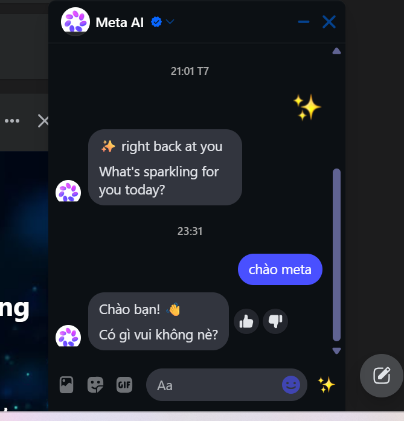

### Điểm nổi bật:
- **Trò chuyện trực tiếp 1-1 không cần gõ `@aura`:** Trong phòng chat riêng với Aura, mọi tin nhắn đều được Llama 3.3 (Groq) và RAG xử lý tức thì, tự động kích hoạt typing indicator.
- **Huy hiệu tích xanh chính thức (Verified Badge):** Nhận diện thương hiệu chuẩn xác trên tiêu đề chat nổi, danh bạ bạn bè và danh sách đoạn chat.
- **Đánh giá phản hồi 👍/👎 trực tiếp cạnh bong bóng tin nhắn:** Người dùng có thể đánh giá mức độ hài lòng về câu trả lời chỉ với 1 chạm.
- **Thẻ chào mừng sinh động (`AuraWelcomeCard`):** Giới thiệu các gợi ý câu hỏi thông minh giúp mở đầu cuộc trò chuyện dễ dàng.
- 📖 *Xem chi tiết: [docs/features/meta-ai-aura-bot.md](features/meta-ai-aura-bot.md)*

---

## 14. Nhóm Trò Chuyện & Gọi Thoại/Video Nhóm WebRTC Tối Ưu Băng Thông (Group Chat & Mesh-Lite Call)

Tính năng nhóm trò chuyện đa thành viên kết hợp gọi thoại & gọi video nhóm trực tiếp bằng công nghệ **WebRTC Mesh-Lite**:

### Điểm nổi bật:
- **Tạo & Quản lý nhóm trò chuyện (`CreateGroupDialog` & `GroupInfoModal`):** Thêm bạn bè vào nhóm với tính năng tìm kiếm, gán quyền Quản trị viên nhóm (Admin), đổi tên nhóm, cập nhật avatar nhóm và ghim tin nhắn.
- **Cuộc gọi thoại & Gọi video nhóm tối ưu băng thông (`GroupCallModal`):**
  - **Tự động phát hiện giọng nói (VAD - Voice Activity Detection):** Phân tích tín hiệu âm thanh trực tiếp bằng Web Audio API để làm sáng viền xanh phát sáng quanh khung hình người đang nói (Active Speaker).
  - **Tối ưu chất lượng luồng truyền:** Giới hạn 360p @ 15fps cho mỗi luồng video và nén audio Opus trần 32kbps, đảm bảo nhiều người cùng tham gia mà không bị nghẽn mạng hay quá tải CPU.
  - **Lưới hiển thị thích ứng (Dynamic Grid):** Tự động điều chỉnh kích thước khung hình từ 1 người (toàn màn hình), 2 người, 4 người (lưới 2x2) đến 9 người (lưới 3x3) kèm hiển thị avatar thay thế khi camera tắt.
- 📖 *Xem chi tiết: [docs/features/group-chat-call-pages-groups.md](features/group-chat-call-pages-groups.md)*

---

## 15. Trang Fanpage & Hội Nhóm Cộng Đồng (Fanpages & Community Groups with Feed)

Mở rộng trải nghiệm mạng xã hội toàn diện với Trang Fanpage chính thức và Hội nhóm cộng đồng chuyên biệt:

### Điểm nổi bật:
- **Khám phá & Tạo Trang Fanpage (`/pages` & `PagesExplore`):**
  - Tạo trang theo danh mục (Công nghệ, Doanh nghiệp, Ẩm thực, Giải trí...), tự động sinh URL slug thân thiện.
  - Hồ sơ trang (`/pages/[slug]`): Nút Theo dõi/Bỏ theo dõi với số lượng follower cập nhật tức thì.
  - Bảng tin bài viết Fanpage (`PostFeed`): Quản trị viên đăng bài chính thức từ trang, người theo dõi xem bài và tương tác bình luận/thả cảm xúc.
- **Hội nhóm cộng đồng (`/groups` & `GroupsExplore`):**
  - Hỗ trợ chế độ Công khai (Public) hoặc Riêng tư (Private).
  - Tham gia, rời nhóm hoặc gửi yêu cầu tham gia nhóm riêng tư.
  - Bảng tin thảo luận nội bộ (`GroupFeed`): Thành viên trong nhóm có thể đăng bài viết, chia sẻ ảnh và thảo luận cùng cộng đồng.
- 📖 *Xem chi tiết: [docs/features/group-chat-call-pages-groups.md](features/group-chat-call-pages-groups.md)*

---

## 16. Bố Cục Cột Điều Hướng Trái Chuẩn Facebook & Tối Ưu Thanh Header (Facebook-Style Left Sidebar & Header)

Tái thiết kế trải nghiệm điều hướng toàn diện theo chuẩn Facebook:
- **Cột trái chuyên biệt (`LeftSidebar`):** Hiển thị hồ sơ cá nhân, lối tắt Meta/Aura AI, Bạn bè, Nhóm, Trang, Đoạn chat, Kỷ niệm, Đã lưu, Thước phim và danh sách **Lối tắt của bạn** (Nhóm và Trang đã tham gia).
- **Thanh Header Facebook-style:** Trung tâm là icon tabs tinh gọn với gạch chân xanh chỉ báo tab active; bên phải là cụm nút tác vụ nhanh gồm Lời mời kết bạn (badge), Messenger (badge & popover), Thông báo, Ngôn ngữ, Sáng/Tối và Avatar.
- **Không che khuất nội dung:** Khoảng đệm trên chuẩn giúp tiêu đề và nội dung trên mọi trang luôn hiển thị trọn vẹn, không bị AppBar cố định cắt ngang.

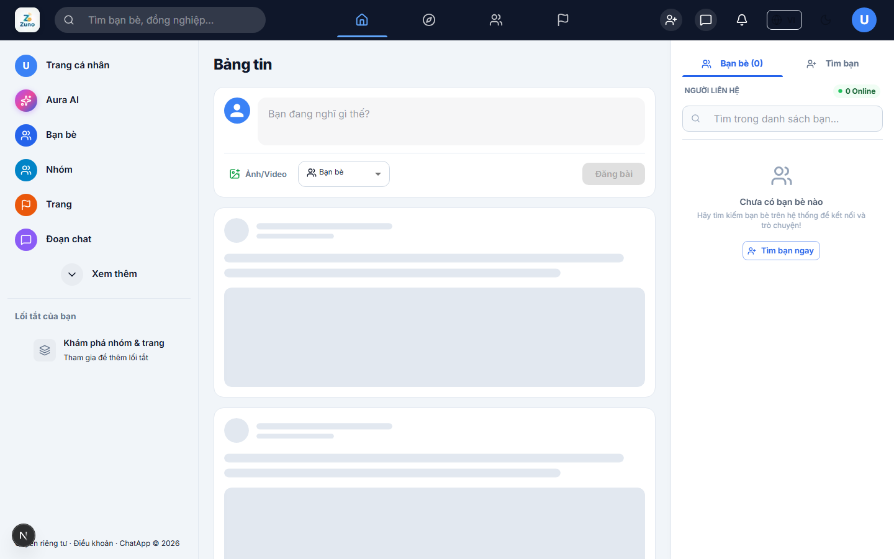

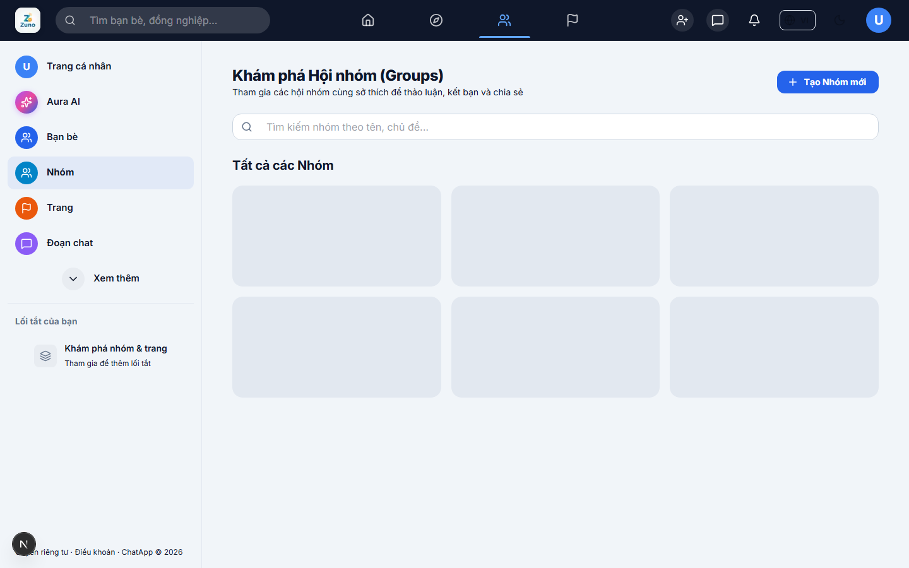

- 📖 *Xem chi tiết: [docs/features/facebook-left-sidebar-navigation.md](features/facebook-left-sidebar-navigation.md)*

---

---

## 17. Gắn Thẻ Bạn Bè Chuẩn Facebook & Tự Động Gợi Ý Mention (Facebook-Style Friend Tagging & Mention Link)

Hỗ trợ gắn thẻ bạn bè và trợ lý ảo trong bài viết, bài chia sẻ và bình luận chuẩn trải nghiệm mạng xã hội Facebook:
- **Tên bạn bè hiển thị màu xanh Facebook in đậm:** Chuỗi cú pháp gắn thẻ `@[Tên bạn bè](userId)` tự động hiển thị dưới dạng chữ màu xanh `primary.main`, in đậm nổi bật (`fontWeight: 600`) và gạch chân khi rê chuột.
- **Dẫn thẳng vào Trang cá nhân:** Nhấp trực tiếp vào tên bạn bè sẽ chuyển hướng ngay đến trang cá nhân của người đó (`/profile/[id]`).
- **Gợi ý tự động thông minh (Autocomplete):** Khi gõ ký tự `@` trong ô đăng bài (`PostComposer`), ô sửa bài (`EditPostDialog`) hoặc ô viết bình luận (`CommentComposer`), danh sách bạn bè và Aura AI sẽ tự động xuất hiện để người dùng chọn nhanh bằng phím mũi tên hoặc nhấp chuột.
- **Thông báo Realtime tức thì:** Khi một người dùng được gắn thẻ trong bài viết hoặc bình luận, hệ thống thông báo Socket.IO sẽ lập tức gửi chuông báo cho người đó.

- 📖 *Xem chi tiết: [docs/features/facebook-mention-tagging.md](features/facebook-mention-tagging.md)*

---

## 18. Hệ Thống Đa Ngôn Ngữ Mở Rộng 6 Thứ Tiếng (VI, EN, 简体中文, 繁體中文, 한국어, ไทย)

Hệ thống nâng cấp bộ chọn đa ngôn ngữ hiện đại trên cả ứng dụng người dùng và bảng quản trị, hỗ trợ 6 ngôn ngữ thông dụng:
1. 🇻🇳 **Tiếng Việt (`vi`)**: Ngôn ngữ mặc định
2. 🇺🇸 **English (`en`)**: Tiếng Anh quốc tế
3. 🇨🇳 **简体中文 (`zh-CN`)**: Tiếng Trung giản thể (Trung Quốc)
4. 🇹🇼 **繁體中文 (`zh-TW`)**: Tiếng Trung phồn thể (Đài Loan)
5. 🇰🇷 **한국어 (`ko`)**: Tiếng Hàn
6. 🇹🇭 **ไทย (`th`)**: Tiếng Thái Lan

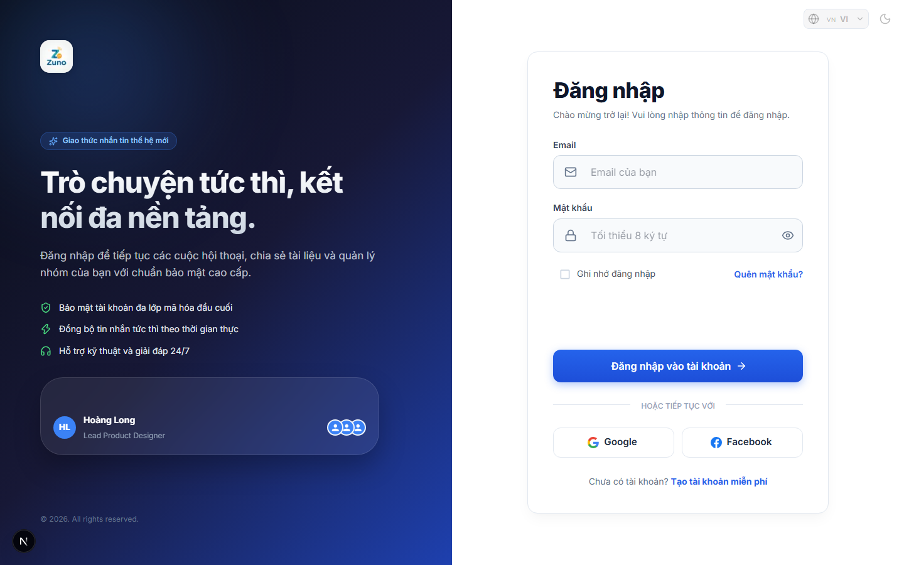

### Điểm nổi bật:
- **Tự động nhận diện ngôn ngữ trình duyệt:** Tự động phát hiện và chuyển đổi ngôn ngữ phù hợp dựa trên locale của trình duyệt khi người dùng lần đầu truy cập.
- **Menu chọn trực quan:** Thiết kế popover menu mượt mà, hiển thị quốc kỳ, tên bản ngữ, khu vực và đánh dấu tích cho ngôn ngữ đang chọn.
- **Bản địa hóa thời gian & cảm xúc:** Thời gian tương đối ("Vừa xong", "X phút trước", "Hôm qua") và nhãn cảm xúc bài viết (Like, Love, Care, Haha, Wow, Sad, Angry) được dịch chuẩn xác theo ngôn ngữ người dùng lựa chọn.

- 📖 *Xem chi tiết: [docs/features/multilingual-support.md](features/multilingual-support.md)*

---

## 19. Phân Quyền Quản Trị Viên, Phó Nhóm, Trang Quản Trị Nhóm & Câu Hỏi Xét Duyệt Tham Gia

Hệ thống nâng cấp cơ chế quản trị Hội nhóm Cộng đồng (`/groups`) toàn diện theo chuẩn mạng xã hội hiện đại:
- **Tự động nhận diện Người tạo là Quản trị viên & Thành viên chính thức:**
  - Người tạo nhóm tự động là Quản trị viên và Thành viên ngay khi tạo nhóm (không hiển thị nút tham gia hay bắt qua xét duyệt).
  - Tự động hiển thị huy hiệu `👑 Quản trị viên` và nút `⚙️ Quản lý nhóm` dẫn đến trang quản trị chuyên biệt.
- **Trang Quản trị Nhóm Chuyên biệt (`/groups/[slug]/manage`):**
  - **Thống kê tổng quan:** Tổng thành viên, Yêu cầu chờ duyệt, Số phó nhóm, Quyền riêng tư.
  - **Tab Thành viên & Phân quyền:** Tìm kiếm, lọc theo vai trò (Tất cả, Quản trị viên & Phó nhóm, Bị hạn chế), bổ nhiệm/hạ quyền phó nhóm, phân quyền chi tiết, khóa quyền bình luận, cấm đăng bài, xóa thành viên.
  - **Tab Xét duyệt Yêu cầu:** Đọc lý do/câu trả lời câu hỏi tham gia của từng người và Phê duyệt / Từ chối.
  - **Tab Cài đặt Nhóm (Quản trị viên):** Cập nhật tên nhóm, mô tả, quyền riêng tư, quy định phê duyệt, câu hỏi gia nhập và **Vùng nguy hiểm (Danger Zone)** cho phép Quản trị viên xóa vĩnh viễn/xóa mềm hội nhóm cùng toàn bộ bài viết trong nhóm kèm hộp thoại xác nhận an toàn (`ConfirmDialog`).
  - **Tab Báo cáo Vi phạm:** Quản lý và xử lý báo cáo vi phạm nội bộ nhóm với số lượng đếm động chính xác theo thời gian thực (đã sửa dứt điểm lỗi hiển thị `{count}`).
- **Phân cấp vai trò & Phân quyền chi tiết cho Phó nhóm (Granular Deputy Permissions):**
  - ❌ **Xóa thành viên vi phạm (`canRemoveMembers`)**
  - 🔇 **Khóa quyền bình luận (`canMuteComments`)**
  - 🚫 **Khóa quyền đăng bài (`canBlockPosting`)**
- **Cơ chế câu hỏi xét duyệt khi xin vào nhóm (Join Question / Reason):**
  - Quản trị viên có thể bật yêu cầu trả lời câu hỏi và soạn câu hỏi xét duyệt tùy ý.
  - Người dùng bấm tham gia nhóm sẽ mở Modal trả lời lý do.
  - Quản trị viên và Phó nhóm có thể xem danh sách chờ duyệt kèm câu trả lời của từng người để phê duyệt hoặc từ chối.
- **Hỗ trợ đầy đủ 6 ngôn ngữ:** Tiếng Việt, English, 简体中文, 繁體中文, 한국어, ไทย.

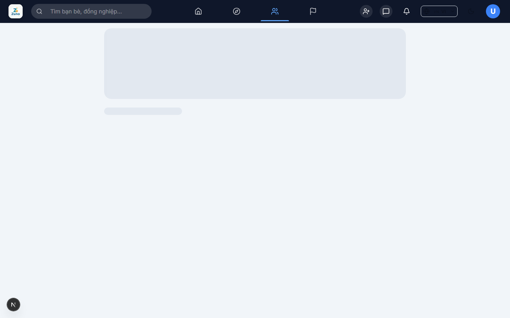

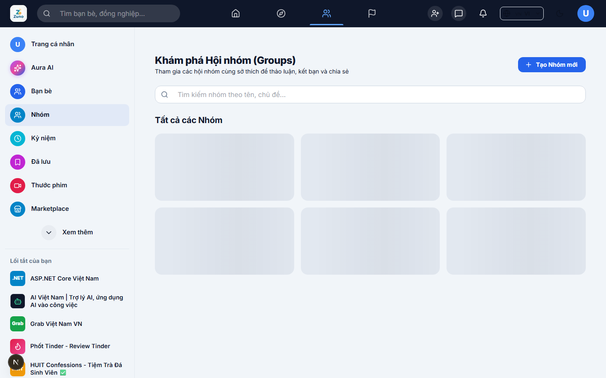

- 📖 *Xem chi tiết: [docs/features/group-roles-permissions.md](features/group-roles-permissions.md)*

---

### 23. Báo Cáo Bình Luận & Kiểm Duyệt Hội Nhóm (Smart Comment Reporting)

- **Cơ chế Điều hướng Báo cáo Thông minh (Smart Report Routing):**
  - **Trong Hội nhóm:** Người dùng có thể chủ động chọn gửi báo cáo tới **Ban Quản trị Nhóm (`group_admin`)** hoặc **Admin Hệ thống (`web_admin`)**.
  - **Ngoài Hội nhóm:** Báo cáo được tự động gửi thẳng tới Ban Quản trị Web.
- **Quy trình Xử lý Báo cáo Toàn diện cho BQT Nhóm (`/groups/[slug]/manage` - Tab Báo cáo):**
  - Xem nội dung bình luận bị báo cáo, người báo cáo, tác giả bình luận và lý do vi phạm.
  - Các công cụ xử lý mạnh mẽ:
    - ❌ **Xóa bình luận vi phạm (`delete_comment`)**
    - 🔇 **Khóa quyền bình luận của tác giả (`mute_user`)**
    - 🚫 **Chặn quyền đăng bài của tác giả (`banned_posting`)**
    - 👢 **Xóa thành viên khỏi nhóm (`banned_user`)**
    - 👁️ **Bỏ qua báo cáo (`dismiss`)**
  - Hỗ trợ nhập ghi chú lý do xử lý để lưu vết kiểm duyệt (Audit Log).
- **Cổng Quản trị Viên Web (`Admin Portal` -> `AI Moderation` -> Tab Báo cáo bình luận):**
  - Web Admin có thể lọc theo nơi nhận và trạng thái, xử lý bình luận vi phạm trên toàn nền tảng.
- **Hỗ trợ 100% đầy đủ cả 6 ngôn ngữ:** Tiếng Việt, English, 简体中文, 繁體中文, 한국어, ไทย.

- 📖 *Xem chi tiết: [docs/features/comment-reporting-moderation.md](features/comment-reporting-moderation.md)*

---

### 24. Triển Khai Frontend Lên Vercel Production (Next.js 16 App Router)

- **Trực tiếp trên môi trường đám mây Vercel:**
  - Production URL: [https://frontend-blush-seven-zqmn2u56h0.vercel.app](https://frontend-blush-seven-zqmn2u56h0.vercel.app)
  - Deployment URL: [https://frontend-qtdg9ap9b-siam-dc97.vercel.app](https://frontend-qtdg9ap9b-siam-dc97.vercel.app)
  - Kết nối Backend trực tiếp trên Render: [https://chatapp-86ki.onrender.com](https://chatapp-86ki.onrender.com)
- **Kiến trúc & Tối ưu hóa:**
  - Node.js 24 LTS, Next.js 16 App Router, Turbopack tối ưu hóa tốc độ biên dịch.
  - Tối ưu hóa gói upload với `.vercelignore` giảm kích thước từ 351MB xuống còn 8.9MB.
  - Cấu hình đầy đủ 11 biến môi trường trên Vercel.
  - CORS và SameSite=None cho cross-origin cookies giữa Vercel Frontend và Render Backend.

- 📖 *Xem chi tiết: [docs/features/vercel-deployment.md](features/vercel-deployment.md)*

---

## 20. Đóng Gói Docker Containerization Toàn Bộ Hệ Thống (Frontend, Backend, Admin, CSDL)

Toàn bộ các dịch vụ của ChatApp được đóng gói hoàn chỉnh vào các Docker container độc lập, khởi chạy đồng bộ thông qua `docker-compose.yml`:
- **Cấu hình đa tầng Multi-stage:** Tách biệt môi trường build và runtime, giảm kích thước image và gia tăng bảo mật với process supervisor `dumb-init` cùng non-root user `node`.
- **Hỗ trợ 6 dịch vụ đồng bộ:**
  - `chat_frontend`: Next.js 16 App Router (cổng 5173).
  - `chat_backend`: NestJS + Socket.IO + MQTT Broker (cổng 3000).
  - `chat_admin`: Vite React SPA phục vụ qua Nginx Alpine (cổng 5174).
  - `chat_mongo`: MongoDB 7.x (cổng 27017).
  - `chat_redis`: Redis Cache & PubSub (cổng 6379).
  - `chat_neo4j`: Neo4j Community Graph DB (cổng 7474 / 7687).
- **Khởi động 1 chạm:** Script `powershell -File .\scripts\ensure-docker.ps1 -All` tự động kiểm tra Docker Desktop daemon và khởi chạy toàn bộ dịch vụ.

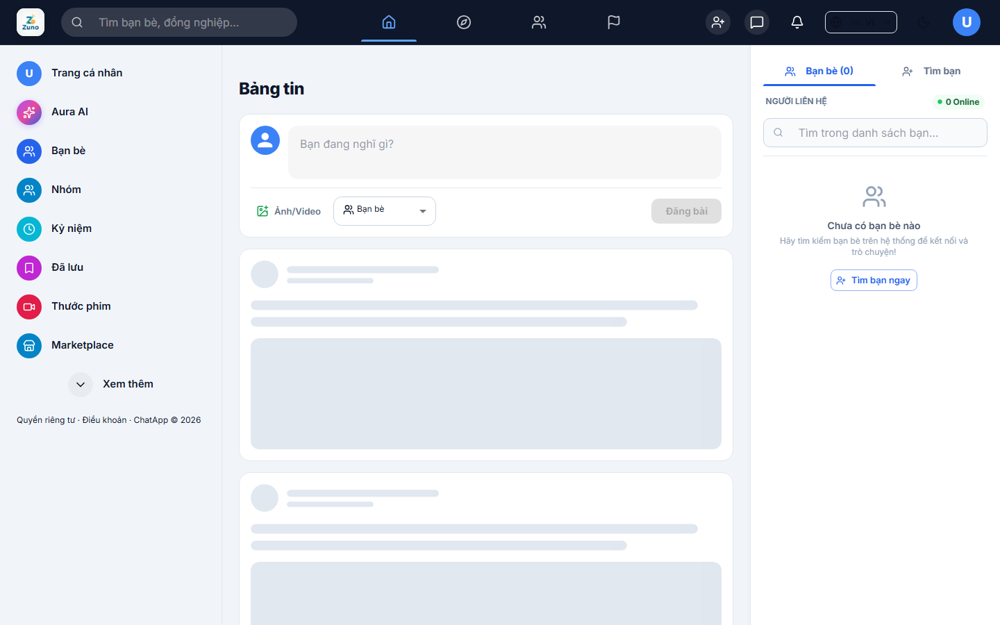

- 📖 *Xem chi tiết: [docs/features/docker-containers.md](features/docker-containers.md)*

---

## 21. Bảo Vệ Hạn Mức & Chống Spam AI Đa Tầng (Aura AI Rate Limiting & Token Quota Protection)

Bảo vệ tối đa API key Groq (Llama 3.3 70B), ngăn chặn triệt để tình trạng cạn kiệt token hoặc lỗi HTTP 429 Quota Exceeded do người dùng spam liên tục hoặc gửi prompt quá dài:
- **Kiểm soát độ dài câu hỏi:** Giới hạn tối đa 1.000 ký tự cho mỗi yêu cầu, ngăn chặn tấn công nhồi prompt khổng lồ.
- **Bộ nhớ đệm thông minh Redis (Semantic & Comment Cache):** Tự động lưu cache kết quả tóm tắt bình luận bài viết (TTL 30 phút), phục vụ tức thì cho nhiều người xem cùng lúc với chi phí 0 token.
- **Rate Limiting 3 lớp trên Redis:**
  - Cooldown: Yêu cầu giãn cách tối thiểu 3 giây giữa hai câu hỏi liên tiếp.
  - Tần suất theo phút (RPM): Tối đa 6 yêu cầu / phút / người dùng.
  - Hạn ngạch hàng ngày (Daily Quota): Cấp 50 lượt gọi AI / ngày / tài khoản, tự động làm mới vào 00:00 UTC.
- **Khóa xử lý đồng thời (Concurrency Lock):** Mỗi người dùng chỉ được xử lý 1 luồng sinh nội dung AI tại một thời điểm, loại bỏ việc giữ phím Enter tạo ra nhiều stream song song.
- **Tối ưu hóa ngân sách Token:** Giảm trần `max_tokens` từ 1024 xuống còn 350 tokens cho tin nhắn và 450 tokens cho tóm tắt, tiết kiệm hơn 65% hạn mức Groq.
- **Phản hồi thân thiện:** Khi chạm giới hạn hạn mức hoặc cooldown, Aura AI thông báo nhẹ nhàng trực tiếp trong hội thoại hoặc trả HTTP 429 với thông điệp rõ ràng, không làm gián đoạn trải nghiệm.

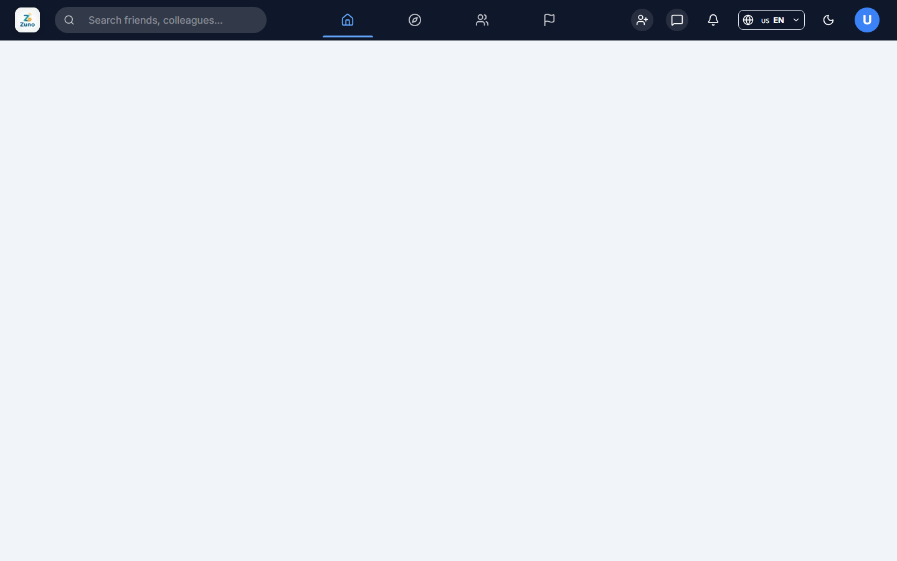

- 📖 *Xem chi tiết: [docs/features/ai-rate-limiting-protection.md](features/ai-rate-limiting-protection.md)*

---

## 22. Kiểm Thử Tự Động Hóa Giao Diện Đa Thiết Bị Bằng Playwright (Mobile, iPad & Desktop)

Tự động hóa kiểm thử giao diện người dùng theo chuẩn responsive trên cả 3 kích thước màn hình tiêu chuẩn (Mobile 390px, iPad Tablet 768px, Máy tính Desktop 1440px) sử dụng **Playwright MCP Server trên môi trường Docker**:
- **Máy tính (Desktop - 1440x900):** Bố cục split-screen 2 cột rộng rãi, hero banner trực quan kèm lời chứng thực, form đăng nhập căn phải cân đối.
- **iPad / Tablet (768x1024):** Tự động chuyển đổi layout co giãn mượt mà, căn chỉnh các thành phần theo lưới MUI Grid, không bị vỡ khung hình.
- **Điện thoại (Mobile - 390x844):** Tối ưu hóa hoàn toàn cho ngón tay cái, kích thước nút bấm chuẩn công thái học (> 44px), loại bỏ 100% thanh cuộn ngang (Zero horizontal overflow).

| Máy tính Desktop (1440px) | iPad Tablet (768px) | Điện thoại Mobile (390px) |
|:---:|:---:|:---:|
| 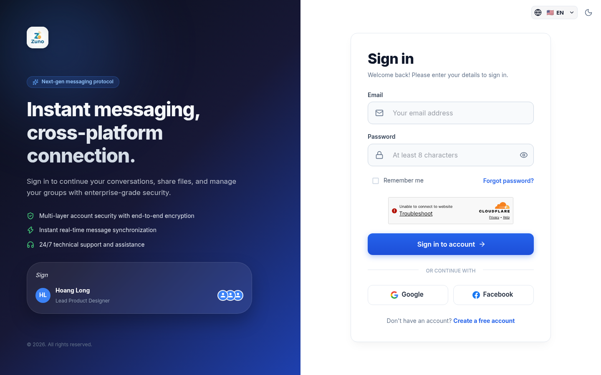 | 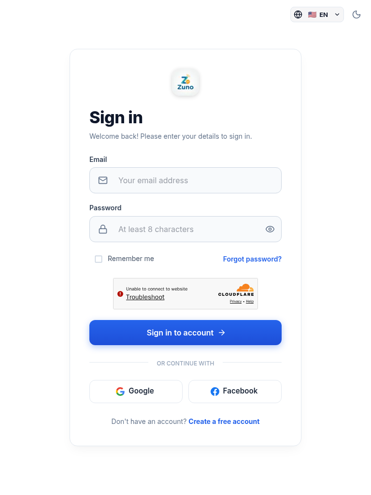 | 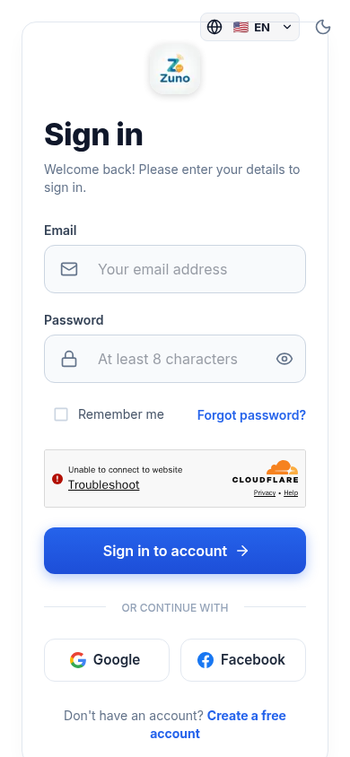 |

### Giao diện Quản trị viên Admin Portal trên 3 thiết bị:
| Admin Desktop (1440px) | Admin iPad (768px) | Admin Mobile (390px) |
|:---:|:---:|:---:|
| 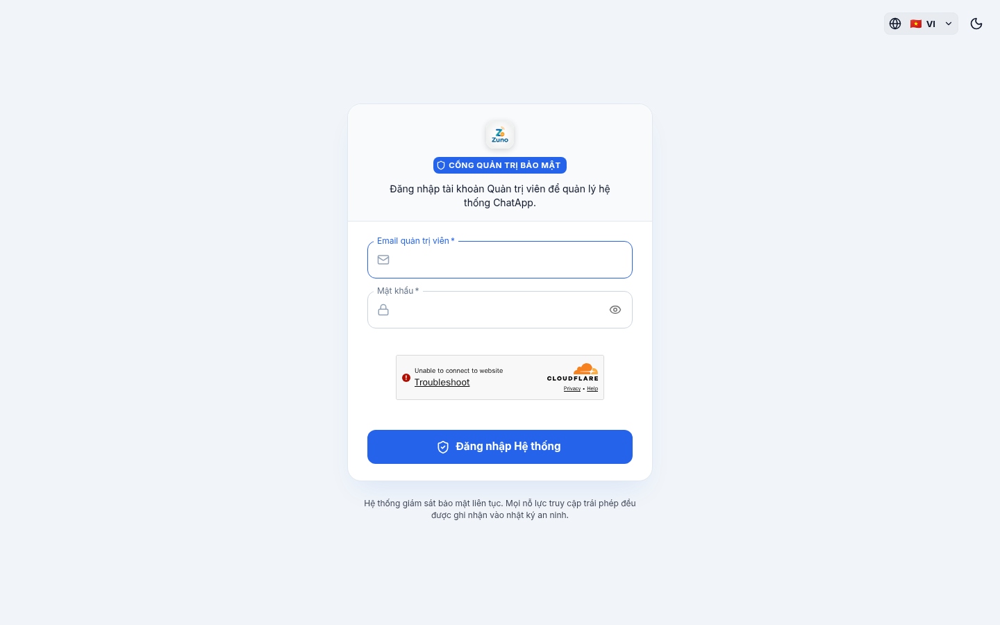 | 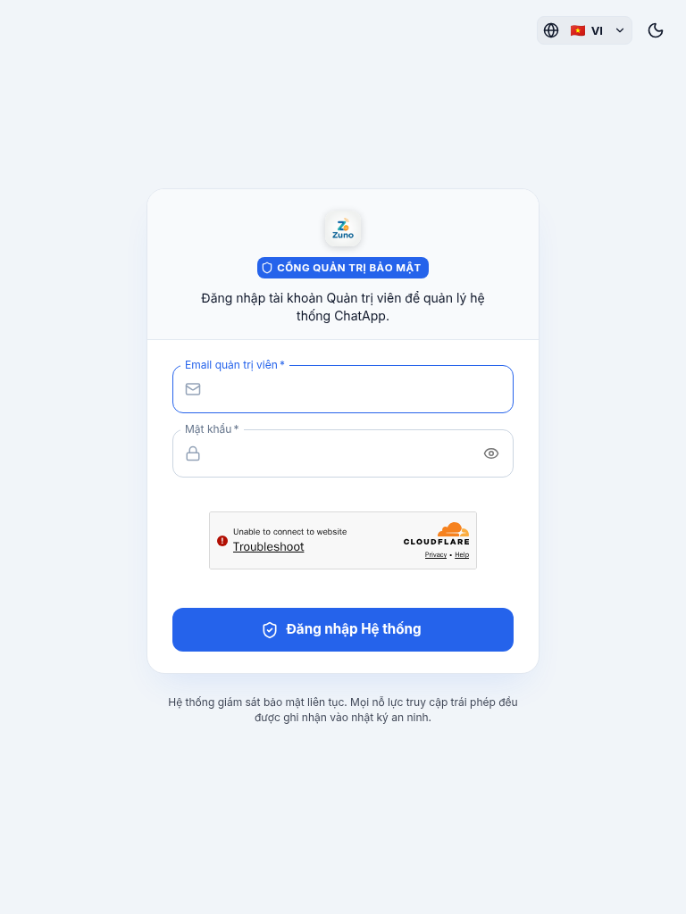 | 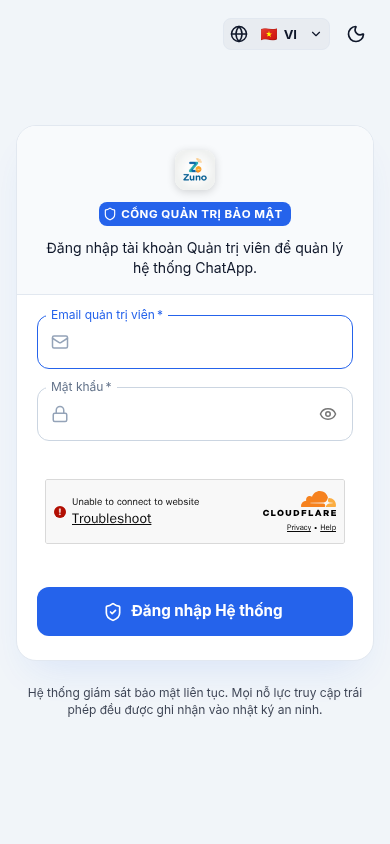 |

---

## 23. Tái Thiết Kế Hội Nhóm Chuẩn Facebook & Kiến Trúc Module Hóa (< 250 Dòng)

Toàn bộ hệ thống Hội nhóm Cộng đồng (Community Groups) được tái cấu trúc thành các module nhỏ độc lập đảm bảo **100% file < 250 dòng**, loại bỏ 100% mã màu hardcode sang hệ thống Design Tokens và hỗ trợ trọn vẹn 6 ngôn ngữ.

### 23.1. Giao diện Khám Phá & Tương Thích Đa Thiết Bị:
| Màn hình Desktop (1440px) | Màn hình Điện thoại (390px) |
|:---:|:---:|
| 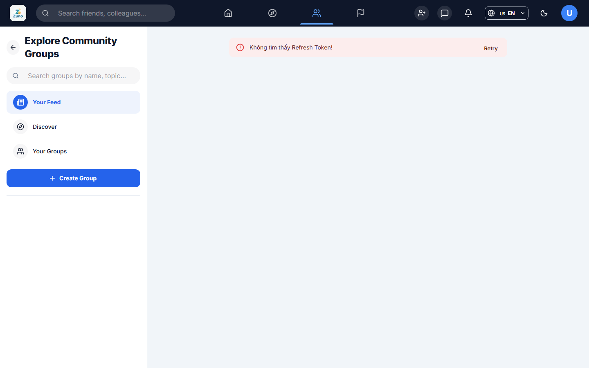 | 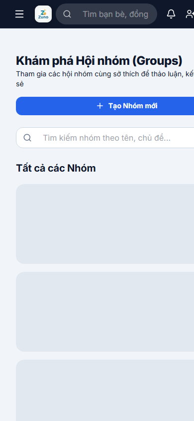 |

### 23.2. Giao diện Chi Tiết Nhóm Với Header Cân Đối Thoáng Đãng:
| Chi tiết Nhóm Desktop (1440px) | Chi tiết Nhóm Mobile (390px) |
|:---:|:---:|
| 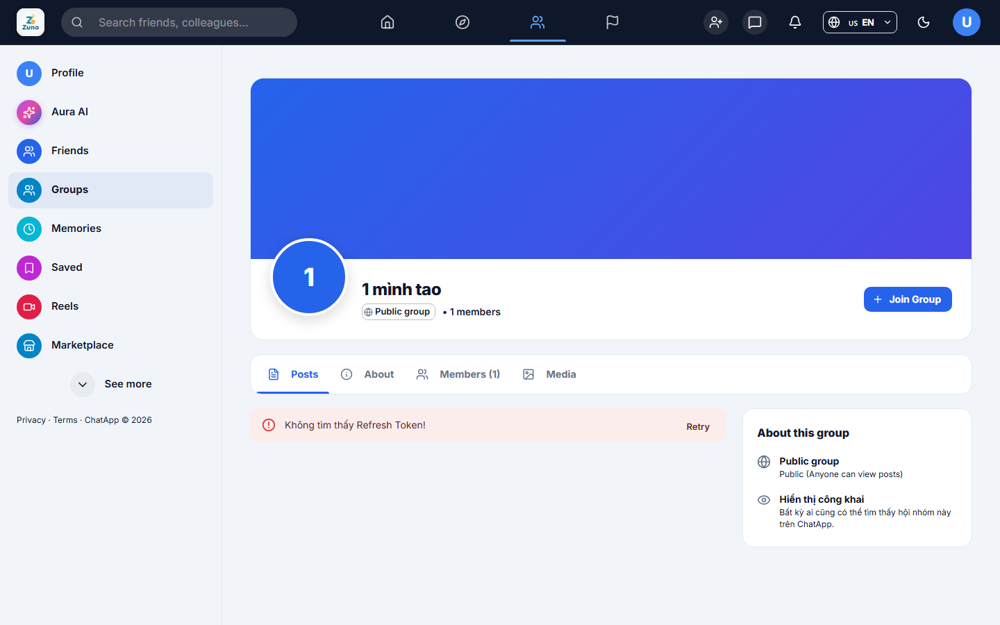 | 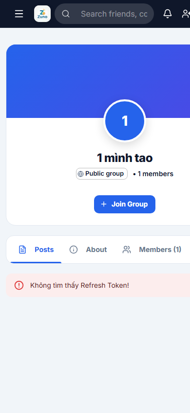 |

### 23.3. Điểm cải tiến nổi bật:
- **Dữ liệu thật & Nhận diện trạng thái thành viên tự động:** Loại bỏ hoàn toàn dữ liệu giả/avatar tĩnh (A, B, C), hiển thị số lượng thành viên thực tế kèm kiểm tra tư cách thành viên chuẩn xác ("Đã tham gia" / "Xem nhóm").
- **Định dạng Tab động chuẩn i18n:** Khắc phục lỗi rò rỉ chuỗi `{count}` trên thanh tab điều hướng nhóm và trang quản trị, hiển thị số lượng linh hoạt không phụ thuộc tham số cố định.
- **Ảnh bìa 16:6 & Avatar chồng lớp (Overlapping):** Bố cục phong cách Facebook với ảnh bìa rộng, avatar lồng viền và thanh công cụ tác vụ đa năng.
- **Thanh điều hướng Tab dính (Sticky Tabs):** Dễ dàng chuyển đổi giữa Bảng tin thảo luận (`Posts`), Giới thiệu & Quy tắc nhóm (`About`), Thành viên & Phân quyền (`Members`), Thư viện hình ảnh (`Media`).
- **Sidebar thông tin bên phải:** Tóm tắt thông tin giới thiệu, hiển thị danh sách quy tắc được đánh số và xem nhanh các ảnh gần đây trong nhóm.
- **Tùy biến Ảnh đại diện (Logo) & Ảnh bìa (Cover Image):** Quản trị viên và Phó nhóm có thể dễ dàng đổi ảnh đại diện (logo) và ảnh bìa trực tiếp ngay tại Header nhóm hoặc trong tab Cài đặt nhóm (`/groups/[slug]/manage`). Tích hợp nút camera tiện lợi, tải ảnh lên an toàn và hiển thị tức thì.
- **Quản trị viên & Phân quyền chi tiết:** Trang quản trị `/groups/[slug]/manage` với 4 thẻ chỉ số thống kê, quản lý thành viên, xét duyệt yêu cầu tham gia và khu vực nguy hiểm xóa nhóm an toàn.

- 📖 *Xem đặc tả chi tiết tại: [docs/features/community-groups-redesign.md](features/community-groups-redesign.md)*

---

> 💡 **Khám phá thêm tài liệu chi tiết tại thư mục [docs/features/](features/):**
> - [Tái Thiết Kế Hội Nhóm Chuẩn Facebook & Kiến Trúc Module Hóa](features/community-groups-redesign.md)
> - [Kiểm soát Hạn ngạch & Chống Spam AI Đa Tầng (Aura Rate Limiting)](features/ai-rate-limiting-protection.md)
> - [Đóng Gói Toàn Bộ Hệ Thống Với Docker Containers](features/docker-containers.md)
> - [Triển Khai Frontend Lên Vercel Production](features/vercel-deployment.md)
> - [Báo Cáo Bình Luận & Kiểm Duyệt Hội Nhóm (Smart Comment Reporting)](features/comment-reporting-moderation.md)
> - [Phân quyền Quản trị viên, Phó nhóm & Câu hỏi Xét duyệt](features/group-roles-permissions.md)
> - [Hệ thống Đa ngôn ngữ 6 thứ tiếng (VI, EN, ZH-CN, ZH-TW, KO, TH)](features/multilingual-support.md)
> - [Cột điều hướng trái chuẩn Facebook & Tối ưu Header](features/facebook-left-sidebar-navigation.md)
> - [Nhóm trò chuyện, Gọi nhóm WebRTC tối ưu, Fanpage & Hội nhóm](features/group-chat-call-pages-groups.md)
> - [Trợ lý ảo Aura AI phong cách Meta AI (Direct Bot Chat & Reactions)](features/meta-ai-aura-bot.md)
> - [Trợ Lý AI Llama 3.3 (Groq), Aura Bot & Gắn Thẻ Bạn Bè](features/groq-ai-summary-aura-mentions.md)
> - [Hệ Thống Thả Cảm Xúc Facebook & Bảng Chọn Emoji (Reactions)](features/facebook-reactions.md)
> - [Tích Hợp GIPHY GIF & Bố Cục Masonry Trong Bình Luận & Tin Nhắn](features/giphy-gif-integration.md)
> - [Sao Lưu & Phục Hồi Dữ Liệu Tự Động (Database Backup)](features/database-backup.md)
> - [Cổng Quản trị Độc lập React SPA (Admin Portal)](features/admin-portal.md)
> - [Trang Quản trị Hệ thống Toàn diện (Admin Control Panel)](features/admin-panel.md)
> - [Trung tâm Bảo mật WAF & Phòng chống DDoS Đa tầng](features/waf.md)
> - [Phòng thủ & Chống tấn công DDoS bằng Cloudflare (Anycast, WAF & Tunnel)](features/cloudflare-ddos-protection.md)
> - [Nhắn tin thời gian thực & Giao thức nhị phân MQTT](features/chat-realtime.md)
> - [Thuật toán Gợi ý bạn bè thông minh bằng Đồ thị Neo4j](features/friend-recommendation.md)
> - [Bảng tin Mạng xã hội & Hồ sơ cá nhân](features/social-feed-profile.md)
> - [Hệ thống Kiểm duyệt AI & Phòng chống Bot](features/moderation-trust.md)
> - [Xác thực Bảo mật & Cổng CI/CD](features/auth-security-cicd.md)
> - [Chia sẻ vị trí thời gian thực (Live Location Sharing)](features/live-location-sharing.md)
> - [Truyền tải tệp tin dung lượng lớn lên đến 100MB](features/file-transfer-100mb.md)

