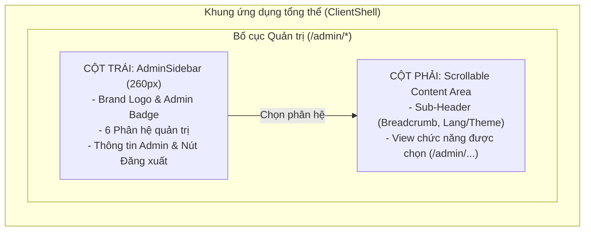

# 🎛️ TRANG QUẢN TRỊ VIÊN HỆ THỐNG (ADMINISTRATION PANEL)

> Tài liệu kỹ thuật chi tiết về hệ thống quản trị trung tâm dành riêng cho Quản trị viên (`/admin/*`), được thiết kế theo kiến trúc chuẩn 2 cột: **Thanh điều hướng Sidebar cố định bên trái** và **Khu vực hiển thị nội dung nghiệp vụ bên phải**.

---

## 📑 MỤC LỤC
1. [Tổng Quan Kiến Trúc Giao Diện (Layout Architecture)](#1-tổng-quan-kiến-trúc-giao-diện-layout-architecture)
2. [Cơ Chế Phân Quyền & Bảo Vệ Tuyệt Đối (RBAC & Guards)](#2-cơ-chế-phân-quyền--bảo-vệ-tuyệt-đối-rbac--guards)
3. [Chi Tiết Các Phân Hệ Chức Năng (Core Admin Subsystems)](#3-chi-tiết-các-phân-hệ-chức-năng-core-admin-subsystems)
   - [3.1. Tổng Quan Hệ Thống (Dashboard & Analytics)](#31-tổng-quan-hệ-thống-dashboard--analytics)
   - [3.2. Quản Lý Người Dùng & Phân Quyền (Users Management)](#32-quản-lý-người-dùng--phân-quyền-users-management)
   - [3.3. Kiểm Duyệt Bài Viết & Bảng Tin (Posts Moderation)](#33-kiểm-duyệt-bài-viết--bảng-tin-posts-moderation)
   - [3.4. Hệ Thống Kiểm Duyệt AI & Hàng Đợi An Toàn (AI Moderation Queue & Playground)](#34-hệ-thống-kiểm-duyệt-ai--hàng-đợi-an-toàn-ai-moderation-queue--playground)
   - [3.5. Trung Tâm Bảo Mật & Tường Lửa WAF (Security Center)](#35-trung-tâm-bảo-mật--tường-lửa-waf-security-center)
   - [3.6. Trạng Thái Hệ Thống & Hạ Tầng (System Health & V8 Metrics)](#36-trạng-thái-hệ-thống--hạ-tầng-system-health--v8-metrics)
4. [Đặc Tả API Backend (`/api/admin/*`)](#4-đặc-tả-api-backend-apiadmin)
5. [Kiểm Thử & Đảm Bảo Chất Lượng (Quality Gates)](#5-kiểm-thử--đảm-bảo-chất-lượng-quality-gates)

---

## 1. TỔNG QUAN KIẾN TRÚC GIAO DIỆN (LAYOUT ARCHITECTURE)

Giao diện quản trị viên được xây dựng hoàn toàn tuân thủ theo **ChatApp Design System** và **Next.js 16 App Router**, tách biệt rõ rệt giữa điều hướng và nội dung:

### 1.1. Cột Trái: AdminSidebar (`AdminSidebar.tsx`)
- **Độ rộng cố định:** `260px` trên desktop; tự động chuyển thành Drawer trượt (slide drawer) trên thiết bị di động (< 900px).
- **Phân hệ điều hướng nhanh:**
  1. 📊 **Tổng quan** (`/admin`)
  2. 👥 **Người dùng** (`/admin/users`)
  3. 📰 **Bài viết** (`/admin/posts`)
  4. 🤖 **Kiểm duyệt AI** (`/admin/moderation`)
  5. 🛡️ **Bảo mật & WAF** (`/admin/security`)
  6. ⚙️ **Hệ thống & Dịch vụ** (`/admin/system`)
- **Tích hợp chân trang (Footer) & Nút Đăng Xuất:** Hiển thị avatar người dùng trực quan với `PresenceAvatar`, email quản trị và nút **Đăng xuất** nhanh chóng, tách biệt hoàn toàn khỏi không gian người dùng.

### 1.2. Cột Phải: Content Area (`AdminLayout.tsx`)
- **Sub-Header:** Thanh điều khiển phụ chứa nút mở Drawer trên mobile, Breadcrumbs chỉ dẫn đường dẫn phân cấp, biểu tượng trạng thái bảo vệ đa tầng, bộ chuyển đổi chế độ Sáng/Tối (`ColorModeToggle`), Song ngữ VI/EN (`LanguageToggle`) và nút Đăng xuất an toàn.
- **Nội dung độc lập:** Mỗi tính năng con nằm trong thư mục App Router riêng (`/admin/page.tsx`, `/admin/users/page.tsx`, `/admin/posts/page.tsx`, `/admin/moderation/page.tsx`, `/admin/security/page.tsx`, `/admin/system/page.tsx`).

---

## 2. CƠ CHẾ PHÂN QUYỀN & BẢO VỆ TUYỆT ĐỐI (RBAC & GUARDS)

Quyền truy cập khu vực Quản trị viên được bảo vệ chặt chẽ ở cả Frontend và Backend:

1. **Frontend Guard (`AdminGuard.tsx`):**
   - Kiểm tra `useAuthStore()`: Nếu chưa đăng nhập -> điều hướng về `/login?redirect=/admin`.
   - Nếu đã đăng nhập nhưng `user.role !== 'admin'` -> điều hướng về trang chủ `/` kèm thông báo không có quyền truy cập.
2. **Backend Guard (`RolesGuard` & `JwtAuthGuard`):**
   - Mọi endpoint trong `AdminController` đều được gắn decorator `@UseGuards(JwtAuthGuard, RolesGuard)` và `@Roles('admin')`.
   - Token JWT được giải mã từ HttpOnly Cookie; kiểm tra trường `role === 'admin'`. Người dùng thông thường gửi request đến `/admin/*` ngay lập tức nhận mã lỗi `403 Forbidden`.
3. **Chống Tự Khóa Hoặc Xóa Tài Khoản Chính Mình:**
   - Trong `AdminService`, nghiệp vụ cấm tài khoản có kiểm tra logic nghiêm ngặt: Quản trị viên không thể tự cấm (`ban`) chính tài khoản mình đang đăng nhập.
4. **Cách Ly Tuyệt Đối Quản Trị Viên Khỏi Mạng Xã Hội (Admin Strict Route Isolation):**
   - Tài khoản `role === 'admin'` khi đăng nhập hoặc nhập URL người dùng (`/`, `/profile`, `/explore`, `/chat`...) sẽ được `AuthGuard` tự động chặn render và chuyển hướng tức thì về `/admin`.
   - `ClientShell` loại bỏ hoàn toàn thanh điều hướng `ResponsiveAppBar`, `FloatingChatDock`, `FriendNoticeToast`, và `CallModal` khi người dùng là admin hoặc đang ở đường dẫn `/admin/*`.
   - Admin không kết nối vào socket chat mạng xã hội và không tự động nạp danh sách bạn bè, giúp tăng cường bảo mật và không làm rò rỉ dữ liệu hay sự hiện diện của admin.

---

## 3. CHI TIẾT CÁC PHÂN HỆ CHỨC NĂNG (CORE ADMIN SUBSYSTEMS)

### 3.1. Tổng Quan Hệ Thống (Dashboard & Analytics)
- **4 Thẻ Thống Kê Chính:**
  - **Tổng thành viên:** Tổng số tài khoản, tỷ lệ đang hoạt động và số tài khoản đang bị khóa vi phạm.
  - **Bài viết & Tương tác:** Tổng số bài viết trên toàn mạng xã hội và tổng số lượt bình luận.
  - **Bảo mật & WAF:** Trạng thái Tường lửa (Normal vs Under Attack) và số lượng địa chỉ IP đang bị cách ly/cấm.
  - **Tài nguyên máy chủ:** Dung lượng RAM Heap V8 đang dùng, Uptime liên tục và phiên bản Node.js.
- **Tình Trạng Kết Nối Dịch Vụ:** Kiểm tra trực quan MongoDB, Redis Cache, Neo4j Graph DB và WebSocket.
- **Lối Tắt Điều Hướng Nhanh:** Các liên kết 1-click dẫn trực tiếp tới các tác vụ quản trị trọng yếu.

### 3.2. Quản Lý Người Dùng & Phân Quyền (Users Management)
- **Bộ Lọc Đa Năng (`UsersFilterBar.tsx`):**
  - Tìm kiếm tức thời theo Họ tên, Email, hoặc Số điện thoại.
  - Lọc theo Phân quyền: Tất cả, Quản trị viên (`admin`), Người dùng (`user`).
  - Lọc theo Trạng thái: Tất cả, Đang hoạt động (`active`), Bị khóa (`banned`).
- **Bảng Dữ Liệu Phân Trang (`UsersManagementView.tsx`):**
  - Hiển thị danh sách người dùng kèm Avatar Presence, vai trò, ngày tham gia và trạng thái online/offline.
  - Nút tác vụ trực quan: Khóa/Mở khóa tài khoản (có lý do kiểm duyệt) và Nâng/Hạ quyền Admin.
- **Hộp Thoại Xác Nhận An Toàn (`UserActionDialog.tsx`):** Mọi thao tác thay đổi quyền hạn hoặc cấm tài khoản đều yêu cầu nhập lý do kiểm duyệt để lưu vết kiểm toán (Audit Trail).

### 3.3. Kiểm Duyệt Bài Viết & Bảng Tin (Posts Moderation)
- **Theo Dõi Bảng Tin Hệ Thống:** Xem toàn bộ bài viết công khai hoặc bạn bè trên toàn hệ thống kèm ảnh đính kèm chất lượng cao.
- **Tìm Kiếm Nội Dung:** Tìm bài viết chứa từ khóa độc hại, khiêu dâm, lừa đảo hoặc vi phạm tiêu chuẩn cộng đồng.
- **Gỡ Bỏ Nội Dung Vi Phạm:** Nút gỡ bài viết vi phạm một chạm kèm xác nhận Dialog an toàn; bài viết bị ẩn ngay lập tức khỏi bảng tin và trang cá nhân của tất cả người dùng.

### 3.4. Hệ Thống Kiểm Duyệt AI & Hàng Đợi An Toàn (AI Moderation Queue & Playground)
- **Hàng Đợi Kiểm Duyệt Bài Viết (`ModerationQueueTab.tsx`):**
  - Tự động gom các bài viết hoặc nội dung bị AI chấm điểm độc hại cao hoặc mang hình ảnh nhạy cảm.
  - Phân loại vi phạm chi tiết: Toxicity %, Hate speech, Harassment, Spam, Profanity, Sensitive Media.
  - Tác vụ 1-chạm: Duyệt an toàn (`approve`), Gỡ bỏ (`hide`), và Cảnh cáo người dùng (`warn`).
- **Thử Nghiệm Mô Hình AI (`ModerationPlaygroundTab.tsx`):**
  - Mô hình phân loại văn bản Transformer song ngữ VI/EN.
  - Mô hình phát hiện Bot & Tài khoản ảo (Isolation Forest & Autoencoder).

### 3.5. Trung Tâm Bảo Mật & Tường Lửa WAF (Security Center)
- **Tích Hợp Sâu Tường Lửa Đa Tầng:**
  - Bật/Tắt chế độ Bị tấn công (**Under Attack Mode**) tức thì cho Cloudflare Edge hoặc In-App Engine.
  - Chặn công cụ quét lỗ hổng tự động (`blockScanners`).
  - Chặn User-Agent độc hại (`blockBadUserAgents`).
  - Thử thách Captcha đối với lượt đăng nhập từ quốc gia lạ (`challengeForeignAuth`).
  - Danh sách IP cho phép (Allowlist) và Danh sách IP bị cấm (Blocklist).

### 3.6. Trạng Thái Hệ Thống, Giám Sát RAM & Cảnh Báo Nâng Cấp (System Health & RAM Upgrade Warning)
- **Runtime Metrics:** Uptime của hệ thống (ngày, giờ, phút, giây), phiên bản Node.js runtime, OS Platform (win32, linux), Architecture (x64, arm64), Process PID.
- **Giám Sát RAM Vật Lý Máy Chủ Toàn Diện:** Đo lường chính xác tổng RAM vật lý máy chủ (`systemTotalMB`), RAM đang dùng (`systemUsedMB`), RAM còn trống (`systemFreeMB`) và tỷ lệ phần trăm (`systemUsagePercent`).
- **Giám Sát V8 Heap vs Giới Hạn Sập OOM:** Phân tích `heapUsedMB`, `heapTotalMB`, `rssMB` và trần tối đa `heapLimitMB` (`v8.getHeapStatistics().heap_size_limit`).
- **3 Cấp Độ Cảnh Báo & Khuyến Nghị Nâng Cấp:**
  - 🟢 **Healthy (< 70%):** Bộ nhớ hoạt động ổn định, tài nguyên dồi dào.
  - 🟡 **Warning (70% - 84%):** Tải RAM tăng cao, khuyến nghị theo dõi lưu lượng và chuẩn bị phương án nâng cấp RAM.
  - 🔴 **Critical (≥ 85%):** Cảnh báo nguy cấp RAM sắp cạn kiệt, yêu cầu nâng cấp RAM máy chủ ngay lập tức để tránh lỗi Out of Memory crash.
- **Kế Hoạch Nâng Cấp Phần Cứng Tự Động (Hardware Upgrade Plan):**
  - Tự động gợi ý mức RAM cần bổ sung (+4GB, +8GB, +16GB) và dung lượng đích sau khi nâng cấp.
  - Đề xuất cờ tham số runtime Node.js tối ưu (`--max-old-space-size=...`).
  - Gợi ý giải pháp Scale Out với PM2 Cluster hoặc Docker Swarm.
- **Dịch Vụ Hạ Tầng Kết Nối:** Trạng thái kết nối MongoDB (ReadyState 1), Redis Cache & Blacklist (Độ trễ Latency ms), Neo4j Graph DB, và Cloudflare Zero Trust Tunnel.

---

## 4. ĐẶC TẢ API BACKEND (`/api/admin/*`)

| Phương Thức | Đường Dẫn | Quyền Hạn | Mô Tả |
|---|---|---|---|
| `GET` | `/api/admin/stats` | Admin | Lấy tổng quan số liệu thống kê (User, Post, Security, System) |
| `GET` | `/api/admin/users` | Admin | Lấy danh sách người dùng phân trang kèm bộ lọc tìm kiếm |
| `PATCH` | `/api/admin/users/:id/ban` | Admin | Khóa hoặc mở khóa tài khoản người dùng kèm lý do kiểm toán |
| `PATCH` | `/api/admin/users/:id/role` | Admin | Thay đổi quyền hạn tài khoản (`admin` hoặc `user`) |
| `GET` | `/api/admin/posts` | Admin | Tìm kiếm và duyệt bài viết toàn hệ thống |
| `DELETE` | `/api/admin/posts/:id` | Admin | Xóa mềm/Gỡ bài viết vi phạm tiêu chuẩn |
| `GET` | `/api/admin/moderation/queue` | Admin | Lấy hàng đợi bài viết / nội dung bị AI gắn cờ vi phạm |
| `PATCH` | `/api/admin/moderation/queue/:id/resolve` | Admin | Xử lý nội dung hàng đợi (`approve`, `hide`, `warn`) |
| `POST` | `/api/admin/moderation/test-text` | Admin | Thử nghiệm phân loại độc hại văn bản với Transformer |
| `POST` | `/api/admin/moderation/test-behavior` | Admin | Thử nghiệm thuật toán phát hiện dị biệt Bot hành vi |
| `GET` | `/api/admin/system` | Admin | Đo lường tài nguyên runtime, RAM V8 và độ trễ vi dịch vụ |

---

## 5. KIỂM THỬ & ĐẢM BẢO CHẤT LƯỢNG (QUALITY GATES)

Hệ thống quản trị đã vượt qua toàn diện 7 cổng chất lượng nghiêm ngặt của dự án (`scripts/check.ps1`):
1. **Frontend Lint & Types:** 0 lỗi ESLint, 0 lỗi TypeScript (`tsc --noEmit`).
2. **Backend Lint & Types:** 0 cảnh báo Oxlint, 0 lỗi TypeScript.
3. **Backend Unit Tests:** Toàn bộ 38 test suites và 326 unit tests đều PASSED (bao gồm `admin.service.spec.ts` và `admin.controller.spec.ts`).
4. **Kiểm tra rò rỉ RAM & Buffer:** PASSED với GC profiling.
5. **Kiểm tra N+1 Query & OWASP:** PASSED.
6. **Production Build:** Cả backend NestJS và frontend Next.js 16 App Router biên dịch thành công 100%.
