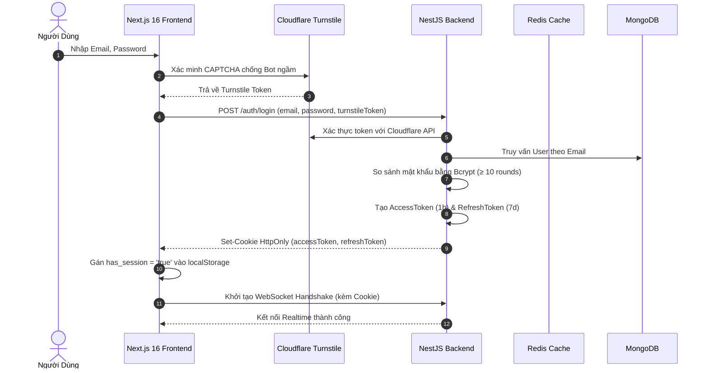

# 🔒 XÁC THỰC BẢO MẬT & HỆ THỐNG CỔNG CHẤT LƯỢNG CI/CD (AUTH & CI/CD)

> Tài liệu mô tả chi tiết cơ chế bảo mật phiên làm việc (HttpOnly Cookies, Cloudflare Turnstile, Firebase Auth, OTP Mail) và Hệ thống Kiểm soát Chất lượng 2 tầng (Pre-Push Hook & GitHub Actions CI).

---

## 📑 MỤC LỤC
1. [Kiến Trúc Xác Thực Đa Lớp (Authentication Flow)](#1-kiến-trúc-xác-thực-đa-lớp-authentication-flow)
2. [Bảo Mật Phiên Bằng HttpOnly Cookies](#2-bảo-mật-phiên-bằng-httponly-cookies)
3. [Phòng Chống Bot & Tấn Công Brute-Force](#3-phòng-chống-bot--tấn-công-brute-force)
4. [Đăng Nhập Mạng Xã Hội (Firebase Social Login)](#4-đăng-nhập-mạng-xã-hội-firebase-social-login)
5. [Khôi Phục Mật Khẩu Bằng Email OTP](#5-khôi-phục-mật-khẩu-bằng-email-otp)
6. [Hệ Thống Cổng Kiểm Soát Chất Lượng 2 Tầng (CI/CD Quality Gates)](#6-hệ-thống-cổng-kiểm-soát-chất-lượng-2-tầng-cicd-quality-gates)

---

## 1. KIẾN TRÚC XÁC THỰC ĐA LỚP (AUTHENTICATION FLOW)



---

## 2. BẢO MẬT PHIÊN BẰNG HTTPONLY COOKIES

- **Chống Tấn Công XSS (Cross-Site Scripting):** Cả hai token `accessToken` (thời hạn 1 giờ) và `refreshToken` (thời hạn 7 ngày) đều được thiết lập cờ `HttpOnly: true`. JavaScript phía trình duyệt hoàn toàn không thể truy cập token qua `document.cookie`, triệt tiêu nguy cơ bị đánh cắp danh tính qua mã độc XSS.
- **Cấu hình SameSite Lax & Secure:** Bảo vệ hệ thống khỏi tấn công giả mạo yêu cầu chéo trang (CSRF).
- **Tự động làm mới phiên ngầm (Silent Refresh):** Khi `accessToken` hết hạn trong lúc đang thao tác, Axios Response Interceptor tự động phát hiện mã `401 Unauthorized`, gọi endpoint `POST /auth/refresh` để cấp token mới và tự động gửi lại yêu cầu gốc mà người dùng không hề hay biết hay bị gián đoạn.
- **In-flight Promise Deduplication (`checkAuthPromise`):** Khi người dùng mở đồng thời nhiều tab hoặc tải lại trang, chỉ một cuộc gọi duy nhất tới `/auth/profile` được thực hiện, các request khác sẽ dùng chung Promise đang bay, loại bỏ hoàn toàn tình trạng spam API.
- **Danh sách đen thu hồi Token (Redis Blacklist):** Khi người dùng bấm Đăng xuất, `accessToken` được đưa vào Redis Blacklist với TTL bằng đúng thời hạn còn lại của token. Nếu Redis tạm thời mất kết nối, hệ thống kích hoạt cơ chế an toàn **Fail-Safe** để bảo vệ ứng dụng không bị sập (graceful degradation).

---

## 3. PHÒNG CHỐNG BOT & TẤN CÔNG BRUTE-FORCE

- **Cloudflare Turnstile:** Tích hợp trực tiếp tại các form Đăng nhập, Đăng ký và Quên mật khẩu. Turnstile bảo vệ hệ thống khỏi bot tự động mà không làm phiền người dùng giải các câu đố CAPTCHA phức tạp.
- **Mã hóa Mật khẩu Chuẩn OWASP:** Sử dụng thuật toán `bcrypt` với muối tối thiểu 10 rounds (`saltRounds >= 10`), được kiểm chứng bởi test case tự động `security-owasp.spec.ts`.

---

## 4. ĐĂNG NHẬP MẠNG XÃ HỘI (FIREBASE SOCIAL LOGIN)

- Hỗ trợ đăng nhập một chạm qua tài khoản Google và Facebook thông qua Firebase Authentication Client SDK.
- Phía backend xác thực `IdToken` từ Firebase Admin SDK, tự động liên kết tài khoản nếu email đã tồn tại và phát hành cặp HttpOnly Cookie đồng nhất với luồng đăng nhập truyền thống.

---

## 5. KHÔI PHỤC MẬT KHẨU BẰNG EMAIL OTP

Luồng khôi phục mật khẩu gồm 4 bước nghiêm ngặt tại route `/forgot-password`:
1. **Bước 1: Nhập Email:** Kiểm tra tài khoản tồn tại trong hệ thống.
2. **Bước 2: Gửi mã OTP:** Hệ thống sinh mã OTP 6 số ngẫu nhiên lưu trong Redis (thời hạn 5 phút) và gửi email qua NestJS Mailer.
3. **Bước 3: Xác thực OTP:** Người dùng nhập mã OTP; backend xác minh và cấp mã vé tạm thời (Reset Token).
4. **Bước 4: Đặt lại Mật khẩu mới:** Kiểm tra độ mạnh mật khẩu và băm lại bằng `bcrypt`.

---

## 6. HỆ THỐNG CỔNG KIỂM SOÁT CHẤT LƯỢNG 2 TẦNG (CI/CD QUALITY GATES)

### 6.1. Tầng 1: Git Pre-Push Hook Cục Bộ (`.git/hooks/pre-push`)
Trước mỗi lần lệnh `git push origin main` được thực thi, hook tự động chạy tuần tự 4 cổng kiểm tra:
1. `➡️ [1/4] Kiểm tra Backend Lint & Types:` `oxlint --type-aware src/ test/` (0 errors, 0 warnings).
2. `➡️ [2/4] Kiểm tra Backend Unit Tests:` `vitest run` (**141/141 tests passed**).
3. `➡️ [3/4] Kiểm tra Backend Build:` `nest build` biên dịch sạch.
4. `➡️ [4/4] Kiểm tra Frontend Lint & Build:` `eslint .` và `next build` (Turbopack) hoàn tất.
*Nếu có bất kỳ lỗi nào xuất hiện, lệnh push sẽ lập tức bị hủy bỏ để bảo vệ kho mã nguồn.*

### 6.2. Tầng 2: GitHub Actions CI Pipeline (`.github/workflows/ci.yml`)
Khi commit được đẩy lên GitHub, 4 Jobs chạy song song độc lập trên môi trường Ubuntu:
- **Job 1 (Cú pháp & Typecheck):** Chạy `oxlint`, `eslint` và `tsc --noEmit`.
- **Job 2 (Bảo mật chuyên sâu):**
  - **Gitleaks:** Quét phát hiện secret/token vô tình lọt vào commit.
  - **Semgrep SAST:** Phân tích tĩnh lỗ hổng theo tiêu chuẩn OWASP Top 10.
  - **OWASP Test Suite:** Chống NoSQL Injection, kiểm tra bcrypt rounds, kiểm tra cookie flags.
- **Job 3 (Chống Tràn Bộ Nhớ & N+1 Query):**
  - Chạy test rò rỉ RAM với Node flag `--expose-gc`.
  - Quét tĩnh mã nguồn (`ci-inspect.mjs`) phát hiện các truy vấn N+1 lặp trong vòng lặp.
- **Job 4 (Toàn bộ Unit Tests & Build):** Đảm bảo bản build production biên dịch hoàn hảo.

### 6.3. Script Kiểm Tra Cục Bộ Nhanh
Các nhà phát triển có thể tự chạy toàn bộ quy trình kiểm tra này bất cứ lúc nào:
```powershell
# Trên Windows PowerShell:
.\scripts\check.ps1

# Trên Linux / macOS / Git Bash:
bash scripts/check.sh
```

