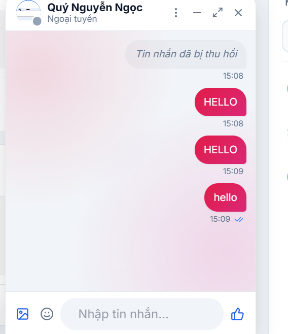
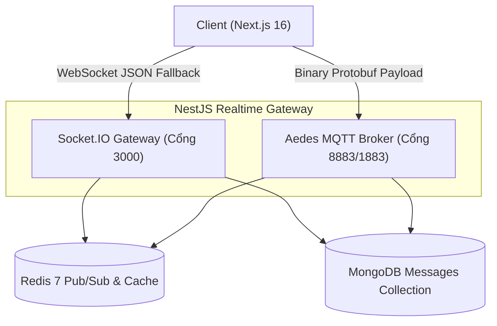

# 💬 TÍNH NĂNG NHẮN TIN THỜI GIAN THỰC & HỘP CHAT NỔI MESSENGER

> Tài liệu mô tả chi tiết giải pháp kỹ thuật, giao thức truyền tin đa tầng (Dual-Engine: Socket.IO + Binary MQTT/Protobuf) và trải nghiệm hộp chat nổi Facebook Messenger.

---

## 📑 MỤC LỤC
1. [Tổng Quan Trải Nghiệm Chat](#1-tổng-quan-trải-nghiệm-chat)
2. [Hình Ảnh Minh Họa Thực Tế](#2-hình-ảnh-minh-họa-thực-tế)
3. [Kiến Trúc Kỹ Thuật Đa Tầng (Dual-Engine)](#3-kiến-trúc-kỹ-thuật-đa-tầng-dual-engine)
4. [Giao Thức Nhị Phân Binary MQTT & Protobuf](#4-giao-thức-nhị-phân-binary-mqtt--protobuf)
5. [Các Tính Năng Bảo Mật & Quyền Riêng Tư](#5-các-tính-năng-bảo-mật--quyền-riêng-tư)
6. [Cơ Chế Chỉ Báo Đang Soạn Tin (Typing Indicator)](#6-cơ-chế-chỉ-báo-đang-soạn-tin-typing-indicator)

---

## 1. TỔNG QUAN TRẢI NGHIỆM CHAT

Hệ thống cung cấp trải nghiệm nhắn tin toàn diện, liền mạch trên mọi thiết bị (Desktop, Tablet, Mobile) với 3 hình thức sử dụng:
- **Cửa sổ chat nổi đa nhiệm (Floating Chat Dock):** Cho phép mở nhiều hộp thoại chat cùng lúc ở góc dưới bên phải màn hình. Người dùng có thể vừa lướt Bảng tin hay xem Trang cá nhân vừa trò chuyện mà không bị gián đoạn.
- **Menu tin nhắn nhanh (AppBar Dropdown):** Truy cập nhanh các tin nhắn gần đây, lọc hội thoại chưa đọc, tìm kiếm bạn bè và xem trước tin nhắn mới nhất trực tiếp trên thanh điều hướng.
- **Trang tin nhắn độc lập (`/chat`):** Giao diện tập trung toàn màn hình cho phép quản lý chi tiết danh sách hội thoại, tùy biến chủ đề, tìm kiếm nội dung và duyệt media.

---

## 2. HÌNH ẢNH MINH HỌA THỰC TẾ

### 2.1. Hộp thoại chat nổi đa nhiệm phong cách Facebook

*Giao diện hộp chat nổi với thanh điều khiển thu nhỏ/đóng, ảnh đại diện đối phương, ô nhập liệu thông minh và trạng thái tin nhắn tức thời.*

### 2.2. Chi tiết luồng trò chuyện & Chủ đề đa sắc màu

*Luồng tin nhắn trực quan với bong bóng chat bo góc công thái học, hiển thị thời gian thông minh và các nút thao tác nhanh.*

### 2.3. Menu thả xuống Danh sách tin nhắn trên Header

*Dropdown tin nhắn nhanh phong cách Facebook Messenger trên thanh Header với công cụ tìm kiếm và lọc hội thoại.*

---

## 3. KIẾN TRÚC KỸ THUẬT ĐA TẦNG (DUAL-ENGINE)

Nhằm tối ưu hóa băng thông mạng và đảm bảo độ tin cậy tuyệt đối ngay cả khi kết nối mạng yếu hoặc không ổn định, hệ thống triển khai kiến trúc truyền thông kép:



1. **Kênh Socket.IO (WebSockets chuẩn):** Đảm nhiệm các sự kiện quản lý kết nối, đồng bộ trạng thái đăng nhập, chuông thông báo và luồng REST API fallback.
2. **Kênh Binary MQTT/Protobuf:** Đảm nhiệm các tác vụ có tần suất phát sóng cao (High-frequency events) như truyền tải nội dung tin nhắn tức thì, cập nhật tọa độ bạn bè và nhịp tim soạn thảo văn bản.

---

## 4. GIAO THỨC NHỊ PHÂN BINARY MQTT & PROTOBUF

### 4.1. Lợi thế vượt trội so với JSON truyền thống
- **Tiết kiệm 75% - 80% dung lượng payload:** Thay vì truyền lặp đi lặp lại các chuỗi khóa như `"senderId"`, `"conversationId"`, Google Protocol Buffers mã hóa dữ liệu thành các trường nhị phân 1-2 byte.
- **Tốc độ tuần tự hóa siêu tốc:** Giải mã nhị phân trực tiếp trên bộ nhớ đệm `ArrayBuffer`/`Buffer` mà không cần phân tích cú pháp chuỗi JSON qua CPU.
- **Tiết kiệm pin thiết bị di động:** Gói tin Keep-Alive của giao thức MQTT chỉ vỏn vẹn 2 byte, giảm thiểu tiêu hao năng lượng và duy trì kết nối bền vững khi chạy trên mạng 3G/4G/5G.

### 4.2. Cấu trúc Message Protobuf (`chat.proto`)
```protobuf
syntax = "proto3";

package chat;

enum MessageType {
  TEXT = 0;
  IMAGE = 1;
  FILE = 2;
  SYSTEM = 3;
}

message ChatMessageProto {
  string messageId = 1;
  string conversationId = 2;
  string senderId = 3;
  string senderName = 4;
  string content = 5;
  int64 timestamp = 6;
  MessageType type = 7;
}

message TypingEventProto {
  string conversationId = 1;
  string userId = 2;
  string userName = 3;
  bool isTyping = 4;
  string receiverId = 5;
}
```

---

## 5. CÁC TÍNH NĂNG BẢO MẬT & QUYỀN RIÊNG TƯ

### 5.1. Thu hồi tin nhắn thời gian thực (Unsend / Delete Message)
- Người dùng có thể thu hồi tin nhắn đã gửi của chính mình bất kỳ lúc nào.
- Thao tác yêu cầu xác nhận qua `ConfirmDialog` nhằm tránh bấm nhầm.
- Phía backend cập nhật trường `isDeleted = true` trong cơ sở dữ liệu và phát sự kiện `message:deleted` tới toàn bộ người tham gia phòng chat để đồng bộ hiển thị nội dung *"Tin nhắn đã bị thu hồi"*.

### 5.2. Chế độ Hạn chế người dùng (Restrict Mode kiểu Facebook Messenger)
- Cho phép người dùng hạn chế một người khác mà đối phương **hoàn toàn không hay biết**.
- Khi đã bị hạn chế:
  - Trạng thái *"Đã xem"* của bạn sẽ không bao giờ được gửi tới người bị hạn chế dù bạn đã đọc tin nhắn của họ.
  - Ẩn hoàn toàn trạng thái Online/Offline của bạn đối với người đó.
  - Cuộc trò chuyện được tách riêng vào mục danh sách *"Bị hạn chế"* để giữ hộp thư chính luôn sạch sẽ.

### 5.3. Chặn & Bỏ chặn (Block / Unblock)
- Ngăn chặn triệt để hành vi gửi tin nhắn từ cả hai chiều.
- Hiển thị thanh cảnh báo trực quan trên đầu cuộc trò chuyện kèm nút "Bỏ chặn" thuận tiện khi cần kết nối lại.

### 5.4. Tùy biến Chủ đề & Hình nền hội thoại (Chat Themes)
Hỗ trợ 5 bảng màu chủ đề sống động:
1. **Mặc định:** Tông màu xanh thương hiệu hiện đại.
2. **Hẹn hò lãng mạn:** Sắc hồng tím ngọt ngào.
3. **Bầu trời trong xanh:** Gam màu lam dịu mát.
4. **Bóng đêm huyền bí:** Sắc xám đen ánh tím sang trọng.
5. **Biển cả tươi mát:** Sắc ngọc bích tràn đầy năng lượng.
*Tất cả chủ đề đều đồng bộ thời gian thực qua WebSocket, tự động áp dụng cho cả hai bên người dùng.*

---

## 6. CƠ CHẾ CHỈ BÁO ĐANG SOẠN TIN (TYPING INDICATOR)

Để giải quyết triệt để lỗi "đang gõ bị biến mất sau vài giây" phổ biến trong các ứng dụng chat, hệ thống áp dụng cơ chế 3 lớp:
1. **Heartbeat định kỳ 2.5s:** Trong lúc người dùng liên tục gõ phím, client gửi nhịp tim `isTyping = true` mỗi 2.5 giây một lần.
2. **Cửa sổ ngừng gõ 5.0s:** Khi người dùng dừng gõ đủ 5 giây, client mới gửi tín hiệu `isTyping = false`.
3. **Bộ đếm tự hủy an toàn 6.5s:** Nếu đối phương bị mất mạng đột ngột giữa chừng, bộ đếm tại client người nhận sẽ tự động tắt chỉ báo sau 6.5 giây mà không bị treo vĩnh viễn.

