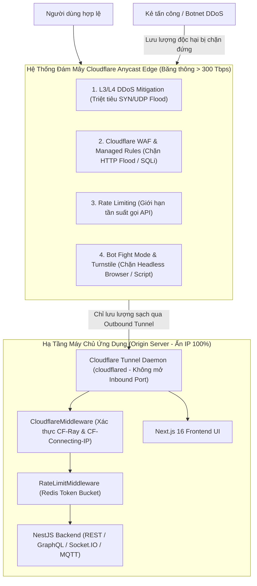

# 🛡️ HỆ THỐNG PHÒNG THỦ & CHỐNG TẤN CÔNG DDOS BẰNG CLOUDFLARE

> Tài liệu hướng dẫn thiết lập toàn diện giải pháp bảo mật, phòng vệ đa tầng và chống tấn công từ chối dịch vụ phân tán (DDoS - Distributed Denial of Service) sử dụng Cloudflare kết hợp Cloudflare Tunnel và NestJS Application Firewall.

---

## 📑 MỤC LỤC
1. [Tổng Quan Nguy Cơ DDoS & Kiến Trúc Phòng Vệ](#1-tổng-quan-nguy-cơ-ddos--kiến-trúc-phòng-vệ)
2. [Sơ Đồ Luồng Truy Cập & Triệt Tiêu Tấn Công](#2-sơ-đồ-luồng-truy-cập--triệt-tiêu-tấn-công)
3. [Mô Hình Phòng Thủ Đa Tầng (5-Layer Defense)](#3-mô-hình-phòng-thủ-đa-tầng-5-layer-defense)
4. [Hướng Dẫn Thiết Lập Từng Bước Trên Cloudflare](#4-hướng-dẫn-thiết-lập-từng-bước-trên-cloudflare)
5. [Ẩn 100% IP Máy Chủ Gốc Bằng Cloudflare Tunnel (`cloudflared`)](#5-ẩn-100-ip-máy-chủ-gốc-bằng-cloudflare-tunnel-cloudflared)
6. [Phục Hồi Real IP & Chống Bypass Origin Phía Backend](#6-phục-hồi-real-ip--chống-bypass-origin-phía-backend)
7. [Bảo Vệ WebSockets & MQTT Realtime Qua Cloudflare Edge](#7-bảo-vệ-websockets--mqtt-realtime-qua-cloudflare-edge)
8. [Quy Trình Xử Lý Khẩn Cấp Khi Đang Bị Tấn Công Dồn Dập](#8-quy-trình-xử-lý-khẩn-cấp-khi-đang-bị-tấn-công-dồn-dập)

---

## 1. TỔNG QUAN NGUY CƠ DDOS & KIẾN TRÚC PHÒNG VỆ

Các ứng dụng mạng xã hội và chat thời gian thực thường xuyên đối mặt với 3 loại hình tấn công từ chối dịch vụ:
- **Tấn công tầng mạng L3/L4 (Volumetric Attacks):** SYN Flood, UDP Amplification, ICMP Flood nhằm làm nghẽn băng thông đường truyền hoặc tràn bảng trạng thái kết nối firewall máy chủ.
- **Tấn công tầng ứng dụng L7 (HTTP/HTTPS Floods):** Gửi hàng triệu request liên tục vào các endpoint nặng như tìm kiếm bạn bè đồ thị Neo4j, kiểm duyệt AI hoặc đăng nhập nhằm tiêu hao 100% CPU/RAM.
- **Tấn công cạn kiệt tài nguyên kết nối (Slowloris / WebSocket Exhaustion):** Mở hàng chục nghìn kết nối WebSocket hoặc MQTT giữ trạng thái dở dang nhằm đánh sập máy chủ realtime.

---

## 2. SƠ ĐỒ LUỒNG TRUY CẬP & TRIỆT TIÊU TẤN CÔNG



---

## 3. MÔ HÌNH PHÒNG THỦ ĐA TẦNG (5-LAYER DEFENSE)

| Tầng | Cơ chế bảo vệ | Vai trò |
|---|---|---|
| **Tầng 1** | **Cloudflare Anycast DDoS Mitigation (L3/L4)** | Hấp thụ và phân tán hàng trăm Gbps tấn công lưu lượng lớn trên toàn cầu trước khi đến máy chủ. |
| **Tầng 2** | **Cloudflare WAF & HTTP DDoS Rulesets (L7)** | Tự động phát hiện và chặn các đợt bùng nổ HTTP request bất thường, Slowloris và botnet. |
| **Tầng 3** | **Cloudflare Turnstile & Bot Fight Mode** | Xác minh người thật trong nền, chặn hoàn toàn các script tự động dò mật khẩu brute-force. |
| **Tầng 4** | **Cloudflare Tunnel (`cloudflared`)** | Đóng hoàn toàn mọi cổng Inbound trên Firewall/Router; kẻ tấn công không thể tìm ra IP thật để tấn công trực tiếp. |
| **Tầng 5** | **Application Rate Limiting & Origin Shield** | Kiểm tra `cf-connecting-ip` chuẩn hóa và giới hạn tần suất request bằng Redis; chặn truy cập nếu phát hiện kết nối lậu không qua Cloudflare. |

---

## 4. HƯỚNG DẪN THIẾT LẬP TỪNG BƯỚC TRÊN CLOUDFLARE

### 4.1. Bước 1: Trỏ DNS & Bật chế độ Proxy (Đám mây cam ☁️)
Trên trang quản trị DNS của Cloudflare:
- Tạo bản ghi `A` hoặc `CNAME`:
  - `chat.yourdomain.com` -> Trỏ về máy chủ
  - `api.yourdomain.com` -> Trỏ về máy chủ
  - `mqtt.yourdomain.com` -> Trỏ về máy chủ
- **Bắt buộc:** Bật trạng thái **Proxy status = Proxied (Đám mây màu cam ☁️)**. Nếu để *DNS only (Đám mây xám)*, lưu lượng sẽ đi thẳng vào máy chủ và mất hoàn toàn khả năng chống DDoS.

### 4.2. Bước 2: Kích hoạt Web Application Firewall (WAF)
1. Truy cập **Security -> WAF -> Managed rules**:
   - Bật **Cloudflare Managed Ruleset** (Bộ quy tắc chuẩn của Cloudflare).
   - Đặt hành động: `Block` đối với các mối nguy hiểm mức độ cao.
2. Truy cập **Security -> Bots**:
   - Bật **Bot Fight Mode** để tự động đặt thử thách Managed Challenge cho các crawler xấu.

### 4.3. Bước 3: Cấu hình Rate Limiting Rules trên Cloudflare
Truy cập **Security -> WAF -> Rate limiting rules**, bấm **Create rule**:
- **Bảo vệ API Đăng nhập / Đăng ký:**
  - *If incoming requests match:* `(http.request.uri.path in {"/auth/login" "/auth/register" "/auth/otp/send"})`
  - *Rate:* Khi 1 IP gửi vượt quá `15 requests` trong `1 phút`.
  - *Action:* `Block` hoặc `Managed Challenge` trong thời gian `10 phút`.
- **Bảo vệ Endpoint Upload tệp nặng:**
  - *If incoming requests match:* `(http.request.uri.path contains "/upload")`
  - *Rate:* Khi vượt quá `30 requests` trong `1 phút`.
  - *Action:* `Managed Challenge`.

---

## 5. ẨN 100% IP MÁY CHỦ GỐC BẰNG CLOUDFLARE TUNNEL (`cloudflared`)

### 5.1. Vấn đề của cách mở port truyền thống
Nếu bạn dùng NAT / Port Forwarding (mở port 80, 443, 3000 trên modem/router):
- Kẻ tấn công có thể quét dải IP công cộng của nhà mạng (Shodan, Censys, nmap) để tìm ra IP thực của bạn.
- Sau đó chúng tấn công trực tiếp vào IP đó mà không hề đi qua Cloudflare, khiến toàn bộ WAF của Cloudflare bị vô hiệu hóa (*Bypass Attack*).

### 5.2. Giải pháp Cloudflare Tunnel
Với **Cloudflare Tunnel**, máy chủ của bạn không cần mở bất kỳ cổng nào từ ngoài vào. `cloudflared` sẽ chủ động mở một kết nối TLS ra ngoài (Outbound) tới cụm server gần nhất của Cloudflare:

1. **Khởi chạy qua Docker Compose:**
   Dự án đã tích hợp sẵn tệp cấu hình [`docker-compose.tunnel.yml`](file:///d:/Web/chat/docker-compose.tunnel.yml):
   ```bash
   # Thiết lập Token nhận được từ Cloudflare Zero Trust Dashboard
   export CLOUDFLARE_TUNNEL_TOKEN="eyJhIjoi..."

   # Khởi chạy daemon bảo vệ
   docker compose -f docker-compose.tunnel.yml up -d
   ```

2. **Cấu hình Ingress Rules:**
   Được định nghĩa tại [`config/cloudflared/config.yml`](file:///d:/Web/chat/config/cloudflared/config.yml) để định tuyến sạch:
   - `chat.yourdomain.com` -> `http://localhost:5173` (Next.js)
   - `api.yourdomain.com` -> `http://localhost:3000` (NestJS)
   - `mqtt.yourdomain.com` -> `https://localhost:8884` (MQTT WSS)

---

## 6. PHỤC HỒI REAL IP & CHỐNG BYPASS ORIGIN PHÍA BACKEND

### 6.1. Trích xuất chính xác IP thật với `getClientIp()`
Khi đứng sau Cloudflare Proxy, mọi kết nối TCP đến máy chủ đều mang địa chỉ IP của Cloudflare Edge. Nếu máy chủ dùng trực tiếp `req.ip`, hệ thống Rate Limit và AI Moderation sẽ nhìn thấy toàn bộ người dùng có cùng một IP và có thể chặn nhầm!

Dự án sử dụng tiện ích [`client-ip.util.ts`](file:///d:/Web/chat/backend/src/common/utils/client-ip.util.ts):
```typescript
// Ưu tiên cao nhất cho header chuẩn của Cloudflare
const cfIp = req.headers['cf-connecting-ip'];
```

### 6.2. Chặn đứng kết nối trực tiếp vào máy chủ gốc với `CLOUDFLARE_PROXY_ONLY=true`
Middleware [`CloudflareMiddleware`](file:///d:/Web/chat/backend/src/common/middlewares/cloudflare.middleware.ts) được kích hoạt toàn cục:
- Khi bật cờ `CLOUDFLARE_PROXY_ONLY=true` trong `.env` trên môi trường Production, bất kỳ kết nối nào cố tình gửi thẳng vào máy chủ mà không có chữ ký xác thực `cf-ray` và `cf-connecting-ip` hợp lệ từ Cloudflare sẽ bị máy chủ trả mã **403 Forbidden** ngay lập tức.

---

## 7. BẢO VỆ WEBSOCKETS & MQTT REALTIME QUA CLOUDFLARE EDGE

Cloudflare hỗ trợ WebSockets mặc định trên các cổng tiêu chuẩn:
- Cổng HTTP: `80, 8080, 8880, 2052, 2082, 2086, 2095`
- Cổng HTTPS: `443, 2053, 2083, 2087, 2096, 8443`

Để bảo vệ kết nối WSS của MQTT và Socket.IO:
1. Đảm bảo tính năng **WebSockets** đã được BẬT trên Cloudflare Dashboard (**Network -> WebSockets: ON**).
2. Định tuyến tên miền phụ `mqtt.yourdomain.com` qua Cloudflare Tunnel trỏ về cổng nội bộ `8884` của máy chủ.
3. Toàn bộ gói tin nhị phân Protobuf và tin nhắn tức thời được Cloudflare bảo vệ chống tràn socket và ngập lụt băng thông.

---

## 8. QUY TRÌNH XỬ LÝ KHẨN CẤP KHI ĐANG BỊ TẤN CÔNG DỒN DẬP

Khi phát hiện lượng truy cập tăng đột biến bất thường, CPU máy chủ chạm ngưỡng 100%:

1. **Bật chế độ "Under Attack Mode" ngay lập tức:**
   - Trên Cloudflare Dashboard: Truy cập trang chủ domain -> Bật nút chuyển đổi **Under Attack Mode**.
   - Cloudflare sẽ tự động hiển thị màn hình kiểm tra (JavaScript Challenge) 5 giây cho mọi khách truy cập, lọc sạch 100% botnet trước khi yêu cầu chạm vào máy chủ.
2. **Kích hoạt quy tắc chặn địa lý (Geographic Blocking):**
   - Nếu hệ thống chủ yếu phục vụ người dùng Việt Nam: Vào **Security -> WAF -> Custom rules**, tạo quy tắc:
     - `If IP Country is NOT Vietnam (VN) -> Action: Managed Challenge`.
3. **Theo dõi thời gian thực:**
   - Truy cập **Security -> Analytics & Logs** trên Cloudflare để xem biểu đồ lưu lượng đã chặn, địa chỉ IP nguồn và kiểu tấn công.
