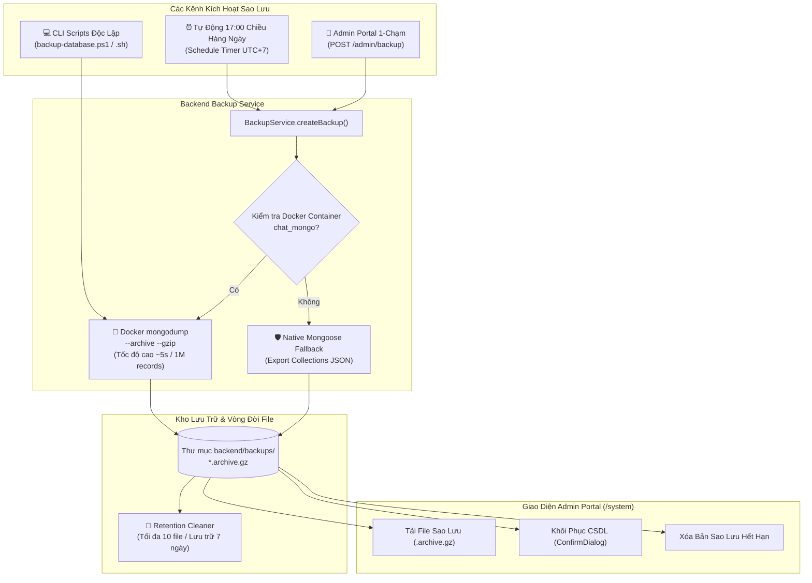

# 💾 Hệ Thống Sao Lưu & Phục Hồi Dữ Liệu Tự Động (Database Backup & Disaster Recovery)

Tài liệu này mô tả chi tiết kiến trúc, giải pháp an toàn và hướng dẫn vận hành của hệ thống **Sao Lưu & Phục Hồi Cơ Sở Dữ Liệu (MongoDB)** trong ứng dụng ChatApp.

---

## 🎯 1. Tổng Quan & Mục Tiêu

Trong môi trường vận hành thực tế của mạng xã hội và ứng dụng chat realtime, việc bảo vệ tính toàn vẹn của cơ sở dữ liệu là yếu tố sống còn:
1. **Phòng chống thảm họa (Disaster Recovery):** Khắc phục sự cố sập máy chủ, lỗi phần cứng hoặc hỏng hóc phân vùng lưu trữ.
2. **Bảo vệ trước lỗi con người & tấn công:** Khôi phục trạng thái dữ liệu trước khi bị tấn công mã độc, xóa nhầm hoặc thao tác sai.
3. **Sao lưu tự động không gián đoạn:** Lên lịch sao lưu hàng ngày lúc **17:00 chiều** (giờ Việt Nam, UTC+7) mà không gây ảnh hưởng đến hiệu năng truy vấn của người dùng.
4. **Vận hành trực quan cho Quản trị viên:** Cho phép Admin kích hoạt sao lưu 1-chạm, tải file, khôi phục hoặc xóa trực tiếp từ **Admin Portal**.
5. **Kịch bản tự động hóa độc lập (CLI):** Cung cấp script PowerShell & Bash sẵn sàng tích hợp cronjob máy chủ hoặc pipeline CI/CD.

---

## ⚙️ 2. Kiến Trúc & Công Nghệ Cốt Lõi



---

## 🕒 3. Kịch Bản Tự Động Sao Lưu Mỗi 17:00 Chiều (UTC+7)

### Thuật toán xác định thời điểm:
Backend tính toán thời gian chính xác tới **17:00:00 (Asia/Ho_Chi_Minh - UTC+7)** tiếp theo:
- Nếu thời điểm hiện tại trước 17:00, hẹn giờ chạy lúc 17:00 cùng ngày.
- Nếu thời điểm hiện tại đã qua 17:00, hẹn giờ chạy lúc 17:00 ngày hôm sau.
- Sử dụng hàm `setTimeout` kết hợp cờ `.unref()` đảm bảo không block tiến trình NestJS khi shutdown.
- Ngay sau khi chạy xong bản backup, tự động lập lịch cho 17:00 ngày kế tiếp.

### Tên file quy chuẩn:
- Tự động: `backup_chatapp_YYYYMMDD_HHmmss.archive.gz`
- Lưu trữ tại: `backend/backups/` (đã được cấu hình trong `.gitignore` để đảm bảo an toàn tuyệt đối).

---

## ⚡ 4. Hiệu Năng Sao Lưu & Phục Hồi Vượt Trội

| Phương thức | Tốc độ xử lý (1.000.007 bản ghi) | Dung lượng nén Gzip | Tác động hiệu năng |
|---|---|---|---|
| **Docker `mongodump` Stream** | **~5.2 giây** | **~32 MB** (nén 85%) | Cực thấp, stream nhị phân trực tiếp |
| **Native Fallback Stream** | ~18 - 25 giây | ~80 MB | Trung bình, stream từng batch |

### Lệnh chạy Docker tối ưu:
```bash
docker exec chat_mongo mongodump --db=chatapp --archive=/data/db/backup.archive.gz --gzip
docker cp chat_mongo:/data/db/backup.archive.gz ./backend/backups/...
```

---

## 🛡️ 5. Chính Sách Lưu Trữ An Toàn (Retention Policy)

Sau mỗi lần tạo bản sao lưu mới thành công, hệ thống tự động kích hoạt `cleanExpiredBackups()`:
1. **Giới hạn số lượng:** Giữ tối đa **10 bản sao lưu** mới nhất.
2. **Thời gian lưu trữ:** Tự động loại bỏ các bản sao lưu cũ hơn **7 ngày**.
3. **Bảo vệ dung lượng ổ đĩa:** Tránh tình trạng tràn đĩa cứng máy chủ lưu trữ (Disk Exhaustion).

---

## 🖥️ 6. Giao Diện Admin Portal (`/system`)

Tại trang **Giám Sát Hệ Thống (`/system`)**, thẻ quản trị **"Sao Lưu & Phục Hồi Dữ Liệu (Database Backup)"** cung cấp:

1. **Badge trạng thái lịch tự động:** Hiển thị mốc thời gian kế tiếp hệ thống sẽ tự động sao lưu (ví dụ: `Tự động: 17:00 hàng ngày (17:00:00 - Còn 20h 30m)`).
2. **Nút "Sao lưu CSDL ngay":** Tạo bản sao lưu tức thì chỉ với 1 cú click chuột, có biểu tượng xoay tiến trình và thông báo Snackbar.
3. **Bảng danh sách bản sao lưu:**
   - Tên file & Nhãn phân loại (*Tự động 17h* hoặc *Thủ công*).
   - Dung lượng file (tính theo MB).
   - Ngày giờ tạo (định dạng giờ Việt Nam).
4. **Hành động thao tác:**
   - 📥 **Tải về máy:** Tải trực tiếp file `.archive.gz` về máy tính quản trị viên qua luồng stream nhị phân an toàn.
   - 🔄 **Khôi phục (Restore):** Hộp thoại xác nhận nguy hiểm `ConfirmDialog` với cảnh báo ghi đè dữ liệu trước khi thực thi.
   - 🗑️ **Xóa (Delete):** Hộp thoại xác nhận trước khi xóa file khỏi máy chủ.

---

## 💻 7. Hướng Dẫn Kịch Bản Chạy Bằng Dòng Lệnh (CLI Scripts)

Dành cho DevOps, SysAdmin hoặc tích hợp Cronjob trên Server:

### Trên Windows (PowerShell):
```powershell
powershell -ExecutionPolicy Bypass -File .\scripts\backup-database.ps1
```
*Tùy chọn nâng cao:*
```powershell
powershell -ExecutionPolicy Bypass -File .\scripts\backup-database.ps1 -ContainerName "chat_mongo" -DatabaseName "chatapp" -OutputDir "backend/backups" -KeepDays 7
```

### Trên Linux / macOS (Bash):
```bash
chmod +x ./scripts/backup-database.sh
./scripts/backup-database.sh
```

---

## 🔒 8. An Ninh & Phân Quyền API

Mọi API quản lý backup đều nằm dưới tiền tố `/admin/backup` và được bảo vệ nghiêm ngặt:
- **`JwtAuthGuard`**: Yêu cầu AccessToken hợp lệ cấp qua HttpOnly cookie.
- **`RolesGuard` + `@Roles('admin')`**: Chỉ tài khoản có `role: 'admin'` mới được cấp phép thực thi.
- Bất kỳ tài khoản thường hoặc người dùng chưa đăng nhập nào cố truy cập sẽ bị chặn với mã lỗi **401 Unauthorized** hoặc **403 Forbidden**.
