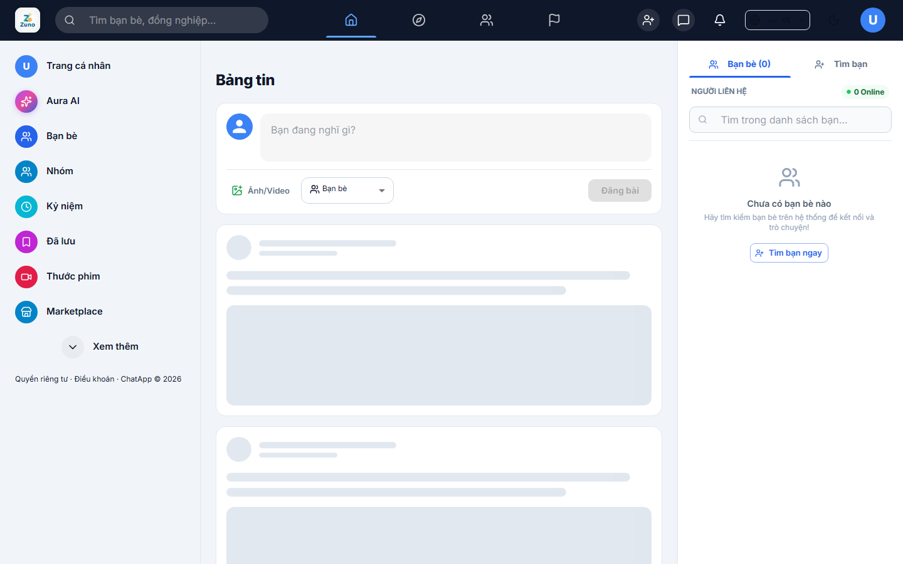

# 🐳 Triển khai Toàn bộ Hệ thống ChatApp với Docker Containers

Tài liệu này hướng dẫn chi tiết quy trình containerization (đóng gói Docker) toàn bộ các dịch vụ của ChatApp bao gồm **Frontend** (Next.js 16 App Router), **Backend** (NestJS + Socket.IO + Socket.IO Gateway), **Admin Portal** (React SPA + Nginx) và hạ tầng lưu trữ (**MongoDB**, **Redis**, **Neo4j**).

---

## 1. Tổng quan Kiến trúc Containers

Hệ sinh thái ChatApp được tổ chức theo kiến trúc micro-service liên kết qua mạng nội bộ Docker bridge (`chat_network`):

```
                                  [Trình duyệt Người dùng / Khách]
                                                │
                 ┌──────────────────────────────┼──────────────────────────────┐
                 │ (Cổng 5173)                  │ (Cổng 3000)                  │ (Cổng 5174)
                 ▼                              ▼                              ▼
      ┌─────────────────────┐        ┌─────────────────────┐        ┌─────────────────────┐
      │    chat_frontend    │        │    chat_backend     │        │     chat_admin      │
      │  Next.js 16 (Node)  │───────▶│    NestJS + Socket.IO    │◀───────│    React + Nginx    │
      └─────────────────────┘        └──────────┬──────────┘        └─────────────────────┘
                                                │
                 ┌──────────────────────────────┼──────────────────────────────┐
                 ▼                              ▼                              ▼
      ┌─────────────────────┐        ┌─────────────────────┐        ┌─────────────────────┐
      │     chat_mongo      │        │     chat_redis      │        │     chat_neo4j      │
      │    MongoDB 7.x      │        │     Redis Cache     │        │    Graph Database   │
      └─────────────────────┘        └─────────────────────┘        └─────────────────────┘
```

---

## 2. Danh sách Tệp Cấu hình Docker

1. **`.dockerignore` (Toàn cục & Từng module)**:
   - `/.dockerignore`: Loại bỏ `.git`, `node_modules`, `dist`, `.next`, cache, logs khỏi build context.
   - `backend/.dockerignore`: Bỏ `dist`, `test`, `coverage`, `.env*`.
   - `frontend/.dockerignore`: Bỏ `.next`, `out`, `.env.local`, `.vercel`.
   - `admin/.dockerignore`: Bỏ `dist`, `.env.local`.

2. **`backend/Dockerfile`**:
   - Multi-stage build (Node 22 Alpine).
   - Biên dịch native dependencies (`python3`, `make`, `g++`) cho `bcrypt`.
   - Tách riêng `prod-deps` giúp tối ưu dung lượng image.
   - Chạy với người dùng không đặc quyền `node` và process supervisor `dumb-init`.
   - Volume đính kèm `/app/uploads` cho bài viết và avatar.

3. **`frontend/Dockerfile`**:
   - Multi-stage build (Node 22 Alpine).
   - Truyền biến môi trường build-time `NEXT_PUBLIC_BACKEND_URL`.
   - Biên dịch Next.js production build (`npm run build`).
   - Khởi chạy server Next.js độc lập trên cổng `5173`.

4. **`admin/Dockerfile` & `admin/nginx.conf`**:
   - Multi-stage build: Giai đoạn 1 build Vite TypeScript SPA; Giai đoạn 2 phục vụ tĩnh qua Nginx Alpine nhẹ (~30MB).
   - Cấu hình Nginx fallback `try_files $uri /index.html;` hỗ trợ React Router SPA định tuyến mượt mà.

5. **`docker-compose.yml`**:
   - Tích hợp 6 dịch vụ chính: `redis`, `mongo`, `neo4j`, `backend`, `frontend`, `admin`.
   - Thiết lập health checks, volumes phân vùng dữ liệu và network `chat_network`.

---

## 3. Hướng dẫn Khởi chạy Nhanh

### 3.1. Khởi động nhanh bằng Script tự động
```powershell
# Khởi động toàn bộ Databases + Backend + Frontend + Admin
powershell -File .\scripts\ensure-docker.ps1 -All

# Hoặc chỉ khởi động cụm CSDL (MongoDB, Redis, Neo4j) khi muốn dev local
powershell -File .\scripts\ensure-docker.ps1
```

### 3.2. Khởi động bằng Docker Compose chuẩn
```bash
# Build tất cả các image
docker compose build

# Khởi chạy ngầm toàn bộ dịch vụ
docker compose up -d

# Xem trạng thái các container
docker compose ps

# Theo dõi logs thời gian thực của backend và frontend
docker compose logs -f backend frontend
```

---

## 4. Bảng Tra cứu Cổng Dịch vụ (Port Mapping)

| Dịch vụ | Container Name | Cổng Host | Cổng Container | Ghi chú |
|---|---|---|---|---|
| **Frontend** | `chat_frontend` | `5173` | `5173` | Ứng dụng mạng xã hội & chat |
| **Backend** | `chat_backend` | `3000` | `3000` | NestJS REST API, Socket.IO, Swagger docs |
| **Admin** | `chat_admin` | `5174` | `5174` | Cổng quản trị hệ thống |
| **MongoDB** | `chat_mongo` | `27017` | `27017` | Cơ sở dữ liệu chính |
| **Redis** | `chat_redis` | `6379` | `6379` | Cache, PubSub, Rate limiter |
| **Neo4j** | `chat_neo4j` | `7474`, `7687` | `7474`, `7687` | Graph Social Network & RAG Knowledge |

---

## 5. Hình ảnh Minh chứng Giao diện Containerized



