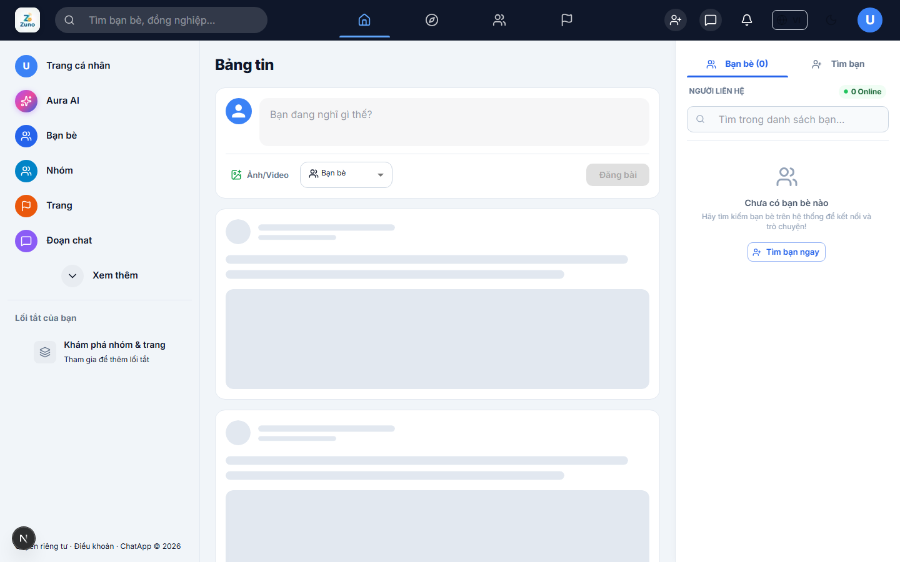
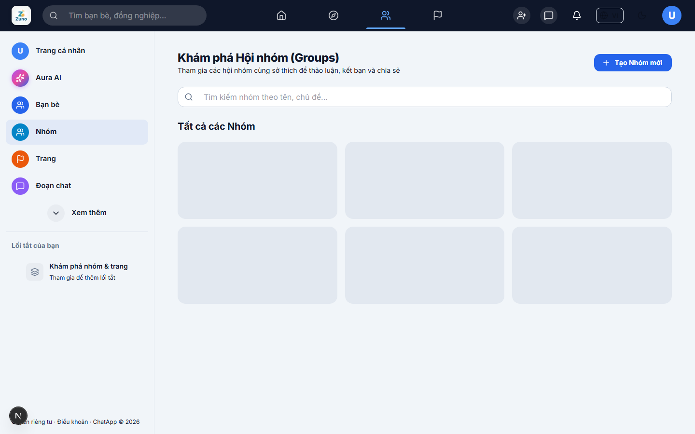

# Giao diện Cột Điều Hướng Trái Chuẩn Facebook & Tối Ưu Header (Facebook-Style Left Sidebar & Header)

## 1. Tổng quan
Tính năng cập nhật cấu trúc điều hướng toàn diện cho ChatApp theo chuẩn giao diện mạng xã hội Facebook trên Desktop (`md` trở lên) và Mobile:
- **Cột điều hướng trái cố định (`LeftSidebar`):** Thay vì dồn ép tất cả các nút dạng chữ lên thanh tiêu đề trên cùng gây vỡ giao diện và tràn màn hình, hệ thống bố trí cột trái chuyên biệt hiển thị chuẩn 100% theo giao diện Facebook:
  - Thông tin tài khoản người dùng (Avatar + Họ tên).
  - Lối tắt Aura AI (kết nối nhanh với trợ lý ảo AI qua icon gradient).
  - Bạn bè (`/explore`), Nhóm (`/groups`).
  - Kỷ niệm (`/profile`), Đã lưu (`/profile`), Thước phim (`/explore`), Marketplace (`/explore`).
  - Danh mục mở rộng (`Xem thêm / Thu gọn`): Trang (`/pages`), Đoạn chat (`/chat`), Bảng feed (`/`), Sự kiện (`/groups`).
  - **Lối tắt của bạn:** Tự động lấy danh sách Hội nhóm đã tham gia, Fanpage đang theo dõi và các nhóm cộng đồng nổi bật trong hệ thống (ASP.NET Core Việt Nam, AI Việt Nam, Grab Việt Nam VN, Cộng đồng CNTT, HUIT Confessions, Thiết kế Website) với avatar đại diện bo góc 8px, liên kết trực tiếp.
  - Thông tin bản quyền, điều khoản dịch vụ và chính sách bảo mật.
- **Thanh Header Facebook-style gọn gàng:**
  - **Khu vực trung tâm:** Chuyển đổi thành các tab biểu tượng (Trang chủ, Khám phá, Nhóm, Trang) với chỉ báo gạch chân xanh dương khi active, hoàn toàn không bị tràn nút chữ.
  - **Khu vực bên phải:** Bố trí nút Lời mời kết bạn (kèm số lượng badge), nút Messenger / Đoạn chat (kèm popover danh sách trò chuyện gần đây), Chuông thông báo, Đổi ngôn ngữ (VI/EN), Chế độ sáng/tối và Menu tài khoản người dùng.
- **Khắc phục triệt để lỗi che nội dung & layout đồng bộ:**
  - Đặt khoảng đệm trên `pt: "64px"` / `pt: "76px"` chuẩn cho tất cả các trang (`/groups`, `/pages`, `/groups/[slug]`, `/pages/[slug]`, `/`) để tiêu đề và ảnh bìa không bao giờ bị AppBar cố định che khuất.
  - Đưa `LeftSidebar` vào cả trang chi tiết nhóm (`GroupFeed`) và chi tiết trang (`PageProfile`) để trải nghiệm người dùng luôn liền mạch, không bị mất cột điều hướng khi click vào các lối tắt.
- **Đồng bộ hóa dữ liệu ban đầu (Seed Data):**
  - Tự động khởi tạo dữ liệu mẫu phong phú cho Hội nhóm và Fanpage ngay khi hệ thống khởi động để trang `/groups`, `/pages` và danh sách "Lối tắt của bạn" luôn có dữ liệu sống động, không bị trống trải.

## 2. Hình ảnh minh họa

*Hình 1: Cột điều hướng bên trái chuẩn Facebook cùng thanh điều hướng trung tâm dạng icon tabs trên desktop.*

*Hình 2: Trang Khám phá Hội nhóm (/groups) với cột bên trái và tiêu đề không bị che lấp.*

## 3. Kiến trúc kỹ thuật
- `frontend/src/components/layout/LeftSidebar.tsx`: Component sidebar chuẩn Facebook, responsive ẩn trên mobile và hiển thị trên desktop (`md:` 280px, `lg:` 320px, `xl:` 350px).
- `frontend/src/components/layout/AppBar.tsx`: Tách biệt `desktopTabs` dạng icon tabs và `drawerPages` cho mobile drawer, đưa Friend requests và Messenger ra cụm thao tác nhanh bên phải.
- `frontend/src/components/groups/GroupFeed.tsx` & `frontend/src/components/pages/PageProfile.tsx`: Tích hợp `LeftSidebar` cho trang chi tiết hội nhóm và fanpage.
- `backend/src/modules/community-groups/community-groups.service.ts` & `backend/src/modules/pages/pages.service.ts`: Bổ sung `onModuleInit` tự động seed các hội nhóm và fanpage mẫu phổ biến.

