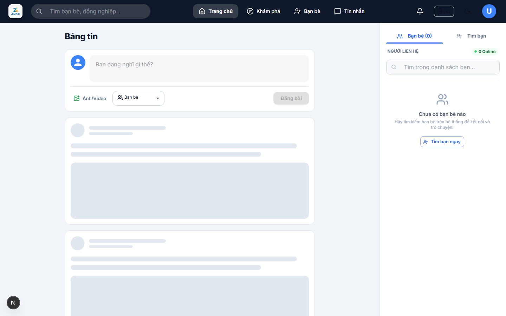

# Hệ thống Cảm xúc Facebook (Reactions) & Tích hợp Emoji Picker

Hệ thống biểu cảm và cảm xúc tương tác đa chiều chuẩn phong cách Facebook (Like, Love, Care, Haha, Wow, Sad, Angry) được tích hợp toàn diện trên toàn bộ ứng dụng ChatApp, bao gồm **Bài viết (Posts)**, **Bình luận (Comments)** và **Tin nhắn trực tuyến (Chat Messages)**, kết hợp cùng thư viện `emoji-picker-react` chuyên nghiệp.

---

## 1. Bộ 7 Cảm xúc Chuẩn Facebook (Facebook Reactions Set)

Hệ thống hỗ trợ đầy đủ 7 trạng thái cảm xúc:

| Mã (Type) | Biểu tượng | Nhãn tiếng Việt | Nhãn tiếng Anh | Màu chủ đạo (Design Token) |
|---|:---:|---|---|---|
| `like` | 👍 | Thích | Like | `primary.main` |
| `love` | ❤️ | Yêu thích | Love | `error.main` |
| `care` | 🥰 | Thương thương | Care | `warning.main` |
| `haha` | 😆 | Haha | Haha | `warning.main` |
| `wow` | 😮 | Wow | Wow | `warning.main` |
| `sad` | 😢 | Buồn | Sad | `warning.main` |
| `angry` | 😡 | Phẫn nộ | Angry | `error.dark` |

---

## 2. Tính năng & Trải nghiệm Người dùng (UX Features)

### 2.1. Cầu nối Di chuột Liền mạch (Invisible Hover Bridge & Grace Period)
- Khắc phục triệt để hiện tượng mất thanh chọn cảm xúc khi di chuyển chuột từ nút "Thích" lên popover:
  - Sử dụng cầu nối vô hình (`pb: 10px` / `pt: 8px`) nối liền giữa nút bấm và popover cảm xúc, loại bỏ hoàn toàn khoảng trống (gap) gây kích hoạt sự kiện `mouseLeave` sớm.
  - Tích hợp bộ đệm thời gian rời chuột (*close grace period* 320ms) giúp trải nghiệm lướt chuột mượt mà, không bị giật hay biến mất đột ngột.
  - Thời gian mở hover nhạy bén (160ms) với hiệu ứng nảy nhẹ (`cubic-bezier`).

### 2.2. Bài viết (Posts)
- **Thanh chọn cảm xúc (Reaction Picker)**: Xuất hiện nổi bật khi di chuột qua nút "Thích" (hoặc chạm giữ trên di động).
- **Thao tác 1 chạm (Quick Click)**: Bấm trực tiếp vào nút để thích nhanh (Like) hoặc hủy cảm xúc hiện tại.
- **Thống kê cảm xúc đa tầng (Reaction Summary)**: Hiển thị các icon cảm xúc nhiều nhất xếp chồng lên nhau kèm tổng số lượng lượt thả, tooltip chi tiết từng loại cảm xúc.

### 2.3. Bình luận (Comments)
- Từng bình luận hiển thị nút "Thích" dạng inline, hỗ trợ hover mở bộ 7 cảm xúc Facebook.
- Huy hiệu cảm xúc nhỏ gọn đính kèm góc bình luận khi có tương tác.

### 2.4. Tin nhắn Trò chuyện (Chat Messages & Floating Chat)
- Người dùng có thể thả cảm xúc trực tiếp vào từng tin nhắn (cả tin của mình và bạn bè).
- Huy hiệu cảm xúc (Reaction Badges) hiển thị phong cách Messenger ngay dưới góc bong bóng tin nhắn.
- Đồng bộ tức thời qua **Socket.IO** (`message:reaction`): cả hai phía nhìn thấy cảm xúc nhảy lên ngay lập tức mà không cần tải lại trang.

### 2.5. Thư viện Emoji Picker Chuyên nghiệp (`emoji-picker-react`)
- Tích hợp vào ô soạn tin nhắn (`MessageComposer`) và khung chat thu nhỏ (`FloatingChatBox`).
- Tự động đồng bộ theo giao diện Sáng / Tối (Light / Dark Theme) của người dùng.
- Tìm kiếm emoji theo từ khóa, phân nhóm danh mục trực quan và hỗ trợ lazy-load tối ưu hiệu năng.

---

## 3. Kiến trúc Kỹ thuật (Technical Architecture)

### Backend (NestJS & MongoDB)
- **Schema `PostLike`**: Mở rộng trường `type` với enum 7 cảm xúc (`like`, `love`, `care`, `haha`, `wow`, `sad`, `angry`).
- **Schema `Post` & `PostComment`**: Bổ sung bộ đếm `reactionsCount` và subdocument `reactions` cho bình luận.
- **Schema `Message`**: Thêm mảng `reactions: [{ userId, type, createdAt }]`.
- **API Endpoints**:
  - `POST /posts/:postId/like` (nhận body `{ type }`)
  - `POST /posts/:postId/comments/:commentId/reaction` (nhận body `{ type }`)
  - `POST /chat/messages/:id/reaction` (nhận body `{ type }`)
- **WebSocket Gateway**: Event `@SubscribeMessage('message:reaction')` phát broadcast tới các phòng chat cá nhân của người gửi và người nhận.

### Frontend (Next.js & MUI v9)
- `frontend/src/components/reactions/reactionConstants.ts`: Khai báo hằng số cảm xúc và màu sắc token.
- `frontend/src/components/reactions/ReactionPicker.tsx`: Thanh cảm xúc nổi chuẩn phong cách Facebook.
- `frontend/src/components/reactions/ReactionSummary.tsx`: Hiển thị các icon cảm xúc xếp chồng và tổng số lượng.
- `frontend/src/components/reactions/PostReactionButton.tsx`: Nút cảm xúc tích hợp cầu nối hover bridge cho bài viết.
- `frontend/src/components/reactions/InlineReactionButton.tsx`: Nút cảm xúc thu gọn cho bình luận và tin nhắn.
- `frontend/src/components/chat/MessageReactionsDisplay.tsx`: Huy hiệu cảm xúc tin nhắn kiểu Facebook Messenger.
- `frontend/src/components/common/AppEmojiPicker.tsx`: Component bọc `emoji-picker-react` tương thích SSR và theme động.

