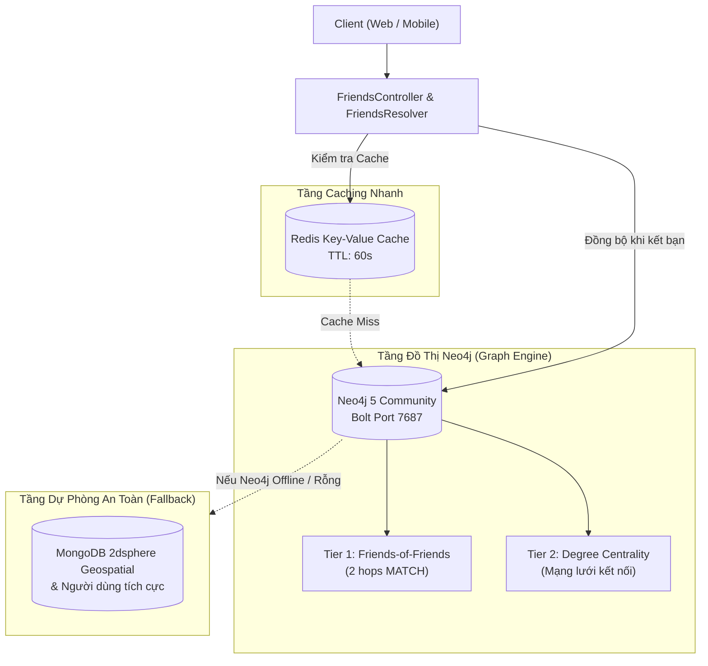

# 🤝 THUẬT TOÁN GỢI Ý BẠN BÈ THÔNG MINH BẰNG ĐỒ THỊ NEO4J

> Tài liệu mô tả chi tiết bài toán gợi ý kết bạn trên mạng xã hội quy mô lớn, kiến trúc đồ thị **Neo4j Graph Database** (thuật toán Friends of Friends & Network Centrality) kết hợp Redis Cache và cơ chế dự phòng an toàn.

---

## 📑 MỤC LỤC
1. [Bài Toán & Lợi Thế Của Đồ Thị Neo4j](#1-bài-toán--lợi-thế-của-đồ-thị-neo4j)
2. [Hình Ảnh Giao Diện Thực Tế](#2-hình-ảnh-giao-diện-thực-tế)
3. [Kiến Trúc Tổng Thể Hệ Thống Gợi Ý Neo4j](#3-kiến-trúc-tổng-thể-hệ-thống-gợi-ý-neo4j)
4. [Thuật Toán Đồ Thị 2 Tầng (Two-Tier Graph Engine)](#4-thuật-toán-đồ-thị-2-tầng-two-tier-graph-engine)
   - [Tier 1: Bạn của bạn (Friends of Friends - 2 Hops)](#tier-1-bạn-của-bạn-friends-of-friends---2-hops)
   - [Tier 2: Mạng lưới kết nối mở rộng (Degree Centrality - Cold Start)](#tier-2-mạng-lưới-kết-nối-mở-rộng-degree-centrality---cold-start)
5. [Đồng Bộ Dữ Liệu Thời Gian Thực & Công Cụ Migration](#5-đồng-bộ-dữ-liệu-thời-gian-thực--công-cụ-migration)
6. [Cơ Chế Dự Phòng & Caching Đa Tầng](#6-cơ-chế-dự-phòng--caching-đa-tầng)

---

## 1. BÀI TOÁN & LỢI THẾ CỦA ĐỒ THỊ NEO4J

Trong các cơ sở dữ liệu quan hệ (RDBMS) hoặc Document-based (MongoDB), bài toán duyệt đồ thị bạn bè đa cấp (Friend of Friends, tính số bạn chung) đòi hỏi các phép toán Join hoặc Aggregate phức tạp với độ phức tạp tính toán tăng theo cấp số nhân $O(N^2)$ hoặc $O(N^3)$, gây nghẽn nghiêm trọng khi dữ liệu mở rộng.

**Neo4j Graph Database** giải quyết triệt để bài toán này với các ưu thế vượt trội:
1. **Duyệt đồ thị không cần Join (Index-free Adjacency):** Mỗi nút người dùng (`:User`) trỏ trực tiếp đến các con trỏ quan hệ bạn bè (`[:FRIEND]`), cho phép duyệt quan hệ bậc 2 (2 hops) trong thời gian dưới **5 mili-giây** bất kể kích thước cơ sở dữ liệu.
2. **Loại trừ bạn bè và người bị chặn ngay trong Cypher:** Biểu thức Cypher tự động lọc bỏ các cặp đã kết bạn hoặc bị chặn (`[:BLOCK]`) với độ trễ tối thiểu.
3. **Cơ chế Cold-Start dựa trên độ kết nối (Degree Centrality):** Tự động phát hiện và gợi ý những người dùng có số lượng kết nối cao nhất trong mạng lưới cộng đồng cho các tài khoản mới lập.

---

## 2. HÌNH ẢNH GIAO DIỆN THỰC TẾ

### 2.1. Widget Gợi ý kết bạn trên Bảng tin (Feed Sidebar)

*Sidebar hiển thị gợi ý thông minh từ Neo4j kèm số bạn chung, tên bạn chung cụ thể và nút kết bạn tức thì.*

### 2.2. Trang Khám phá bạn bè (`/explore`)

*Giao diện thẻ lưới hiển thị điểm tương thích đồ thị và lý do gợi ý kết nối.*

---

## 3. KIẾN TRÚC TỔNG THỂ HỆ THỐNG GỢI Ý NEO4J



---

## 4. THUẬT TOÁN ĐỒ THỊ 2 TẦNG (TWO-TIER GRAPH ENGINE)

Thuật toán gợi ý bạn bè được thực thi bên trong `Neo4jService.getFriendSuggestions(userId, limit)` gồm 2 giai đoạn:

### Tier 1: Bạn của bạn (Friends of Friends - 2 Hops)
Truy vấn tất cả các người dùng $C$ có kết nối bạn bè thông qua người bạn chung $B$ với người dùng $A$:

```cypher
MATCH (u:User {id: $userId})-[:FRIEND]-(mutual:User)-[:FRIEND]-(suggested:User)
WHERE NOT (u)-[:FRIEND]-(suggested)
  AND NOT (u)-[:BLOCK]-(suggested)
  AND u.id <> suggested.id
WITH suggested, count(DISTINCT mutual) AS mutualCount, collect(DISTINCT mutual.name) AS mutualNames
RETURN suggested.id AS id,
       suggested.name AS name,
       suggested.avatar AS avatar,
       mutualCount AS mutualFriendsCount,
       mutualNames[0..3] AS mutualFriendNames
ORDER BY mutualCount DESC, suggested.name ASC
LIMIT $limit
```
- **Điểm số (Score):** Chuẩn hóa $\text{Score} = \min(100, \text{mutualCount} \times 25 + 50)$.
- **Lý do gợi ý:** *"Có N bạn chung (Tên người bạn 1, Tên người bạn 2)"*.

### Tier 2: Mạng lưới kết nối mở rộng (Degree Centrality - Cold Start)
Nếu người dùng mới chưa có bạn bè, hoặc số lượng gợi ý từ Tier 1 chưa lấp đầy `limit`, hệ thống tự động kích hoạt Tier 2 để tìm các người dùng uy tín có nhiều kết nối nhất trong mạng lưới đồ thị:

```cypher
MATCH (suggested:User)
WHERE NOT (suggested.id IN $existingIds)
  AND NOT (suggested)-[:FRIEND]-(:User {id: $userId})
  AND NOT (suggested)-[:BLOCK]-(:User {id: $userId})
OPTIONAL MATCH (suggested)-[:FRIEND]-(other:User)
WITH suggested, count(other) AS totalFriends
RETURN suggested.id AS id,
       suggested.name AS name,
       suggested.avatar AS avatar,
       totalFriends AS friendsCount
ORDER BY totalFriends DESC, suggested.name ASC
LIMIT $remaining
```
- **Lý do gợi ý:** *"Có N kết nối trong cộng đồng"* hoặc *"Gợi ý từ mạng lưới kết nối"*.

---

## 5. ĐỒNG BỘ DỮ LIỆU THỜI GIAN THỰC & CÔNG CỤ MIGRATION

1. **Đồng bộ sự kiện thời gian thực:**
   - **Tạo tài khoản / Đổi tên:** `this.neo4jService.syncUser({ id, name, avatar })`.
   - **Chấp nhận kết bạn:** `this.neo4jService.addFriendship(user1, user2)` áp dụng lệnh `MERGE (u1:User)-[:FRIEND]-(u2:User)` đảm bảo an toàn tuyệt đối.
   - **Hủy kết bạn:** `this.neo4jService.removeFriendship(user1, user2)` xóa cạnh `[:FRIEND]`.
   - **Chặn người dùng:** `this.neo4jService.blockUser(user1, user2)` tạo quan hệ định hướng `[:BLOCK]`.

2. **Script đồng bộ từ MongoDB sang Neo4j:**
   Hệ thống cung cấp sẵn script đồng bộ hàng loạt dành cho việc triển khai mới hoặc di chuyển dữ liệu:
   ```bash
   cd backend
   npm run neo4j:sync
   ```
   Script tự động đọc toàn bộ tài khoản thật và các mối quan hệ bạn bè từ MongoDB và đẩy sang Neo4j chỉ trong vài giây.

---

## 6. CƠ CHẾ DỰ PHÒNG & CACHING ĐA TẦNG

- **Redis Cache (TTL 60s):** Kết quả gợi ý được lưu tạm thời trên Redis theo khóa `cache:rec:{userId}:{limit}:{lat}:{lng}`. Các lần chuyển tab hoặc tải lại trang kế tiếp phản hồi tức thì với độ trễ **< 1ms**.
- **Dự phòng Cold-Start an toàn:** Trong trường hợp Neo4j đang bảo trì hoặc chưa hoàn tất đồng bộ, hệ thống tự động chuyển mượt mà sang truy vấn lân cận MongoDB (2dsphere geospatial) và danh sách người dùng tích cực. Người dùng không bao giờ gặp lỗi gián đoạn giao diện.
