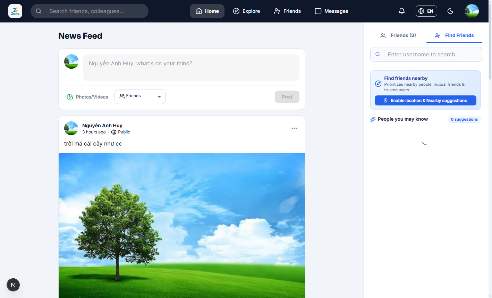
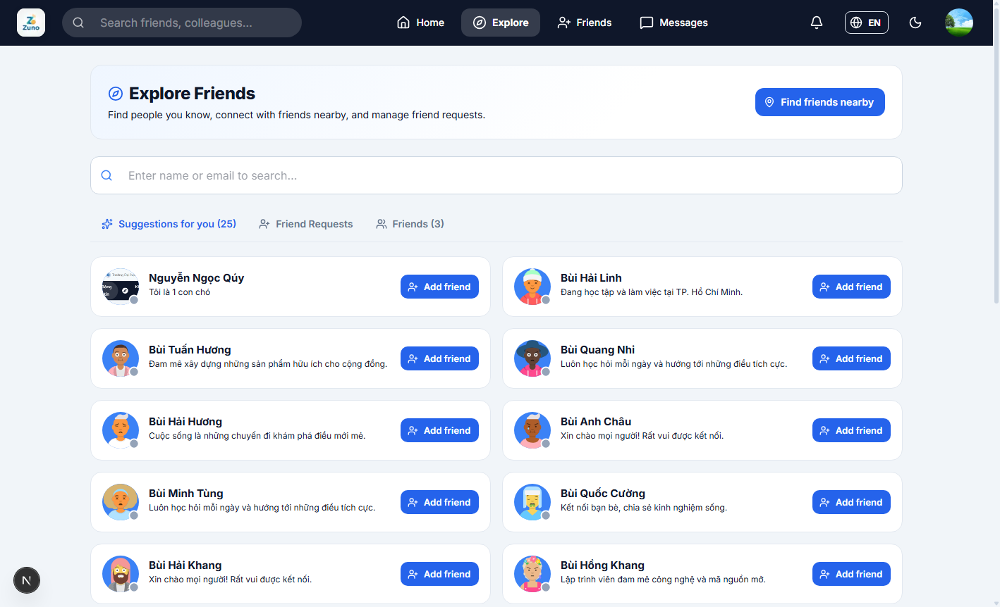
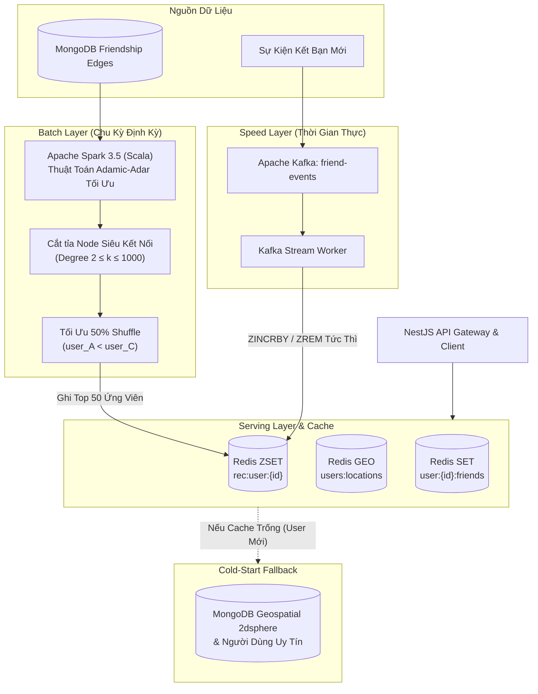

# 🤝 THUẬT TOÁN GỢI Ý BẠN BÈ THÔNG MINH & KIẾN TRÚC LAMBDA

> Tài liệu mô tả chi tiết bài toán gợi ý kết bạn quy mô lớn (Large-scale Friend Recommendation), kiến trúc Lambda (Spark Batch Layer + Kafka Speed Layer + Redis Serving Layer) và thuật toán kết hợp Redis Geospatial + Sets + Cold-start MongoDB.

---

## 📑 MỤC LỤC
1. [Bài Toán & Thách Thức Kỹ Thuật](#1-bài-toán--thách-thức-kỹ-thuật)
2. [Hình Ảnh Giao Diện Thực Tế](#2-hình-ảnh-giao-diện-thực-tế)
3. [Tổng Quan Kiến Trúc Lambda](#3-tổng-quan-kiến-trúc-lambda)
4. [Tầng Xử Lý Theo Lô - Batch Layer (Apache Spark / Scala)](#4-tầng-xử-lý-theo-lô---batch-layer-apache-spark--scala)
5. [Tầng Xử Lý Tức Thời - Speed Layer (Apache Kafka + Worker)](#5-tầng-xử-lý-tức-thời---speed-layer-apache-kafka--worker)
6. [Tầng Phục Vụ & Giải Quyết Cold-Start - Serving Layer (Redis + MongoDB)](#6-tầng-phục-vụ--giải-quyết-cold-start---serving-layer-redis--mongodb)
7. [Công Thức Chấm Điểm Đa Tiêu Chí (Multi-factor Scoring)](#7-công-thức-chấm-điểm-đa-tiêu-chí-multi-factor-scoring)

---

## 1. BÀI TOÁN & THÁCH THỨC KỸ THUẬT

Một hệ thống gợi ý bạn bè trên mạng xã hội quy mô hàng triệu người dùng phải giải quyết triệt để 3 bài toán hóc búa:
1. **Độ trễ truy vấn cực thấp (< 10ms):** Khi người dùng lướt Bảng tin hoặc mở tab Tìm bạn, danh sách gợi ý phải xuất hiện ngay lập tức mà không gây nghẽn database chính.
2. **Tránh bùng nổ phép tính (Combinatorial Explosion) & Data Skew:** Những tài khoản có lượng bạn bè khổng lồ (KOLs, người nổi tiếng) nếu tham gia vào phép duyệt đồ thị bậc 2 sẽ làm bùng nổ hàng triệu phép tính giao nhau, gây tràn bộ nhớ (OOM) trên các nút tính toán phân tán.
3. **Bài toán Người dùng mới (Cold-Start Problem):** Người dùng vừa đăng ký chưa có bất kỳ mối quan hệ bạn bè nào trên hệ thống, không thể áp dụng thuật toán tìm bạn chung thông thường.

---

## 2. HÌNH ẢNH GIAO DIỆN THỰC TẾ

### 2.1. Widget Gợi ý kết bạn trên Bảng tin (Feed Sidebar)

*Widget sidebar hiển thị danh sách người bạn có thể biết kèm số bạn chung, khoảng cách địa lý và nút kết bạn một chạm.*

### 2.2. Trang Khám phá & Radar tìm bạn (`/explore`)

*Giao diện thẻ lưới trực quan với điểm tương thích, hỗ trợ chuyển đổi tab linh hoạt giữa "Tất cả bạn bè" và "Tìm bạn".*

---

## 3. TỔNG QUAN KIẾN TRÚC LAMBDA



---

## 4. TẦNG XỬ LÝ THEO LÔ - BATCH LAYER (APACHE SPARK / SCALA)

Job xử lý theo lô được viết bằng **Scala** chạy trên Apache Spark định kỳ:

### 4.1. Cắt tỉa dữ liệu chống Data Skew (Pruning Super-Nodes)
- Đọc bảng cạnh quan hệ bạn bè 2 chiều `edges(user: Long, friend: Long)`.
- Tính bậc kết nối của từng người (`degree`).
- **Nguyên lý lọc:** Loại bỏ hoàn toàn các tài khoản có bậc kết nối $degree(B) < 2$ (quá ít quan hệ) hoặc $degree(B) > 1000$ (tài khoản người nổi tiếng/KOLs) khỏi vai trò làm cầu nối trung gian (Bridge Node). Điều này ngăn chặn hiện tượng Data Skew và tránh lỗi tràn bộ nhớ (Out-Of-Memory).

### 4.2. Trọng số Adamic-Adar nâng cao
Trọng số của một người bạn chung cầu nối $B$ được tính theo công thức:
$$W(B) = \frac{1}{\log(\text{degree}(B))}$$
*Người bạn chung càng ít bạn bè xung quanh thì giá trị kết nối giữa $A$ và $C$ càng mật thiết.*

### 4.3. Tối ưu hóa Self-Join 50% chi phí Shuffle
- Chỉ tính toán trên một chiều: $\text{user}_A < \text{user}_C$ giúp giảm đúng 50% chi phí truyền tải qua mạng (Shuffle) và gom nhóm (GroupBy).
- Tính tổng điểm Adamic-Adar cho từng cặp $(A, C)$:
  $$\text{Score}(A, C) = \sum_{B \in \text{Friends}(A) \cap \text{Friends}(C)} \frac{1}{\log(\text{degree}(B))}$$
- Loại bỏ hoàn toàn các cặp đã là bạn của nhau bằng phép `left_anti` join với bảng cạnh gốc.
- Xuất Top 50 ứng viên có điểm cao nhất của từng người dùng vào Redis Sorted Set:
  `Key = rec:user:{user_id}`, `Member = candidate_id`, `Score = adamic_adar_score`.

---

## 5. TẦNG XỬ LÝ TỨC THỜI - SPEED LAYER (APACHE KAFKA + WORKER)

1. Khi người dùng bấm chấp nhận kết bạn, NestJS Backend phát sự kiện `FRIEND_ACCEPTED` tới topic `friend-events`:
   ```json
   { "userA": "670...", "userB": "671...", "timestamp": 1730000000000 }
   ```
2. Worker lắng nghe sự kiện, truy vấn danh sách bạn bè hiện tại của `userB` và cộng trực tiếp điểm số vào Redis `ZSET` của `userA` bằng lệnh `ZINCRBY`, đồng thời thực hiện thao tác tương tự theo chiều ngược lại cho `userB`.
3. Xóa ngay lập tức `userB` khỏi danh sách gợi ý của `userA` (`ZREM`) và ngược lại vì họ đã chính thức trở thành bạn bè.

---

## 6. TẦNG PHỤC VỤ & GIẢI QUYẾT COLD-START - SERVING LAYER (REDIS + MONGODB)

Khi API Gateway nhận yêu cầu `GET /users/:id/recommendations`:

### Bước 1: Ưu tiên Serving Layer từ Redis
Đọc từ Redis `ZREVRANGEBYSCORE` với key `rec:user:{id}` để lấy kết quả đã được tính toán sẵn. Phản hồi trong **< 3ms**.

### Bước 2: Cơ chế Cold-Start Thông Minh (Hybrid Cold-Start Fallback)
Nếu Redis trả về rỗng (người dùng mới đăng ký hoặc chưa có quan hệ):
1. **Truy vấn Địa lý Lân cận (Redis Geospatial / MongoDB 2dsphere):**
   - Xác định tọa độ người dùng thông qua GPS client gửi lên hoặc IP.
   - Tìm kiếm người dùng trong bán kính $25\text{km}$ lân cận bằng lệnh `GEOSEARCH users:locations FROMLONLAT lng lat BYRADIUS 25 km`.
2. **Lọc người dùng uy tín (Reputation & Anti-Bot Filtering):**
   - Lọc các tài khoản có điểm tin cậy cao, đã xác thực email/số điện thoại, có ảnh đại diện hoàn chỉnh.
   - Loại trừ các tài khoản bị hệ thống Moderation gắn cờ bất thường hoặc tài khoản clone rác.

---

## 7. CÔNG THỨC CHẤM ĐIỂM ĐA TIÊU CHÍ (MULTI-FACTOR SCORING)

Điểm tổng hợp của ứng cử viên $C$ đối với người dùng hiện tại $A$ được chuẩn hóa theo trọng số:

$$\text{FinalScore} = S_{\text{spark}} + (N_{\text{mutual}} \times 25) + \max\left(0, 30 - D_{\text{km}}\right) + S_{\text{trust}}$$

Trong đó:
- $S_{\text{spark}}$: Điểm số thuật toán đồ thị Adamic-Adar từ Redis ZSET ($0 - 50$).
- $N_{\text{mutual}}$: Số lượng bạn chung tính bằng phép giao Redis `SINTER` (mỗi bạn chung cộng 25 điểm).
- $D_{\text{km}}$: Khoảng cách địa lý thực tế (khoảng cách càng gần điểm càng cao, tối đa 30 điểm).
- $S_{\text{trust}}$: Điểm uy tín tài khoản (có avatar +5đ, hoạt động tích cực +10đ).

