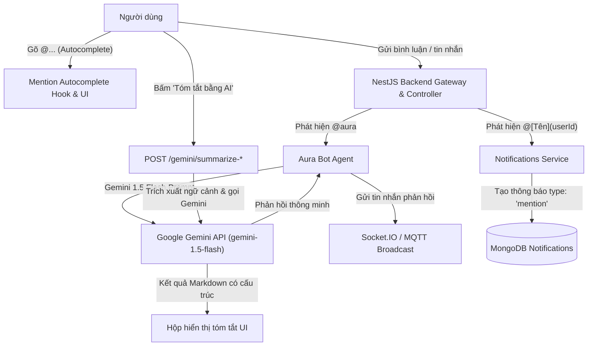

# Tích hợp AI Gemini 1.5 Flash: Tóm tắt Bình luận, Tóm tắt Chat, Trợ lý ảo Aura Bot (@aura) & Gắn thẻ bạn bè (@mentions)

Hệ thống tích hợp mô hình ngôn ngữ lớn thế hệ mới **Google Gemini 1.5 Flash (`gemini-1.5-flash`)** cùng bộ công cụ tương tác thông minh trực tiếp trong giao diện người dùng:
1. **Tóm tắt bình luận bài viết (Comment Summarization)**: Phân tích luồng ý kiến, quan điểm chính, tâm trạng cộng đồng và giải đáp thắc mắc.
2. **Tóm tắt hội thoại tin nhắn (Chat Summarization)**: Tóm tắt 50-100 tin nhắn gần nhất với các gạch đầu dòng cô đọng, hành động tiếp theo (Action items) và các chủ đề thảo luận quan trọng.
3. **Trợ lý ảo Aura Bot (`@aura`)**: Bot thông minh được nhúng sâu trong tin nhắn cá nhân và nhóm, tự động phản hồi khi được gọi tên `@aura <câu hỏi>`.
4. **Hệ thống Gắn thẻ Bạn bè (`@mentions`)**: Menu gợi ý autocomplete tức thì khi gõ `@`, điều hướng phím (Lên / Xuống / Enter), tô sáng thẻ nhắc phong cách mạng xã hội hiện đại và gửi thông báo nhắc tên thời gian thực.

---

## 1. Kiến trúc Hệ thống & Luồng Xử lý



---

## 2. Tính năng Chi tiết

### 2.1. Tóm tắt Bình luận Bài viết (`AiCommentSummaryBox`)
- **Vị trí**: Nút bấm huy hiệu AI Gradient "Tóm tắt bình luận (Gemini)" nằm ngay đầu phần danh sách bình luận (`PostCommentSection`).
- **Nội dung tóm tắt**:
  - Tóm tắt ý kiến đa chiều của các người dùng tham gia thảo luận.
  - Phân loại sắc thái cảm xúc (Tích cực, trung lập, góp ý, phản đối).
  - Tự động hiển thị thẻ số lượng bình luận đã được tổng hợp.
  - Hỗ trợ làm mới kết quả (Reload) và đóng hộp tóm tắt khi không cần xem.

### 2.2. Tóm tắt Cuộc trò chuyện (`AiChatSummaryDialog`)
- **Vị trí**: Tùy chọn "Tóm tắt hội thoại (Gemini)" trong menu 3 chấm của thanh tiêu đề chat (`ChatHeader`) và hộp chat nổi (`FloatingChatHeaderMenu`).
- **Nội dung tóm tắt**:
  - Tổng quan nội dung thảo luận gần nhất giữa hai bên.
  - Danh sách quyết định hoặc việc cần làm được rút ra từ hội thoại.
  - Nút sao chép tóm tắt 1-chạm (`Copy`) để lưu lại hoặc gửi tiếp.

### 2.3. Trợ lý ảo Aura Bot (`@aura`)
- **Danh tính cố định**: ID `666666666666666666666666`, tên "Aura AI Assistant", danh hiệu "Trợ lý ảo thông minh".
- **Cách thức hoạt động**:
  - Khi người dùng gửi tin nhắn có chứa `@aura <câu hỏi hoặc yêu cầu>`, máy chủ tự động phát tín hiệu đang soạn tin (`typing: true`) từ Aura Bot.
  - Bot gọi Gemini 1.5 Flash xử lý ngữ cảnh và trả về câu trả lời súc tích, thân thiện bằng tiếng Việt (hoặc tiếng Anh theo ngôn ngữ câu hỏi).
  - Cho phép trò chuyện trực tiếp 1-1 với Aura Bot như một người bạn thực thụ.

### 2.4. Hệ thống Gắn thẻ Bạn bè (`@mentions`)
- **Bộ nhận diện ký tự `@`**: Tự động kích hoạt khi người dùng gõ `@` trong ô soạn thảo (`CommentComposer`, `MessageComposer`, `FloatingChatBox`).
- **Menu gợi ý (`MentionAutocomplete`)**:
  - Luôn ưu tiên hiển thị Aura Bot ở vị trí đầu tiên kèm huy hiệu AI tím nổi bật.
  - Danh sách bạn bè kèm avatar tròn, tên hiển thị và email/username.
  - Hỗ trợ điều hướng bằng bàn phím đầy đủ: Mũi tên Lên / Xuống, `Enter` / `Tab` để chọn, `Escape` để hủy.
- **Định dạng lưu trữ an toàn**: Thẻ bạn bè được chuẩn hóa theo cú pháp Markdown an toàn `@[Họ và Tên](userId)`, Aura Bot được gắn thẻ `@aura`.
- **Hiển thị trực quan (`MentionText`)**:
  - `@aura`: Hiển thị dưới dạng huy hiệu chip gradient tím hồng mềm mại với icon ngôi sao lấp lánh (Sparkles).
  - `@[Tên](userId)`: Hiển thị dưới dạng nhãn nổi bật màu thương hiệu, nhấp vào để mở ngay trang cá nhân của người được nhắc tới.
- **Thông báo nhắc tên**: Tự động gửi thông báo thời gian thực với loại `mention` đến hộp thư của người được gắn thẻ.

---

## 3. Cấu hình Môi trường

Thêm biến môi trường vào `backend/.env`:
```env
# Google Gemini API Key
GEMINI_API_KEY=your_gemini_api_key_here
```
> **Lưu ý**: Nếu chưa cấu hình `GEMINI_API_KEY`, hệ thống đã được tích hợp bộ phân tích thông minh dự phòng (Rule-based Intelligent Fallback) tự động tóm tắt và phản hồi câu hỏi trực tiếp mà không gây lỗi máy chủ.
