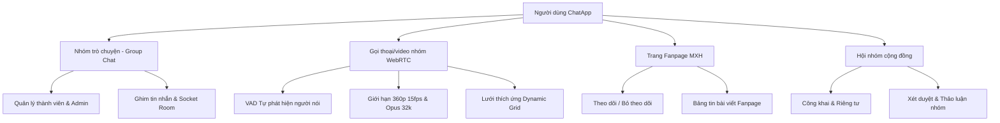

# 👥 Nhóm Trò Chuyện, Cuộc Gọi Nhóm WebRTC Tối Ưu, Trang Fanpage & Hội Nhóm Cộng Đồng

> Tài liệu mô tả chi tiết kiến trúc, thiết kế kỹ thuật, giao diện người dùng và giải pháp tối ưu cho bộ tính năng mạng xã hội nâng cao: **Nhóm trò chuyện (Group Chat)**, **Cuộc gọi thoại/video nhóm WebRTC Mesh-Lite tối ưu băng thông**, **Trang Fanpage** và **Hội nhóm cộng đồng (Community Groups)**.

---

## 1. Tổng Quan Kiến Trúc & Tính Năng

Hệ thống được phát triển mở rộng trên kiến trúc Fullstack hiện đại:
- **Backend**: NestJS, MongoDB (Mongoose Schema & Indexes), Socket.IO (Signaling Gateway), Redis.
- **Frontend**: Next.js 16 (App Router), React 19, MUI v9 Tokens, Zustand Stores (`useChatStore`, `useGroupCallStore`).
- **WebRTC**: Multi-peer Mesh-Lite Signaling, Audio Context VAD (Voice Activity Detection), Opus 32kbps & 360p@15fps constraints.

---

## 2. Chi Tiết Kỹ Thuật

### 2.1. Nhóm Trò Chuyện (Group Chat)
- **Schema & DTO**:
  - `Conversation` hỗ trợ `type: 'direct' | 'group'`, `name`, `avatar`, `creatorId`, `adminIds`, `pinnedMessageId`.
  - Hỗ trợ thêm/xóa thành viên, phân quyền Quản trị viên nhóm, đổi tên và avatar nhóm.
- **Socket.IO Room**:
  - Socket Gateway tự động nạp người dùng vào `conversation:${convId}` để đồng bộ tin nhắn nhóm thời gian thực.
  - Sự kiện `conversation:created`, `conversation:updated`, `group:kicked` giúp cập nhật giao diện tức thì không cần tải lại trang.

### 2.2. Cuộc Gọi Nhóm WebRTC Tối Ưu (Mesh-Lite & VAD)
- **Tối ưu hóa Băng Thông**:
  - Độ phân giải video giới hạn ở mức 360p (640x360 @ 15fps) cho mỗi luồng người tham gia, tránh nghẽn CPU và mạng khi có nhiều người cùng mở camera.
  - Âm thanh được nén với codec Opus trần 32kbps và kích hoạt lọc nhiễu nền (`noiseSuppression`, `echoCancellation`).
- **Phát hiện người đang nói (VAD - Voice Activity Detection)**:
  - Sử dụng Web Audio API (`AudioContext` & `AnalyserNode`) phân tích mức năng lượng RMS trực tiếp từ luồng micro phía client.
  - Tự động phát hiện khi có tiếng nói vượt ngưỡng và áp dụng cơ chế hysteresis (giữ trạng thái 600ms) để viền xanh phát sáng mượt mà, không bị nhấp nháy.
- **Bố cục hiển thị thích ứng (Dynamic Grid)**:
  - Tự động co giãn theo số lượng người tham gia: 1 người (1x1 toàn màn hình), 2 người (2x1), 3-4 người (2x2), 5-9 người (3x3).
  - Tự động hiển thị Avatar dự phòng thanh lịch khi người tham gia tắt camera.

### 2.3. Trang Fanpage (Pages)
- **Hợp đồng API**: `GET /pages/explore` và `GET /pages/:slug` không trả danh sách ID người theo dõi, quản trị viên hoặc kiểm duyệt viên. `PUT /pages/:id/follow` và `DELETE /pages/:id/follow` đặt trạng thái theo dõi rõ ràng; `POST /pages/:id/follow` được giữ tạm cho client cũ.
- **Thực thể Trang**:
  - `name`, `slug`, `category`, `bio`, `avatar`, `coverImage`, `ownerId`, `adminIds`, `followerCount`, `isVerified`.
- **Hành vi**:
  - Trang do người dùng tạo/quản lý hiển thị riêng với Trang chỉ theo dõi. Mọi thành viên đăng nhập có thể theo dõi Trang khác; quyền quản trị không được cấp khi theo dõi.
  - `/pages` tìm theo tên, mô tả hoặc danh mục; bộ lọc danh mục lấy từ các Trang đang hoạt động. Kết quả phân trang 20 mục với nút tải thêm, có trạng thái tải, rỗng và thử lại khi lỗi.
  - Khám phá các Trang nổi bật theo danh mục (Công nghệ, Giải trí, Ẩm thực, Doanh nghiệp...).
  - Theo dõi / Bỏ theo dõi với cập nhật tức thì.
  - Tích hợp Bảng tin bài viết: Quản trị viên đăng bài chính thức từ Fanpage, cộng đồng bình luận và thả cảm xúc.

### 2.4. Hội Nhóm Cộng Đồng (Community Groups)
- **Thực thể Nhóm**:
  - `name`, `slug`, `description`, `privacy: 'public' | 'private'`, `avatar`, `coverImage`, `creatorId`, `adminIds`, `memberIds`, `pendingMemberIds`, `memberCount`.
- **Bảo mật & Quyền riêng tư**:
  - Nhóm Công khai: Bất kỳ ai cũng có thể xem bài viết và tham gia ngay.
  - Nhóm Riêng tư: Nội dung và bài thảo luận chỉ hiển thị với thành viên chính thức; người ngoài phải gửi yêu cầu xét duyệt.

---

## 3. Trợ Lý Aura AI & Hệ Thống Nhận Thức

Kho tri thức RAG của Aura AI được cập nhật toàn diện với toàn bộ các tính năng mới của ChatApp:
1. Nhắn tin đa phương tiện & Nhóm chat đa người dùng.
2. Gọi thoại & Gọi video 1-1 và Cuộc gọi nhóm WebRTC tối ưu băng thông.
3. Bảng tin Mạng xã hội, Trang Fanpage & Hội nhóm cộng đồng.
4. Trợ lý AI Aura (tóm tắt bài viết, tóm tắt chat, bóc phốt tương tác vui).
5. Chia sẻ vị trí thời gian thực (Live GPS radar).
6. Hệ thống kiểm duyệt an toàn, chống bot và lừa đảo 24/7.
7. Chế độ Sáng / Tối và hỗ trợ song ngữ Tiếng Việt & Tiếng Anh.

Khi người dùng hỏi *"app đang sài có những tính năng gì"*, Aura AI sẽ tự động phân loại intent `app_help` và trả lời đầy đủ, chuyên nghiệp, sinh động với cấu trúc rõ ràng.

---

## 4. Kiểm Thử & Đảm Bảo Chất Lượng

- **Backend**:
  - Unit tests cho Pages Service (`pages.service.spec.ts`): 3/3 passed.
  - Unit tests cho Community Groups Service (`community-groups.service.spec.ts`): 4/4 passed.
  - Toàn bộ 45 test suites backend (394 bài kiểm thử) đều vượt qua 100%.
- **Frontend**:
  - Typecheck: 0 errors (`tsc --noEmit`).
  - Lint: 0 errors (`eslint .`).
  - Production Build: Toàn bộ 13 routes (`/`, `/chat`, `/pages`, `/pages/[slug]`, `/groups`, `/groups/[slug]`, `/explore`, `/profile`...) biên dịch thành công.
