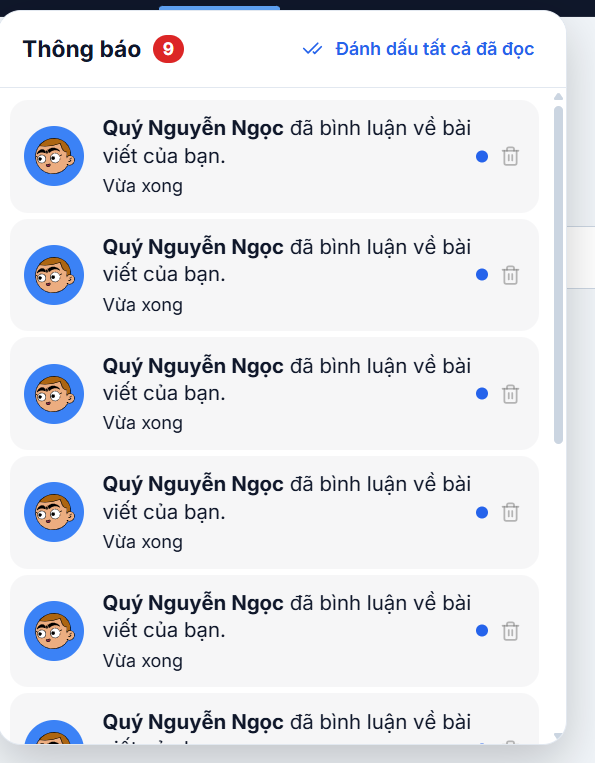
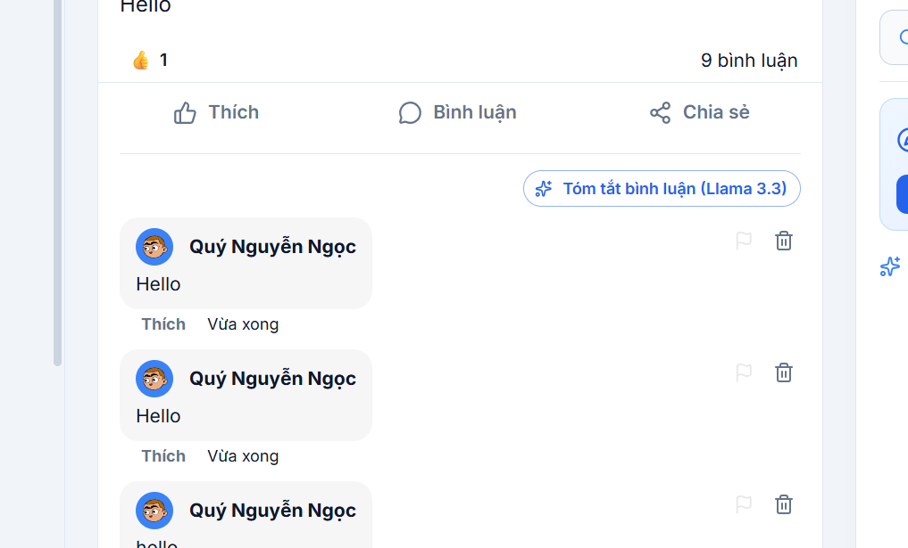

# Phân trang & Cuộn vô hạn (5 mục ban đầu + Cuộn tải tiếp)

## 1. Giới thiệu
Tối ưu hóa trải nghiệm người dùng (UX) và hiệu năng hiển thị (UI rendering performance) cho các danh sách có nhiều phần tử:
- **Thông báo (Notifications Popover)**: Chỉ render tối đa 5 thông báo mới nhất khi mở dropdown. Khi người dùng cuộn xuống gần cuối danh sách trong popover, hệ thống tự động render/tải thêm 5 thông báo tiếp theo.
- **Bình luận bài viết (Post Comments)**: Chỉ render tối đa 5 bình luận đầu tiên dưới mỗi bài viết. Khi người dùng cuộn xuống (hoặc tương tác tới mốc cuối), hệ thống tự động hiển thị tiếp 5 bình luận hoặc tự động gọi API lấy thêm từ máy chủ backend qua cursor pagination (`after`).

## 2. Hình ảnh Demo

### Thông báo (Notification Dropdown)

### Bình luận bài viết (Post Comments Infinite Scroll)

## 3. Kiến trúc kỹ thuật

### 3.1. Phía Thông báo (`NotificationBell.tsx` + `useNotificationStore.ts`)
- Hằng số `NOTIFICATION_PAGE_SIZE = 5`.
- `fetchNotifications`: Gọi API `fetchNotificationsApi({ limit: 5 })` khi mở popover.
- Cắt lát hiển thị nghiêm ngặt: `notifications.slice(0, visibleCount)` (ban đầu `visibleCount = 5`).
- Khung cuộn tối ưu (`maxHeight: 360px`, Popover paper `maxHeight: 460px`): Đảm bảo hiển thị trọn vẹn 5 thông báo đầu tiên.
- Cơ chế chống tải sớm (anti-premature trigger): Chỉ kích hoạt tải thêm khi `el.scrollTop > 20` và `distanceToBottom <= 40px`, ngăn chặn việc kích hoạt ngầm khi popover vừa mở.
- Hiệu ứng tải Facebook skeleton: Khi cuộn hoặc ấn xem thêm, hiển thị avatar tròn và 2 dòng skeleton dạng sóng (`wave`) trong 300ms trước khi hiển thị 5 mục kế tiếp.
- Reset `visibleCount = 5` khi đóng popover.

### 3.2. Phía Bình luận (`PostCommentSection.tsx`)
- Hằng số `COMMENT_PAGE_SIZE = 5`.
- Hook `usePagedList`: Phân trang theo con trỏ với `limit: 5`.
- Khung hiển thị thoải mái (`maxHeight: { xs: 480, sm: 580 }`, `overflowY: "auto"`): Đảm bảo hiển thị trọn vẹn 5 bình luận đầu tiên mà không bị cắt cụt ở bình luận thứ 3.
- **Khung tải bình luận phong cách Facebook (`FacebookCommentSkeleton`)**: Hiển thị avatar tròn (28px), bong bóng bình luận bo tròn (`borderRadius: 14px`) và dòng tác vụ (Thích · Phản hồi · Thời gian) cùng hiệu ứng sóng (`wave`) khi cuộn hoặc tải thêm bình luận, mô phỏng hoàn hảo trải nghiệm Facebook.
- Quản lý trạng thái `visibleCount`: Chỉ hiển thị đúng `COMMENT_PAGE_SIZE` bình luận ban đầu, nâng từng đợt nghiêm ngặt 5 mục khi người dùng thực sự cuộn xuống (`scrollTop > 20 && distanceToBottom <= 40`) hoặc ấn nút "Xem thêm bình luận".
- Đảm bảo khi người dùng tự đăng bình luận mới, bình luận đó ngay lập tức hiển thị đầy đủ.

### 3.3. Đa ngôn ngữ (i18n)
Bổ sung đầy đủ nhãn ngôn ngữ trên cả 6 ngôn ngữ chính thức:
- Tiếng Việt (`vi`)
- English (`en`)
- 简体中文 (`zh-CN`)
- 繁體中文 (`zh-TW`)
- 한국어 (`ko`)
- ไทย (`th`)
