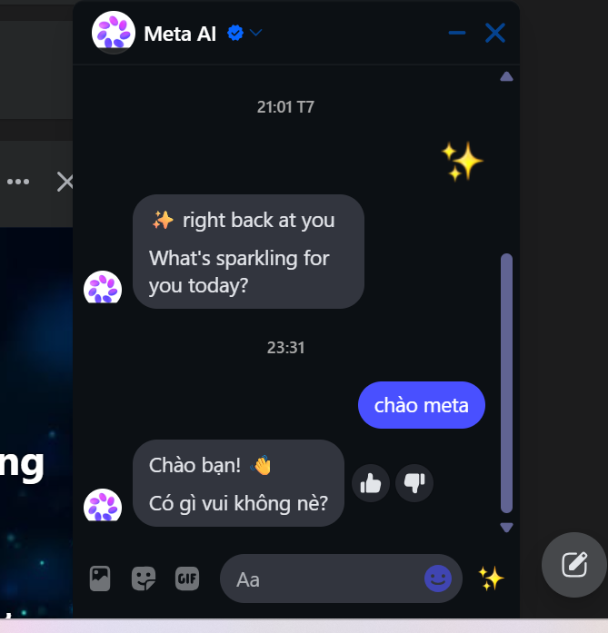

# 🤖 Trợ lý ảo Aura AI phong cách Meta AI (Messenger Bot Experience)

> Tính năng trò chuyện trực tiếp 1-1 với trợ lý ảo **Aura AI** chuẩn giao diện **Meta AI** trên Facebook Messenger: huy hiệu tích xanh chính thức, phản hồi thông minh Llama 3.3 (Groq Cloud) + RAG, đánh giá phản hồi 👍/👎 và thẻ gợi ý mở đầu thân thiện.

---

## 📸 Ảnh minh họa giao diện thực tế (Demo)

*Giao diện hộp chat nổi Aura AI chuẩn Meta: Tích xanh xác thực, trả lời thông minh không cần tag `@aura`, nút phản hồi 👍/👎 ngay cạnh bong bóng tin nhắn và phím gợi ý câu hỏi ✨.*

---

## 🌟 Các điểm nổi bật của tính năng

### 1. Trò chuyện 1-1 trực tiếp như Meta AI
- Không cần phải gõ cú pháp `@aura` khi đang trong phòng chat riêng với bot. Mọi tin nhắn gửi đến Aura AI đều tự động kích hoạt tiến trình suy luận và trả lời theo thời gian thực.
- Placeholder thanh soạn thảo tự động chuyển thành `"Nhắn cho Aura AI…"` giúp người dùng nhận biết ngay ngữ cảnh hội thoại.
- Trạng thái hoạt động hiển thị rõ ràng: `Trợ lý ảo AI • Sẵn sàng` (hoặc `Aura đang suy nghĩ…` khi AI đang sinh phản hồi).

### 2. Huy hiệu tích xanh chính thức (Verified Badge)
- Xuất hiện bên cạnh tên **Aura AI** tại:
  - Tiêu đề cửa sổ chat nổi (`FloatingChatBox`).
  - Thanh tiêu đề phòng chat lớn (`ChatHeader`).
  - Danh sách hội thoại (`ConversationList`).
  - Danh bạ bạn bè & người liên hệ (`PersonCall`).
  - Popover tin nhắn gần đây trên thanh điều hướng (`RecentChatsPopover`).
- Được thiết kế chuẩn token hệ thống MUI (`CheckCircle2` với màu thương hiệu và viền tương phản cao), tuân thủ 100% Dark Mode & Light Mode.

### 3. Đánh giá phản hồi thông minh (👍 Hữu ích / 👎 Chưa hài lòng)
- Mỗi câu trả lời của Aura AI đều đi kèm cụm 2 nút đánh giá nhanh 👍 và 👎 đặt tinh tế ngay bên cạnh bong bóng chat (y hệt Meta AI).
- Lưu trữ trạng thái đánh giá người dùng tức thì vào `localStorage` theo từng mã tin nhắn (`messageId`).
- Hiển thị tooltip giải thích tương tác rõ ràng bằng song ngữ Tiếng Việt & Tiếng Anh.

### 4. Thẻ chào mừng & Gợi ý câu hỏi bắt đầu (`AuraWelcomeCard`)
- Khi người dùng mở cuộc trò chuyện mới chưa có tin nhắn nào, hệ thống hiển thị thẻ chào mừng nổi bật với logo Aura AI phát sáng đa sắc (gradient ring).
- Các chip câu hỏi nhanh cho phép bấm một chạm để bắt đầu:
  - *✨ Có gì vui không nè?*
  - *👋 Chào Aura AI!*
  - *💡 Bạn có thể giúp gì cho tôi?*
  - *📝 Giúp tôi tóm tắt bài viết*
  - *🎯 Lên kế hoạch một ngày hiệu quả*

### 5. Cơ chế phản hồi luồng chữ theo thời gian thực (Streaming Chunks / Typewriter Effect - "Nhắn từ từ")
- **Trải nghiệm gõ chữ sống động chuẩn Gemini / ChatGPT**: Thay vì chờ đợi vài giây rồi nhận một khối văn bản dài đột ngột, Aura AI lập tức mở luồng Server-Sent Events (SSE) và phát từng cụm từ (chunk/token) theo thời gian thực về giao diện người dùng.
- **Con trỏ nhấp nháy phát sáng (`auraBlink`)**: Trong suốt quá trình AI sinh văn bản, con trỏ thanh đứng `▊` nhấp nháy mượt mà ở cuối câu chữ đang xuất hiện và các nút chức năng phụ tạm ẩn để tạo cảm giác tập trung.
- **Tự động cuộn theo dòng chữ (Auto-scroll smooth)**: Giao diện tự động cuộn êm ái theo từng dòng chữ mới sinh ra, đảm bảo người dùng luôn theo dõi được mạch trò chuyện.
- **Lưu trữ toàn vẹn (Eventual Consistency)**: Sau khi luồng chunk kết thúc (`message:stream_end`), toàn bộ nội dung tin nhắn được lưu trữ bền vững vào cơ sở dữ liệu MongoDB với đúng ID đã phát, đảm bảo đồng bộ hoàn hảo với các thiết bị khác.
- **Dự phòng thông minh (Fallback Chunker)**: Khi chạy offline hoặc chưa nạp API Key, bộ sinh dự phòng tự động phân tách câu từ và stream với nhịp 25ms - 35ms mượt mà.

### 6. Đa điểm truy cập nhanh (Omni-channel Entry Points)
- **Danh sách hội thoại (`/chat`)**: Ghim mục Aura AI ở đầu danh sách với nhãn AI nổi bật.
- **Thanh danh bạ trang chủ (`PersonCall`)**: Nằm ngay đầu mục "Người liên hệ" để mở chat nổi chỉ với 1 click.
- **Popover tin nhắn trên AppBar (`RecentChatsPopover`)**: Lối tắt truy cập nhanh ở vị trí trên cùng với trích đoạn tin nhắn gần nhất, tách biệt khỏi danh sách hội thoại cá nhân.

### 7. Tách biệt Chatbot khỏi tài khoản cá nhân & Xóa vĩnh viễn hội thoại
- **Không phải tài khoản cá nhân**: Aura AI là trợ lý ảo hỗ trợ người dùng hỏi đáp & tóm tắt, không phải tài khoản người dùng bình thường. Hệ thống loại trừ hoàn toàn Aura AI khỏi trang cá nhân (`/profile`), tìm kiếm người dùng, gợi ý kết bạn và các menu hành vi cá nhân (như Chặn, Hạn chế).
- **Xóa cuộc hội thoại vĩnh viễn (`DELETE /chat/conversations/:id`)**:
  - Khi người dùng xóa đoạn chat với Aura AI, backend dọn dẹp sạch sẽ toàn bộ hội thoại và tin nhắn khỏi MongoDB.
  - Khi tải lại trang (F5/Reload), đoạn chat đã xóa sẽ biến mất hoàn toàn và không bao giờ tự ý xuất hiện trở lại.
  - Với hội thoại giữa người dùng thật: cơ chế `deletedByUsers` ẩn hội thoại cho người xóa và tự phục hồi khi có tin nhắn mới.

---

## 🏗️ Kiến trúc kỹ thuật Backend & Đồng bộ Transport

Hệ thống hỗ trợ cơ chế phản hồi song song trên mọi giao thức truyền tin:

1. **Socket.IO Realtime Gateway (`chat.gateway.ts`)**:
   - Khi nhận `message:send` gửi tới `AURA_BOT_ID`:
   - Lập tức phát sự kiện `typing:start` của Aura AI về phía người dùng.
   - Gọi `AuraRagService` để trích xuất ngữ cảnh liên quan (hồ sơ, lịch sử, văn bản kiến thức).
   - Truy vấn Groq Cloud (`llama-3.3-70b-versatile`) để sinh câu trả lời tự nhiên, thân thiện.
   - Lưu câu trả lời vào MongoDB và broadcast `message:new` kèm `typing:stop`.

3. **REST API Fallback (`chat.controller.ts`)**:
   - Khi kết nối socket gián đoạn, API `POST /chat/messages` vẫn tự động kích hoạt Aura trả lời qua `ChatGateway.triggerAuraReply`.

