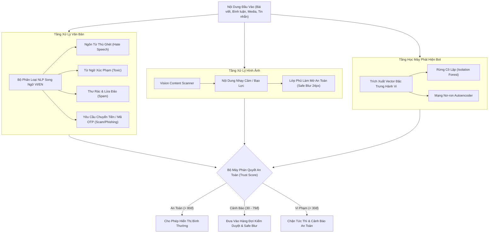

# 🛡️ HỆ THỐNG KIỂM DUYỆT NỘI DUNG & PHÒNG CHỐNG BOT AI (MODERATION & TRUST)

> Tài liệu mô tả chi tiết kiến trúc Hệ thống Kiểm duyệt & An toàn Nội dung, kết hợp mô hình NLP phân loại văn bản, Thị giác máy tính (Vision Models), thuật toán học máy phát hiện dị biệt (Isolation Forest & Autoencoder), cùng **Hàng đợi kiểm duyệt Admin** và **Trợ lý cảnh báo an toàn trong Chat**.

---

## 📑 MỤC LỤC
1. [Mục Tiêu & Tiêu Chuẩn An Toàn](#1-mục-tiêu--tiêu-chuẩn-an-toàn)
2. [Hình Ảnh Bằng Chứng Kiểm Thử Tự Động](#2-hình-ảnh-bằng-chứng-kiểm-thử-tự-động)
3. [Kiến Trúc Tổng Thể Bộ Máy Kiểm Duyệt](#3-kiến-trúc-tổng-thể-bộ-máy-kiểm-duyệt)
4. [Phân Loại Văn Bản Độc Hại Song Ngữ VI / EN (NLP)](#4-phân-loại-văn-bản-độc-hại-song-ngữ-vi--en-nlp)
5. [Quét Nhận Diện Media Nhạy Cảm (Vision Models)](#5-quét-nhận-diện-media-nhạy-cảm-vision-models)
6. [Phát Hiện Bot & Tài Khoản Ảo Bằng Thuật Toán Học Máy](#6-phát-hiện-bot--tài-khoản-ảo-bằng-thuật-toán-học-máy)
7. [Hàng Đợi Kiểm Duyệt Dành Cho Quản Trị Viên (Admin Moderation Queue)](#7-hàng-đợi-kiểm-duyệt-dành-cho-quản-trị-viên-admin-moderation-queue)
8. [Cảnh Báo An Toàn Trong Chat & Tự Động Làm Mờ Ảnh Nhạy Cảm (In-Chat Safety & Safe Blur)](#8-cảnh-báo-an-toàn-trong-chat--tự-động-làm-mờ-ảnh-nhạy-cảm-in-chat-safety--safe-blur)
9. [Bộ Test Cases & Độ Tin Cậy Thực Tế](#9-bộ-test-cases--độ-tin-cậy-thực-tế)

---

## 1. MỤC TIÊU & TIÊU CHUẨN AN TOÀN

Nhằm kiến tạo một môi trường mạng xã hội lành mạnh, văn minh và tin cậy, hệ thống triển khai bộ máy **Moderation & Trust Engine** giải quyết triệt để các nguy cơ an toàn:
1. **Ngôn từ độc hại & Bắt nạt qua mạng:** Phát hiện và ngăn chặn tự động các bình luận hoặc bài viết có tính xúc phạm, thù ghét, quấy rối hoặc thư rác.
2. **Hình ảnh vi phạm chính sách & Safe Blur:** Tự động quét và làm mờ bảo vệ đối với các tệp media có yếu tố bạo lực hoặc nhạy cảm.
3. **Mạng lưới Bot & Tài khoản ảo cày tương tác:** Nhận diện các mẫu hành vi tự động bất thường (gửi kết bạn siêu tốc, like hàng loạt trong vài mili-giây) để cách ly khỏi hệ sinh thái bạn bè thật.
4. **Lừa đảo tài chính & Yêu cầu OTP trong tin nhắn:** Trợ lý an toàn trong khung chat cảnh báo người dùng khi có dấu hiệu lừa đảo, số tài khoản ngân hàng hoặc yêu cầu mật mã.

---

## 2. HÌNH ẢNH BẰNG CHỨNG KIỂM THỬ TỰ ĐỘNG

Bộ test tự động của module Moderation (`moderation.service.spec.ts`) được thực thi định kỳ qua Vitest, chứng minh tính ổn định và sự chính xác tuyệt đối của các thuật toán:

*Toàn bộ 17 test cases của hệ thống Moderation & Trust Engine chạy thành công 100%.*

---

## 3. KIẾN TRÚC TỔNG THỂ BỘ MÁY KIỂM DUYỆT

---

## 4. PHÂN LOẠI VĂN BẢN ĐỘC HẠI SONG NGỮ VI / EN (NLP)

Bộ phân loại văn bản được tối ưu hóa đặc biệt cho ngữ cảnh mạng xã hội Việt Nam và Quốc tế:
- **Tiếng Việt:** Nhận diện các biến thể từ lóng, teencode, viết tắt né tránh bộ lọc (`ch*ửi`, `d*m`, biến âm...).
- **Tiếng Anh:** Áp dụng từ điển độc hại và phân tích ngữ cảnh chuẩn mực.
- **Phân loại 4 nhãn chính:**
  1. `toxic`: Xúc phạm cá nhân, thóa mạ thô tục.
  2. `hate_speech`: Kích động thù hận, phân biệt đối xử vùng miền/tôn giáo.
  3. `spam`: Gửi lặp lại đường link mời chào cá cược hoặc tiếp thị lừa đảo.
  4. `violence`: Đe dọa bạo lực, giết chém hoặc khủng bố.

---

## 5. QUÉT NHẬN DIỆN MEDIA NHẠY CẢM (VISION MODELS)

- Kiểm tra trước khi tệp được lưu trữ vĩnh viễn vào hệ thống file.
- Trích xuất đặc trưng hình ảnh qua mô hình phân loại thị giác để tính toán chỉ số an toàn `nsfwScore` và `violenceScore`.
- Khi điểm rủi ro vượt ngưỡng, bài viết tự động kích hoạt cờ `isSensitive = true`.

---

## 6. PHÁT HIỆN BOT & TÀI KHOẢN ẢO BẰNG THUẬT TOÁN HỌC MÁY

### 6.1. Thuật toán Rừng Cô Lập (Isolation Forest)
- **Nguyên lý:** Dữ liệu bất thường (Anomalies) thường ít và có giá trị đặc trưng rất khác so với người dùng thông thường, do đó các điểm này dễ bị "cô lập" hơn khi chia ngẫu nhiên không gian đặc trưng bằng các cây quyết định.
- **Kết quả:** Trả về điểm dị biệt `anomalyScore` ($0.0 - 1.0$). Nếu $> 0.65$, tài khoản bị gắn cờ nghi vấn.

### 6.2. Mạng Nơ-ron Tái Tạo (Autoencoder)
- Autoencoder được huấn luyện trên tập mẫu các hành vi chuẩn mực của người dùng thật để nén và tái tạo vector hành vi.
- Khi một tài khoản bot hoạt động với các tương tác máy móc bất thường, mô hình sẽ không thể tái tạo chính xác, dẫn đến **Sai số tái tạo (Reconstruction Error)** tăng vọt:
  $$\text{Loss} = \frac{1}{n} \sum_{i=1}^{n} (x_i - \hat{x}_i)^2$$

---

## 7. HÀNG ĐỢI KIỂM DUYỆT DÀNH CHO QUẢN TRỊ VIÊN (ADMIN MODERATION QUEUE)

Phân hệ tại `/admin/moderation` cung cấp giao diện tập trung chia làm 2 tab:
1. **Hàng Đợi Kiểm Duyệt (Moderation Queue Tab):**
   - Tự động tập hợp danh sách các bài viết bị AI chấm điểm độc hại cao hoặc gắn cờ nhạy cảm (`GET /api/admin/moderation/queue`).
   - Hiển thị tỷ lệ phần trăm rủi ro AI (`AI Risk %`), loại vi phạm chi tiết, văn bản và hình ảnh đính kèm.
   - Thao tác 1-chạm (`PATCH /api/admin/moderation/queue/:id/resolve`):
     - **Duyệt an toàn (`approve`):** Đánh dấu bài viết sạch và gỡ bỏ nhãn cảnh báo.
     - **Gỡ bỏ (`hide`):** Ẩn nội dung vi phạm khỏi Bảng tin và Trang cá nhân của người dùng.
     - **Cảnh cáo tác giả (`warn`):** Gửi thông báo cảnh cáo chính thức kèm lý do kiểm duyệt và xử lý nội dung.
2. **Thử Nghiệm Mô Hình AI (AI Playground Tab):**
   - Cho phép Quản trị viên nhập văn bản bất kỳ bằng tiếng Việt hoặc tiếng Anh để trực quan hóa điểm Toxicity và nhãn phân loại của Transformer.
   - Kiểm tra vector hành vi người dùng với các mẫu sẵn (Người thật, Bot kết bạn, Bot cày like) bằng Isolation Forest & Autoencoder.

---

## 8. CẢNH BÁO AN TOÀN TRONG CHAT & TỰ ĐỘNG LÀM MỜ ẢNH NHẠY CẢM (IN-CHAT SAFETY & SAFE BLUR)

### 8.1. Trợ Lý Cảnh Báo Giao Dịch & Lừa Đảo Trong Khung Chat (`InChatSafetyBanner.tsx`)
- Quét theo thời gian thực các tin nhắn gần đây trong cuộc trò chuyện (cả trên trang `/chat` và hộp chat nổi `FloatingChatBox`).
- Nhận diện các dấu hiệu chuyển tiền, số tài khoản ngân hàng (STK), yêu cầu mã OTP, mật khẩu, đường link lạ hoặc trúng thưởng.
- Hiển thị thanh thông báo cảnh báo màu vàng nhẹ nhàng, có thể bấm "Đã hiểu" để đóng khi người dùng đã xác thực đối phương:
  > *"⚠️ Cảnh báo an toàn: Nhận diện yêu cầu tài chính. Tuyệt đối không chuyển tiền, gửi mã OTP hoặc mật khẩu cho người khác qua tin nhắn."*

### 8.2. Lớp Phủ Làm Mờ An Toàn Cho Ảnh Nhạy Cảm (`PostImages.tsx`)
- Khi bài viết mang cờ `isSensitive = true`:
  - Ảnh được phủ một lớp làm mờ mềm mại (`blur(24px)`) cùng hiệu ứng kính mờ (Backdrop Filter).
  - Xuất hiện biểu tượng khiên bảo vệ và nhãn thông báo: *"Cảnh báo nội dung: Hình ảnh nhạy cảm - Nhấn để xem"*.
  - Người dùng bấm vào nút để mở ảnh rõ nét, đồng thời có thể bấm nút icon con mắt ở góc để làm mờ lại bất cứ khi nào mong muốn.

---

## 9. BỘ TEST CASES & ĐỘ TIN CẬY THỰC TẾ

Module được bảo đảm với 17 bài test tự động bao quát trong `moderation.service.spec.ts` cùng các bài test bổ trợ trong `admin.service.spec.ts` và `admin.controller.spec.ts`:
- Test phân loại văn bản độc hại chính xác (cả tiếng Việt có dấu, không dấu và tiếng Anh).
- Test phát hiện spam và từ khóa né tránh kiểm duyệt.
- Test thuật toán Isolation Forest phân chia chuẩn xác giữa người thật và botnet.
- Test sai số tái tạo của Autoencoder với vector dị biệt.
- Test hàng đợi kiểm duyệt và các hành động phê duyệt, gỡ bỏ, cảnh cáo của Admin.
