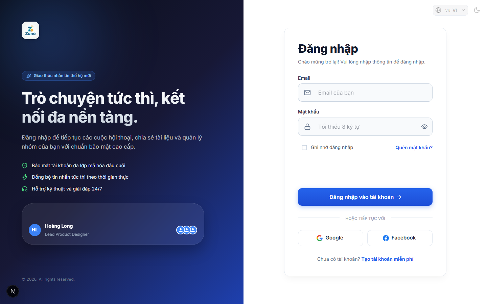

# Hệ Thống Đa Ngôn Ngữ (Multilingual Support)

Hệ thống hỗ trợ đa ngôn ngữ mở rộng toàn diện trên toàn bộ giao diện Người dùng (Frontend) và Bảng Quản trị (Admin Panel), cho phép người dùng chuyển đổi mượt mà giữa 6 ngôn ngữ phổ biến tại khu vực Châu Á và Quốc tế.

## 1. Danh Sách Ngôn Ngữ Được Hỗ Trợ

| Mã Ngôn Ngữ (`code`) | Tên Bản Ngữ (`label`) | Khu Vực / Quốc Gia (`region`) | Quốc Kỳ (`flag`) | Nhãn Tắt (`badge`) |
| :---: | :---: | :---: | :---: | :---: |
| `vi` | **Tiếng Việt** | Việt Nam | 🇻🇳 | `VI` |
| `en` | **English** | International | 🇺🇸 | `EN` |
| `zh-CN` | **简体中文** | 中国 (Trung Quốc) | 🇨🇳 | `简` |
| `zh-TW` | **繁體中文** | 台灣 (Đài Loan) | 🇹🇼 | `繁` |
| `ko` | **한국어** | 대한민국 (Hàn Quốc) | 🇰🇷 | `KO` |
| `th` | **ไทย** | ประเทศไทย (Thái Lan) | 🇹🇭 | `TH` |

---

## 2. Kiến Trúc & Thiết Kế Kỹ Thuật

- **Lưu trữ & Khởi tạo Tự động:**
  - Lựa chọn ngôn ngữ của người dùng được lưu trữ an toàn trong `localStorage` với key `chatapp_language`.
  - Khi người dùng truy cập lần đầu, hệ thống thông minh tự nhận diện ngôn ngữ trình duyệt (`navigator.language`):
    - `zh-tw`, `zh-hk`, `zh-hant` ➔ Tự động chọn **繁體中文 (Đài Loan - `zh-TW`)**.
    - `zh`, `zh-cn`, `zh-hans` ➔ Tự động chọn **简体中文 (Trung Quốc - `zh-CN`)**.
    - `ko` ➔ Tự động chọn **한국어 (Hàn Quốc - `ko`)**.
    - `th` ➔ Tự động chọn **ไทย (Thái Lan - `th`)**.
    - `en` ➔ Tự động chọn **English (`en`)**.
    - Mặc định ➔ **Tiếng Việt (`vi`)**.
  - Gắn thuộc tính `document.documentElement.lang` chuẩn chuẩn W3C/SEO tương ứng với ngôn ngữ đang chọn.

- **Cấu trúc Từ điển Dữ liệu (`TranslationDictionary`):**
  - Mọi từ khóa được phân cụm chặt chẽ theo từng module: `common`, `nav`, `feed`, `chat`, `friends`, `notifications`, `auth`.
  - Hỗ trợ nội suy tham số động `{param}` (ví dụ: bình luận dưới tên, đếm bạn bè, đếm lượt chia sẻ).
  - Tự động fallback đa tầng về Tiếng Việt nếu thiếu từ khóa ở các ngôn ngữ khác, đảm bảo giao diện không bao giờ bị gãy hay trống dữ liệu.

- **Bộ điều khiển Chuyển đổi Ngôn ngữ (`LanguageToggle`):**
  - Thiết kế chuẩn MUI v9 tích hợp theme tokens, hỗ trợ 100% Dark mode / Light mode.
  - Hiệu ứng mở menu nhanh chóng, hiển thị quốc kỳ, tên bản ngữ, khu vực và dấu tích (`Check`) xanh tại ngôn ngữ đang kích hoạt.
  - Tuân thủ quy chuẩn Trợ năng (`a11y`): ARIA roles, keyboard navigation (phím mũi tên, Enter, Esc).

- **Định dạng Thời gian Tương đối Đa ngôn ngữ (`formatTime.ts`):**
  - Đồng bộ hiển thị "Vừa xong", "Hôm nay", "Hôm qua", "X phút trước", "X giờ trước", "X ngày trước" tương ứng theo đúng ngữ pháp của từng ngôn ngữ (VI / EN / ZH-CN / ZH-TW / KO / TH).

- **Đồng bộ Cảm xúc Bày tỏ (Facebook Reactions):**
  - Các cảm xúc Like, Love, Care, Haha, Wow, Sad, Angry được bản địa hóa chính xác theo đúng tên gọi chính thức của Facebook tại từng quốc gia.
