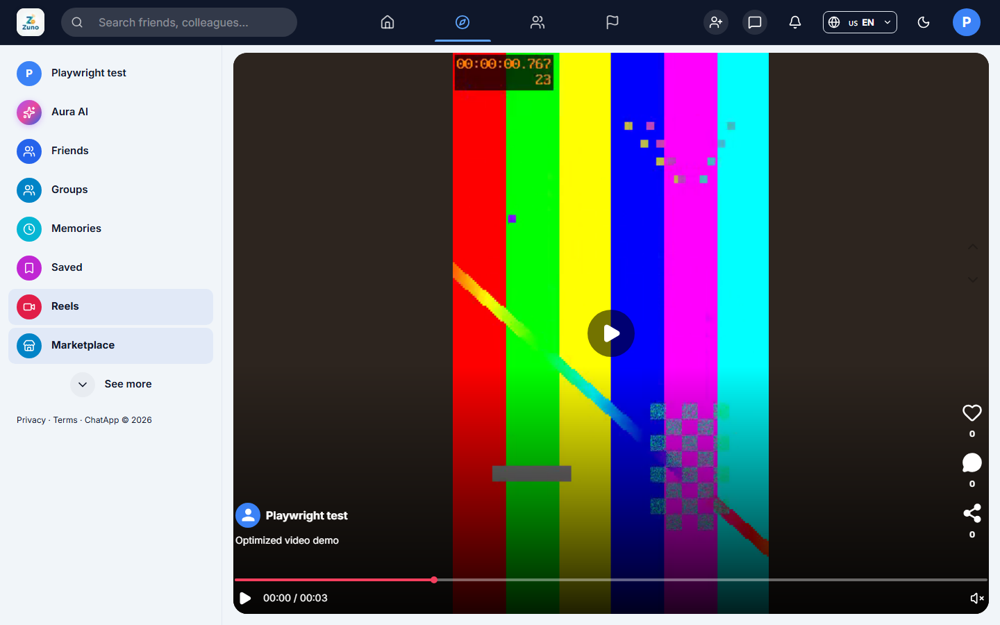
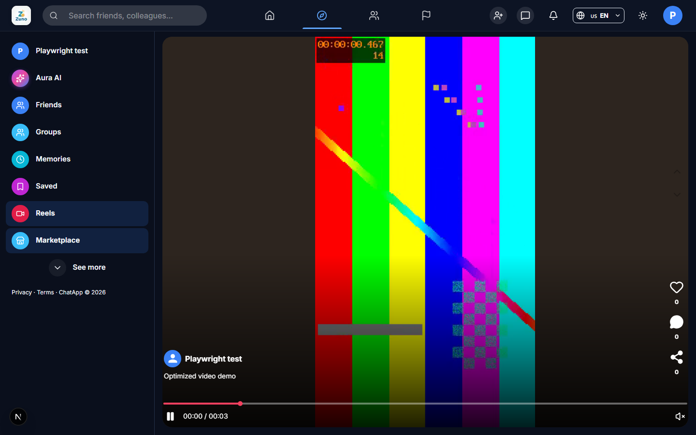

# Short Video Explore

## Overview

`/explore` is a vertical short-video feed for videos attached to posts visible to the signed-in viewer. The backend feed already includes public posts and applies friend privacy rules, so the page reuses that cursor-paginated endpoint and filters for video media.

## Viewer behavior

- Desktop uses the shared left navigation beside a dark, full-height viewing stage. Mobile hides the desktop sidebar and keeps the video stage full-width.
- Each video occupies one stage and snaps into place while scrolling. Previous/next controls move between clips.
- Videos play inline and start muted when at least 65% of the video enters the viewport. They pause after scrolling away and stop on the last frame when finished; replay requires pressing Play.
- The video controls provide play/pause, seek, elapsed time, and mute/unmute. The sound choice applies across clips.
- The heart button toggles the `love` reaction and displays the love count; comment actions reuse the existing post interaction.
- Sharing within ChatApp reuses the post sharing dialog. Public, non-sensitive videos can also be shared as direct media links through Facebook, X, WhatsApp, Telegram, a copy action, or the device share sheet when available. External shares do not increase the in-app share count.
- Friends-only, private, and sensitive videos do not expose direct external share links.
- Media flagged as sensitive is blurred until the viewer chooses to reveal it.
- Loading, retryable errors, empty results, and load-more states are shown.
- The previous friend discovery page is available at `/friends`.

## Posting a video

Select **Đăng video** on `/explore` to jump to the existing post composer on the home feed. Select **Ảnh/Video**, attach an MP4, WebM, or MOV file (up to 100 MB), choose **Công khai**, then publish. Public videos can appear in Explore; the same composer also supports the existing post privacy options.

Post videos are converted before upload to Cloudinary using FFmpeg: H.264 video, AAC audio when present, a maximum long side of 1920 pixels without upscaling, and MP4 `faststart`. Encoding keeps the entire clip but may change its quality and takes additional upload time. The backend accepts one video encoding job at a time per process, limits source frames to 16,777,216 pixels, stops a job after 120 seconds, and rejects output exceeding 100 MB. Temporary files are removed after processing. If FFmpeg or Cloudinary is unavailable, the upload reports an error so it can be retried.

FFmpeg documents [`faststart` in its MOV/MP4 format options](https://ffmpeg.org/ffmpeg-formats.html) and [`max_pixels` in its codec options](https://ffmpeg.org/ffmpeg-codecs.html).

The backend Docker development and production images include FFmpeg. For a backend started directly on the host, install FFmpeg with `libx264` and make `ffmpeg` available on `PATH`. Existing videos and other upload endpoints are not re-encoded.

Demo of a synthetic video processed by FFmpeg, with mocked feed data:



## Verification

- `npm run typecheck` — passed.
- `npm run lint` — passed.
- `npm run build` — passed.
- `node --test tests/shortVideoActions.test.mjs` — passed (heart transitions, encoded social URLs, and private/sensitive sharing limits).
- Playwright checked playback and pause at 1440 px with a synthetic video and mocked feed data. A real signed-in upload and the 390 px and dark-mode views were not checked in this run.

### Progress bar regression checks

The progress bar uses the same media clock during playback, pause and seeking.
Slider track/thumb transitions are disabled so the painted position does not keep
moving after pause or animate backwards through an old position on replay.
Replaying an ended clip resets to zero and restarts progress updates.

With frontend running and Python Playwright/Chromium installed:

```powershell
$env:VIDEO_TEST_CLIP = 'C:\path\to\sample.mp4'
python scripts/test-video-progress.py
```

This browser regression uses mocked API data and a local clip (no uploads). It
checks painted progress, pause stability, paused seeking, end and replay at
320, 390, 768, 1024 and 1440 px in light/dark system schemes. These checks passed
with a synthetic 3-second MP4; the exact remote clip in the reported screenshots
was not available. Frontend typecheck and lint passed.


