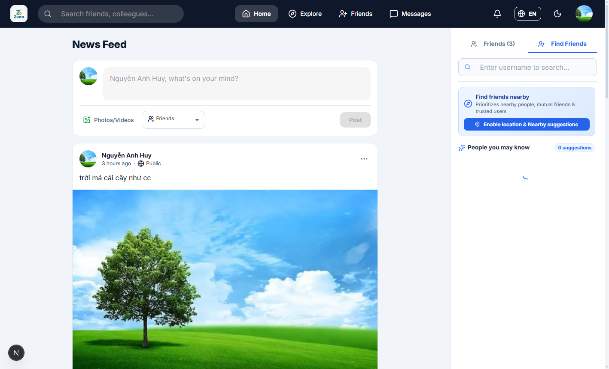
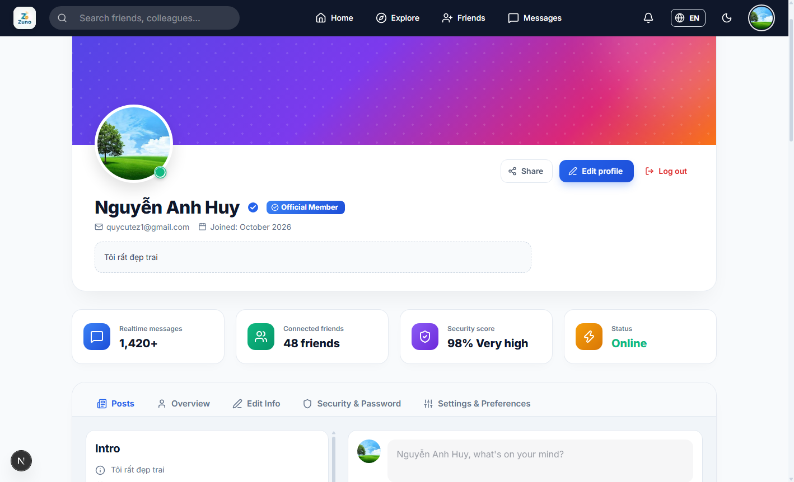
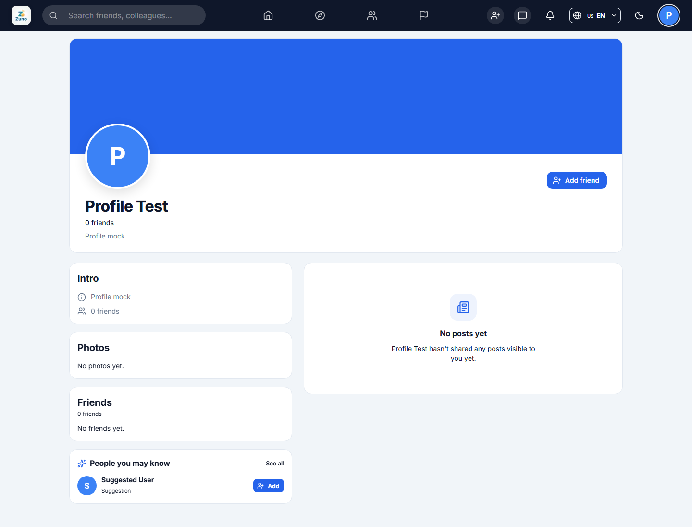

# 📰 BẢNG TIN MẠNG XÃ HỘI & HỒ SƠ CÁ NHÂN (FEED & PROFILE)

> Tài liệu mô tả chi tiết chức năng Bảng tin mạng xã hội, luồng tạo bài viết đa phương tiện, phân quyền riêng tư, tương tác thời gian thực và quản lý Hồ sơ cá nhân (Profile Timeline).

---

## 📑 MỤC LỤC
1. [Bảng Tin Thời Gian Thực (Social Feed)](#1-bảng-tin-thời-gian-thực-social-feed)
2. [Hình Ảnh Giao Diện Thực Tế](#2-hình-ảnh-giao-diện-thực-tế)
3. [Khung Tạo Bài Viết & Xử Lý Media](#3-khung-tạo-bài-viết--xử-lý-media)
4. [Cơ Chế Phân Quyền Riêng Tư (Privacy Levels)](#4-cơ-chế-phân-quyền-riêng-tư-privacy-levels)
5. [Hồ Sơ Cá Nhân & Quản Lý Dòng Thời Gian (Profile Timeline)](#5-hồ-sơ-cá-nhân--quản-lý-dòng-thời-gian-profile-timeline)
6. [Công Cụ Cắt Ảnh Đại Diện Công Thái Học (Avatar Crop)](#6-công-cụ-cắt-ảnh-đại-diện-công-thái-học-avatar-crop)
7. [Thông Tin Học Vấn & Tình Trạng Mối Quan Hệ (Education & Relationship Status)](#7-thông-tin-học-vấn--tình-trạng-mối-quan-hệ-education--relationship-status)

---

## 1. BẢNG TIN THỜI GIAN THỰC (SOCIAL FEED)

Bảng tin (`Feed.tsx`) là trung tâm kết nối cộng đồng, tập hợp các bài viết từ chính người dùng và bạn bè:
- **100% Dữ liệu thực:** Loại bỏ mock data; dữ liệu truy vấn từ MongoDB qua `posts.service.ts`.
- **Cuộn vô hạn (Infinite Scrolling):** Sử dụng custom hooks `usePagedList` và `useInfiniteSentinel` kết hợp phân trang con trỏ (Cursor-based pagination: `limit` và `after`).
- **Tối ưu hóa hiển thị (Zero-Layout-Shift):** Giữ nguyên vị trí thanh cuộn và trạng thái khung nhìn khi nạp thêm dữ liệu bài viết mới.
- **Tương tác mượt mà:**
  - **Thích bài viết (Like):** Cập nhật trạng thái lạc quan (Optimistic Update) ngay trên giao diện trước khi server phản hồi, mang lại cảm giác phản hồi tức thì.
  - **Bình luận (Comments):** Hỗ trợ xem danh sách bình luận, thêm mới và xóa bình luận (áp dụng cho tác giả bình luận hoặc chủ bài viết).
  - **Chia sẻ bài viết (Share):** Tạo bản sao chia sẻ bài viết lên dòng thời gian cá nhân.

---

## 2. HÌNH ẢNH GIAO DIỆN THỰC TẾ

### 2.1. Bảng tin trung tâm & Sidebar gợi ý bạn bè

*Bảng tin với khung đăng bài viết trên cùng, danh sách thẻ bài viết và cột tiện ích bên phải.*

### 2.2. Hồ sơ cá nhân & Quản lý Dòng thời gian

*Trang cá nhân với ảnh bìa, avatar, thanh điều hướng tab, cột thông tin giới thiệu và dòng thời gian bài viết.*

---

## 3. KHUNG TẠO BÀI VIẾT & XỬ LÝ MEDIA

Ô soạn thảo bài viết "Bạn đang nghĩ gì?" hỗ trợ trải nghiệm đăng bài phong phú:
- **Văn bản linh hoạt:** Hỗ trợ tối đa 5,000 ký tự với định dạng tự động co giãn theo nội dung gõ.
- **Đính kèm tối đa 4 hình ảnh/bài viết:**
  - Hỗ trợ các định dạng phổ biến: JPG, PNG, WEBP, GIF (kích thước tối đa 5MB/ảnh).
  - **Bảo mật tệp tải lên:** Backend kiểm tra chữ ký định dạng thực tế (Magic Bytes) thay vì chỉ tin tưởng phần mở rộng file (Extension), chống tấn công tải lên mã độc thực thi.
  - **Bố cục hiển thị ảnh đa năng (Mosaic Grid):** Tự động sắp xếp lưới ảnh 1 ảnh, 2 ảnh, 3 ảnh hoặc 4 ảnh theo tỷ lệ cân đối chuẩn thiết kế.

---

## 4. CƠ CHẾ PHÂN QUYỀN RIÊNG TƯ (PRIVACY LEVELS)

Mỗi bài viết được gán một trong 3 cấp độ hiển thị an toàn:

| Cấp độ | Giá trị enum | Phạm vi hiển thị |
|:---|:---:|:---|
| **Công khai** | `public` | Mọi người dùng trong hệ thống đều có thể xem bài viết trên Bảng tin hoặc Trang cá nhân |
| **Bạn bè** | `friends` | Chỉ tác giả và những người dùng đã là bạn bè chính thức mới được quyền xem |
| **Chỉ mình tôi** | `only_me` | Chỉ tác giả bài viết được phép xem trên trang cá nhân của mình |

*Backend áp dụng bảo vệ đa tầng: Kiểm tra quyền xem ngay tại câu truy vấn MongoDB (`$or` query) cho cả Bảng tin, Trang cá nhân và Endpoint lấy chi tiết bài viết.*

---

## 5. HỒ SƠ CÁ NHÂN & QUẢN LÝ DÒNG THỜI GIAN (PROFILE TIMELINE)

Trang cá nhân được tổ chức theo cấu trúc chuẩn:
- **Phần đầu trang (Header Banner):** Ảnh bìa lớn, ảnh đại diện có viền sáng, tên hiển thị, trạng thái hoạt động và các nút hành động (Chỉnh sửa hồ sơ, Thêm bạn / Nhắn tin).
- **Cột thông tin bên trái (Left Sidebar):**
  - **Tiểu sử & Giới thiệu:** Nơi sinh sống, nơi làm việc, mối quan hệ, ngày tham gia.
  - **Bộ sưu tập ảnh gần đây:** Hiển thị lưới 9 bức ảnh mới nhất đã tải lên.
  - **Danh sách bạn bè thu nhỏ:** Thống kê tổng số bạn bè và ảnh đại diện của 9 người bạn gần nhất.
- **Dòng thời gian bên phải (Right Column):**
  - Ô tạo bài viết cá nhân (chỉ hiển thị trên hồ sơ của chính mình).
  - Danh sách bài viết cá nhân đã lọc theo quyền riêng tư.
- **Xem hồ sơ người khác (`/profile/[id]`):** Tự động phát hiện trạng thái quan hệ (`none`, `pending_sent`, `pending_received`, `friends`) để hiển thị các nút thao tác tương ứng.

---

## 6. CÔNG CỤ CẮT ẢNH ĐẠI DIỆN CÔNG THÁI HỌC (AVATAR CROP)

- Tích hợp hộp thoại cắt ảnh `AvatarCropDialog` trực tiếp khi người dùng tải ảnh đại diện mới.
- Hỗ trợ thao tác kéo, phóng to/thu nhỏ (Zoom), xoay góc ảnh và xem trước khung tròn chuẩn xác.
- Xuất dữ liệu ảnh đã cắt với kích thước chuẩn, tối ưu hóa tốc độ tải và đảm bảo avatar luôn cân đối trên mọi thành phần giao diện.

---

## 7. THÔNG TIN HỌC VẤN & TÌNH TRẠNG MỐI QUAN HỆ (EDUCATION & RELATIONSHIP STATUS)

Hệ thống cho phép người dùng cá nhân hóa thông tin chi tiết trên hồ sơ cá nhân và đồng bộ hai chiều giữa trang cá nhân của mình (`/profile`) và trang xem người khác (`/profile/[id]`):

### 7.1. Cập nhật Trường học / Học vấn (`school`) với Gợi ý từ Public API
- **Tích hợp API Trường học có sẵn:** Hệ thống tích hợp trực tiếp Public Universities API (Hipolabs `universities.hipolabs.com/search?country=Vietnam`) kết hợp với cơ sở dữ liệu trường học chuẩn hóa tại Việt Nam (`POPULAR_SCHOOLS` bao gồm các trường ĐHQG, Bách Khoa, Kinh tế, Ngoại thương, Y Dược, các trường THPT Chuyên...).
- **API Endpoint:** `GET /users/schools?q={từ_khóa}&limit=50` hỗ trợ tìm kiếm nhanh, không phân biệt chữ hoa/chữ thường và hỗ trợ tiếng Việt không dấu.
- **Trải nghiệm chọn trường bằng MUI Autocomplete (`freeSolo`):**
  - Tự động nạp danh sách các trường học phổ biến khi mở form chỉnh sửa.
  - Hỗ trợ gõ để tìm kiếm trực tiếp qua API với chỉ báo nạp dữ liệu mượt mà (`CircularProgress`).
  - Cho phép người dùng nhấp chọn nhanh trường học trong danh sách hoặc tự nhập tên trường tùy ý (`freeSolo`).
- **Hiển thị trực quan:** Đi kèm biểu tượng mũ tốt nghiệp (`GraduationCap` phong cách Facebook) trên dòng thông tin tóm tắt Header, Thẻ Giới thiệu (About tab) và Cột Sidebar Dòng thời gian.

### 7.2. Thiết lập Tình trạng mối quan hệ (`relationshipStatus`)
Hỗ trợ đầy đủ các trạng thái mối quan hệ thực tế trong xã hội kèm biểu tượng trái tim (`Heart`), hỗ trợ song ngữ tự động:

| Trạng thái (Code) | Tiếng Việt (VI) | Tiếng Anh (EN) | Biểu tượng |
|:---|:---|:---|:---:|
| `single` | Độc thân | Single | 💖 |
| `dating` | Đang hẹn hò | In a relationship / Dating | ❤️ |
| `engaged` | Đã đính hôn | Engaged | 💍 |
| `married` | Đã kết hôn | Married | 💒 |
| `complicated` | Có mối quan hệ phức tạp | It's complicated | 💔 |
| `separated` | Đã ly thân | Separated | 🥀 |
| `divorced` | Đã ly hôn | Divorced | 🕊️ |
| `widowed` | Góa | Widowed | 🖤 |

### 7.3. Luồng chỉnh sửa & Đồng bộ dữ liệu
- **Tab "Chỉnh sửa thông tin":** Cung cấp trường chọn trường học thông minh (MUI Autocomplete gọi API `GET /users/schools`) và menu thả xuống (Dropdown Select) lựa chọn tình trạng mối quan hệ, lưu trữ tức thời qua API `PATCH /auth/profile`.
- **Tab "Giới thiệu":** Hiển thị thẻ thông tin với nhãn rõ ràng và nút "Thêm trường học" / "Thiết lập" / "Chỉnh sửa" liên kết nhanh đến form cập nhật.
- **Hồ sơ công khai (`/friends/profile/:userId`):** Người dùng khác ghé thăm trang cá nhân cũng sẽ nhìn thấy trường học và tình trạng quan hệ được chia sẻ trên Cột Sidebar Giới thiệu.

# Truy vấn bảng tin

Bảng tin và trang video ngắn dùng query GraphQL `feed(limit, after)` với xác thực hiện tại. Trang cá nhân dùng `publicProfile` và `profilePosts`; các query tái sử dụng service hiện có để áp dụng quyền xem và phân trang con trỏ, giới hạn mỗi trang từ 1 đến 30. Tìm kiếm bạn bè dùng `searchUsersPage` với phân trang con trỏ; gợi ý theo vị trí tiếp tục dùng REST. API REST tương ứng tiếp tục được hỗ trợ. Các thao tác đăng, sửa, xóa, tương tác và tải tệp vẫn dùng API REST.

GraphQL giới hạn độ sâu truy vấn ở 20 và tối đa 1.000 trường sau khi mở rộng fragment. Mỗi request chỉ thực thi một lần từng query danh sách hoặc hồ sơ mới, kể cả khi dùng alias.

Ảnh kiểm tra trang hồ sơ với dữ liệu GraphQL giả lập:

