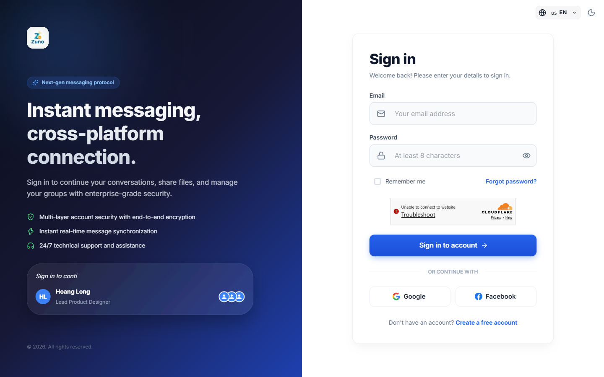

# Triển khai Frontend lên Vercel Production (Next.js 16 App Router)

## 1. Giới thiệu tổng quan
Tài liệu hướng dẫn và ghi nhận cấu hình triển khai phân hệ giao diện người dùng (`frontend/`) của hệ thống ChatApp lên nền tảng đám mây **Vercel** ở môi trường Production.

- **Vercel Production Domain**: [https://frontend-blush-seven-zqmn2u56h0.vercel.app](https://frontend-blush-seven-zqmn2u56h0.vercel.app)
- **Deployment URL**: [https://frontend-qtdg9ap9b-siam-dc97.vercel.app](https://frontend-qtdg9ap9b-siam-dc97.vercel.app)
- **Backend API (Render)**: [https://chatapp-86ki.onrender.com](https://chatapp-86ki.onrender.com)
- **Vercel Project**: `siam-dc97/frontend` (`prj_Cgr1KUJ6grmAd3R5azEhOVwNAubl`)

---

## 2. Hình ảnh Demo triển khai thực tế

---

## 3. Kiến trúc & Cấu hình Kỹ thuật

### 3.1. Cấu hình Vercel Project
- **Root Directory**: `frontend`
- **Node.js Runtime**: `24.x` (LTS)
- **Framework**: Next.js 16 (App Router + Turbopack)
- **Build Command**: `npm run build`
- **Output Directory**: `.vercel/output`

### 3.2. Danh sách Biến Môi trường (Environment Variables)
Tất cả các biến môi trường sau đã được cấu hình đồng bộ cho cả 3 môi trường `production`, `preview`, `development` trên Vercel:

| Biến môi trường | Mục đích / Giá trị |
|---|---|
| `NEXT_PUBLIC_BACKEND_URL` | `https://chatapp-86ki.onrender.com` (Kết nối NestJS Backend trên Render) |
| `NEXT_PUBLIC_FIREBASE_API_KEY` | Firebase API Key cho Web Client |
| `NEXT_PUBLIC_FIREBASE_AUTH_DOMAIN` | `chatapp-fd260.firebaseapp.com` |
| `NEXT_PUBLIC_FIREBASE_PROJECT_ID` | `chatapp-fd260` |
| `NEXT_PUBLIC_FIREBASE_STORAGE_BUCKET` | `chatapp-fd260.firebasestorage.app` |
| `NEXT_PUBLIC_FIREBASE_MESSAGING_SENDER_ID` | `654013175032` |
| `NEXT_PUBLIC_FIREBASE_APP_ID` | `1:654013175032:web:7b2be00e550e887276570d` |
| `NEXT_PUBLIC_FIREBASE_MEASUREMENT_ID` | `G-V7H2RWT2S4` |
| `NEXT_PUBLIC_TURNSTILE_SITE_KEY` | Cloudflare Turnstile CAPTCHA Key |
| `NEXT_PUBLIC_SITE_KEY` | Cloudflare Turnstile Client Key |
| `NEXT_PUBLIC_GIPHY_API_KEY` | Giphy SDK Search & Picker Key |

### 3.3. Tối ưu hóa Bundle đóng gói (`.vercelignore`)
Thêm tệp `.vercelignore` ở thư mục gốc repo để loại bỏ các thư mục ngoài frontend (`backend`, `admin`, `docs`, `node_modules`, `dist`...), giúp tối ưu dung lượng tải lên từ 351MB xuống chỉ còn **8.9MB**.

### 3.4. Xử lý Cross-Origin Cookie & CORS
Do Frontend chạy trên tên miền `*.vercel.app` và Backend chạy trên `onrender.com` (cross-site), hệ thống đã cập nhật:
1. **NestJS CORS Filter (`backend/src/main.ts`)**: Thêm regex `/^https:\/\/.*\.vercel\.app$/` vào `allowedOrigins` với `credentials: true`.
2. **SameSite Cookie Policy (`auth.service.ts`, `auth.controller.ts`, `waf-clearance.service.ts`)**:
   - Ở môi trường `production`, thiết lập `sameSite: 'none'` kết hợp `secure: true`.
   - Giúp trình duyệt lưu và gửi kèm cookie `accessToken`, `refreshToken`, `waf_clearance` an toàn qua các truy vấn Fetch/XHR cross-origin.

