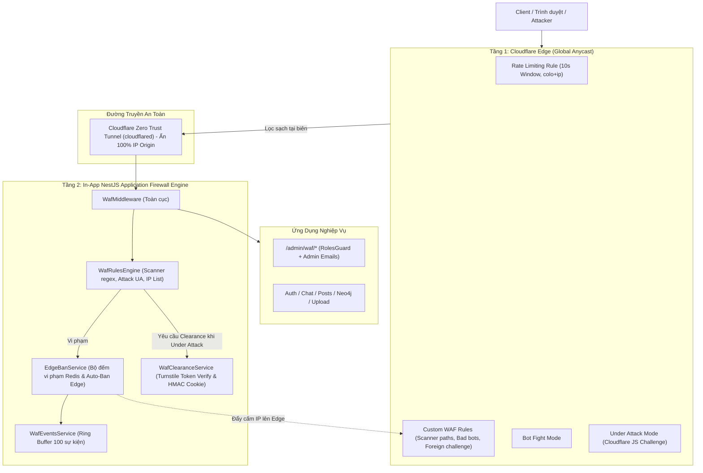
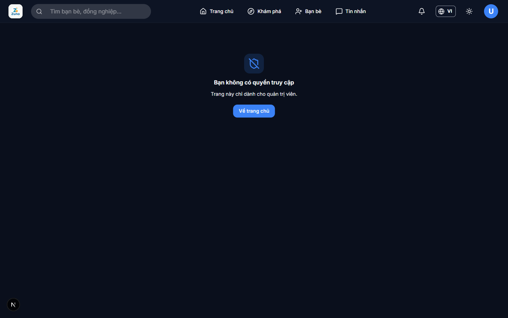
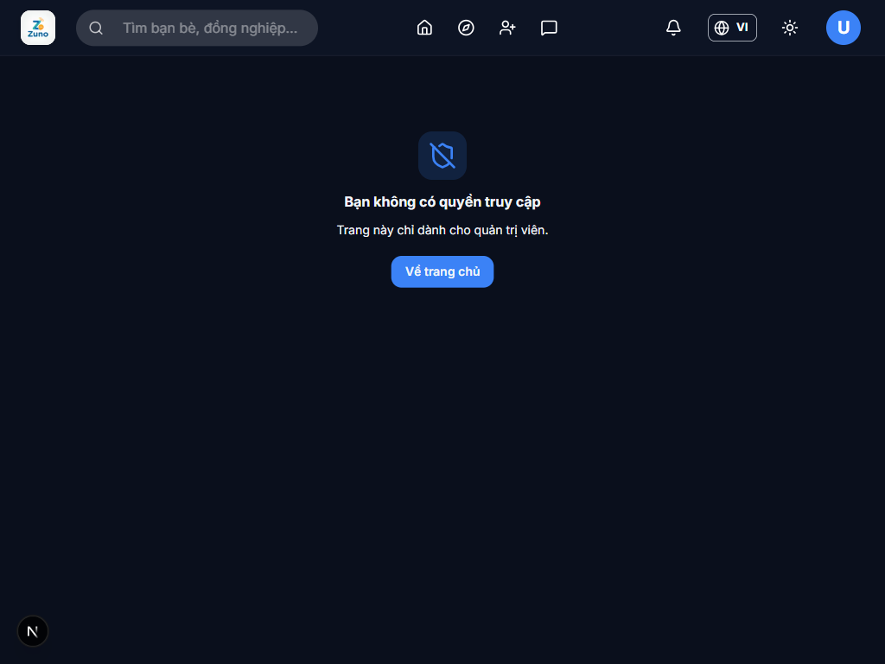
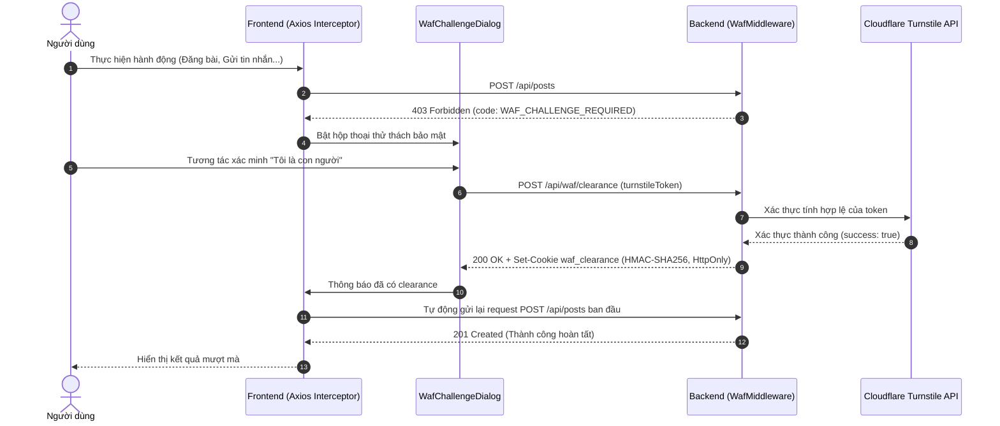

# 🛡️ TRUNG TÂM BẢO MẬT & HỆ THỐNG WAF CHỐNG DDOS ĐA TẦNG

> Tài liệu kỹ thuật chi tiết về hệ thống Web Application Firewall (WAF) và Trung tâm bảo mật Quản trị viên (`/admin/security`), kết hợp giữa **Cloudflare Anycast Edge** và **NestJS In-App Application Firewall Engine**.

---

## 📑 MỤC LỤC
1. [Tổng Quan Nguy Cơ & Mô Hình Đe Dọa (Threat Model)](#1-tổng-quan-nguy-cơ--mô-hình-đe-dọa-threat-model)
2. [Kiến Trúc Phòng Vệ 2 Tầng (Two-Tier Defense Architecture)](#2-kiến-trúc-phòng-vệ-2-tầng-two-tier-defense-architecture)
3. [Giao Diện Trung Tâm Bảo Mật Quản Trị Viên (`/admin/security`)](#3-giao-diện-trung-tâm-bảo-mật-quản-trị-viên-adminsecurity)
4. [WAF-as-Code CLI (`npm run cf:waf`)](#4-waf-as-code-cli-npm-run-cfwaf)
5. [Cơ Chế In-App WAF & Thử Thách Turnstile Clearance](#5-cơ-chế-in-app-waf--thử-thách-turnstile-clearance)
6. [Tự Động Cấm IP Tầng Biên (Edge Auto-Ban Service)](#6-tự-động-cấm-ip-tầng-biên-edge-auto-ban-service)
7. [Bảo Vệ Quyền Quản Trị & Chống Tự Leo Thang Quyền (Admin Role Guard)](#7-bảo-vệ-quyền-quản-trị--chống-tự-leo-thang-quyền-admin-role-guard)
8. [Danh Mục Biến Môi Trường (Environment Variables)](#8-danh-mục-biến-môi-trường-environment-variables)
9. [Kiểm Thử & Đảm Bảo Độ Tin Cậy (Quality Assurance)](#9-kiểm-thử--đảm-bảo-độ-tin-cậy-quality-assurance)

---

## 1. TỔNG QUAN NGUY CƠ & MÔ HÌNH ĐE DỌA (THREAT MODEL)

Các ứng dụng mạng xã hội và nhắn tin thời gian thực thường là mục tiêu của các cuộc tấn công tự động và có chủ đích:

- **Tấn công từ chối dịch vụ tầng ứng dụng (L7 HTTP Flood):** Kẻ tấn công huy động hàng nghìn địa chỉ IP (Botnet) dồn dập gửi request đến các API tiêu tốn CPU/RAM như tìm kiếm bạn bè đồ thị Neo4j, kiểm duyệt nội dung AI, đăng ký tài khoản.
- **Rà quét đường dẫn nhạy cảm (Vulnerability Scanning):** Các crawler độc hại liên tục dò tìm các tệp tin cấu hình (`.env`, `.git`), bảng điều khiển quản trị WordPress (`/wp-admin`, `xmlrpc.php`), hoặc các mã nguồn PHP nhằm khai thác lỗ hổng máy chủ.
- **Công cụ dò quét tự động (Automated Attack Tools):** Các script như `sqlmap`, `nikto`, `masscan`, `dirbuster`, `gobuster` thực hiện brute-force và inject mã độc.
- **Brute-Force & Credential Stuffing:** Tấn công vét cạn tài khoản tại các endpoint đăng nhập/đăng ký.

---

## 2. KIẾN TRÚC PHÒNG VỆ 2 TẦNG (TWO-TIER DEFENSE ARCHITECTURE)



---

## 3. GIAO DIỆN TRUNG TÂM BẢO MẬT QUẢN TRỊ VIÊN (`/admin/security`)

Giao diện quản trị hiện đại, tuân thủ nghiêm ngặt **ChatApp Design System**, hỗ trợ song ngữ VI/EN và chế độ Sáng/Tối (Dark/Light mode).



### Các thành phần chính trên giao diện:
1. **Thẻ Trạng Thái Under Attack (Under Attack Control):**
   - Công tắc kích hoạt nhanh chế độ khẩn cấp ở cả hai tầng: **Cloudflare Edge** và **In-App Application Engine**.
   - Bổ sung trường ghi chú lý do bật chế độ và cơ chế rollback trạng thái an toàn.
2. **Thẻ Tích Hợp Cloudflare (Cloudflare Status & Sync):**
   - Hiển thị trạng thái kết nối Cloudflare API, Zone ID và Hostname đích.
   - Nút **"Đồng bộ quy tắc WAF"** gọi backend thực thi sync các quy tắc chuẩn lên Cloudflare.
   - Công tắc điều khiển nhanh **Bot Fight Mode**.
3. **Thẻ Cấu Hình WAF Ứng Dụng (In-App Rules Engine):**
   - Điều khiển bật/tắt: Chặn đường dẫn quét lỗ hổng (Scanner paths), Chặn User Agent độc hại (Attack tools), Chặn dải IP quốc tế đối với trang xác thực.
4. **Thẻ Quản Lý Danh Sách IP (IP Access Control):**
   - Quản lý danh sách IP bị cấm (Blacklist) và IP ngoại lệ (Whitelist).
   - Cơ chế nhập an toàn: Kiểm tra định dạng IPv4/IPv6, ngăn chặn cấm nhầm địa chỉ Loopback, Subnet nội bộ RFC1918, hoặc dải IP máy chủ Cloudflare.
5. **Bảng Giám Sát Sự Kiện Vi Phạm (Realtime WAF Events Monitor):**
   - Danh sách 100 sự kiện vi phạm gần nhất được lưu trong bộ nhớ (Ring Buffer).
   - Hiển thị đầy đủ: Thời gian, IP nguồn, Quốc gia, Loại vi phạm (Scanner path, Bad User-Agent, Rate limit exceeded, In-app challenge), Phương thức HTTP, URL đích và User Agent.

---

## 4. WAF-AS-CODE CLI (`npm run cf:waf`)

Dự án cung cấp bộ công cụ dòng lệnh (CLI) giúp đồng bộ các quy tắc WAF lên Cloudflare một cách khai báo, bất biến và có thể kiểm toán (Idempotent):

```bash
cd backend

# 1. Kiểm tra trạng thái hiện tại trên Cloudflare
npm run cf:waf -- --status

# 2. Xem trước kế hoạch thay đổi (Dry run)
npm run cf:waf -- --plan

# 3. Áp dụng toàn bộ quy tắc chuẩn lên Cloudflare
npm run cf:waf -- --sync

# 4. Bật chế độ Under Attack khẩn cấp tại tầng biên
npm run cf:waf -- --under-attack on

# 5. Tắt chế độ Under Attack (Khôi phục mức bảo mật ban đầu)
npm run cf:waf -- --under-attack off

# 6. Bật / Tắt Bot Fight Mode
npm run cf:waf -- --bot-fight on
```

### Bộ quy tắc chuẩn được biên dịch tự động:
1. **Rate Limiting Rule (Tương thích gói Cloudflare Free):**
   - Gói Free giới hạn đúng **1 rule rate limit**, cửa sổ thời gian bắt buộc là **10 giây**, thời gian phạt **10 giây**, tổ hợp thuộc tính bắt buộc bao gồm cả `cf.colo.id` và `ip.src`.
   - Giới hạn: 30 requests / 10s cho các endpoint xác thực (`/api/auth/*`).
2. **Scanner & Probe Paths Block Rule:**
   - Tự động chặn ngay tại Edge mọi request truy cập đường dẫn chứa: `.env`, `.git`, `wp-admin`, `wp-login`, `xmlrpc.php`, `composer.json`, `composer.lock`, `.php`.
3. **Malicious User-Agent Block Rule:**
   - Chặn đứng các công cụ quét tự động: `sqlmap`, `nikto`, `masscan`, `dirbuster`, `gobuster`.
4. **Foreign Challenge on Auth Rule:**
   - Tự động áp dụng thử thách **Managed Challenge** đối với các request ngoài lãnh thổ Việt Nam (`ip.geoip.country ne "VN"`) khi truy cập các trang đăng nhập/đăng ký.
5. **Tiền tố quản lý chuẩn hóa:**
   - Tất cả các quy tắc do ChatApp tạo đều mang `ref: "chatapp-*"` và mô tả rõ ràng, không làm mất hoặc ghi đè các quy tắc tùy chỉnh khác do người dùng cấu hình thủ công trên Cloudflare.

---

## 5. CƠ CHẾ IN-APP WAF & THỬ THÁCH TURNSTILE CLEARANCE

Khi Cloudflare Proxy gặp sự cố hoặc máy chủ kích hoạt chế độ **In-App Under Attack**, tầng WAF ứng dụng sẽ tự động kích hoạt cơ chế thử thách bảo mật Turnstile.



### Luồng xử lý trong suốt (Zero UX Interruption):


---

## 6. TỰ ĐỘNG CẤM IP TẦNG BIÊN (EDGE AUTO-BAN SERVICE)

Hệ thống theo dõi tần suất vi phạm của từng địa chỉ IP thông qua dịch vụ [`EdgeBanService`](file:///d:/Web/chat/backend/src/modules/waf/edge-ban.service.ts) lưu trữ trên Redis:

- **Ngưỡng vi phạm:** Mặc định **3 lần vi phạm** trong khoảng thời gian **10 phút** sẽ bị tự động khóa quyền truy cập trong **1 giờ**.
- **Đẩy lệnh cấm lên Cloudflare Edge:** Khi cấu hình `CLOUDFLARE_AUTO_BAN=true`, hệ thống sẽ tự động gọi Cloudflare IP Access Rules API để tạo bản ghi cấm (Block mode) trực tiếp trên đám mây Cloudflare.
- **Cơ chế Safe Guards nghiêm ngặt:**
  - Tuyệt đối không cấm địa chỉ Loopback (`127.0.0.1`, `::1`).
  - Tuyệt đối không cấm các subnet mạng nội bộ RFC1918 (`10.0.0.0/8`, `172.16.0.0/12`, `192.168.0.0/16`).
  - Tuyệt đối không cấm các dải địa chỉ IP của Cloudflare Edge.

---

## 7. BẢO VỆ QUYỀN QUẢN TRỊ & CHỐNG TỰ LEO THANG QUYỀN (ADMIN ROLE GUARD)

Để bảo vệ các endpoint cấu hình nhạy cảm tại `/admin/waf/*`, hệ thống áp dụng cơ chế xác thực kép:

1. **Loại bỏ khả năng tự gán quyền Admin:** Trường `role` bị loại bỏ hoàn toàn khỏi `CreateUserDto` và `UpdateUserDto`. Người dùng đăng ký tài khoản thông thường không thể tự truyền `role: "admin"`.
2. **RolesGuard:** Bảo vệ toàn bộ controller quản trị, yêu cầu người dùng phải đăng nhập (`JwtAuthGuard`) và mang quyền `admin`.
3. **Danh sách Admin tin cậy (`ADMIN_EMAILS`):** Cấu hình danh sách email quản trị viên dự phòng trong tệp cấu hình. Nếu người dùng có email thuộc danh sách này, hệ thống sẽ cấp quyền quản trị ngay cả khi trường role trong cơ sở dữ liệu chưa kịp migrate.

---

## 8. DANH MỤC BIẾN MÔI TRƯỜNG (ENVIRONMENT VARIABLES)

Cấu hình trong `backend/.env`:

| Biến môi trường | Bắt buộc | Giá trị mặc định | Ý nghĩa |
|---|---|---|---|
| `ADMIN_EMAILS` | Khuyên dùng | `admin@example.com` | Danh sách email quản trị viên, phân cách bởi dấu phẩy. |
| `CLOUDFLARE_API_TOKEN` | Tùy chọn | `""` | API Token Cloudflare có quyền chỉnh sửa WAF, Zone Settings và Bot Management. |
| `CLOUDFLARE_ZONE_ID` | Tùy chọn | `""` | Mã định danh Zone của tên miền trên Cloudflare. |
| `CLOUDFLARE_FRONTEND_HOST` | Tùy chọn | `""` | Tên miền frontend (vd: `chat.yourdomain.com`). |
| `CLOUDFLARE_API_HOST` | Tùy chọn | `""` | Tên miền API backend (vd: `api.yourdomain.com`). |
| `CLOUDFLARE_AUTO_BAN` | Tùy chọn | `false` | Tự động đồng bộ các IP vi phạm lên Cloudflare IP Access Rules. |
| `WAF_CLEARANCE_SECRET` | Tùy chọn | `JWT_SECRET` | Khóa bí mật dùng để ký và xác thực cookie `waf_clearance`. |
| `TURNSTILE_SECRET` | Tùy chọn | `""` | Khóa bí mật Cloudflare Turnstile để xác minh mã thử thách. |
| `TURNSTILE_HOSTNAMES` | Tùy chọn | `localhost` | Danh sách hostname hợp lệ được phép giải mã thử thách Turnstile. |

---

## 9. KIỂM THỬ & ĐẢM BẢO ĐỘ TIN CẬY (QUALITY ASSURANCE)

Hệ thống được kiểm thử tự động toàn diện qua các bộ test suite:
- `waf-rules.engine.spec.ts`: Kiểm tra phát hiện scanner paths, attack user agents, allowlist/blocklist IP, clearance checking.
- `waf-clearance.util.spec.ts`: Kiểm tra tạo và giải mã chữ ký điện tử HMAC-SHA256, phát hiện token giả mạo hoặc hết hạn.
- `edge-ban.service.spec.ts`: Kiểm tra bộ đếm vi phạm Redis, ngưỡng kích hoạt auto-ban, safe guards bảo vệ IP nội bộ.
- `waf.middleware.spec.ts`: Kiểm tra tích hợp middleware toàn cục, chuyển hướng thử thách 403.
- `admin.util.spec.ts` & `roles.guard.spec.ts`: Kiểm tra phân quyền quản trị viên, chống leo thang quyền.
- `cloudflare-waf.spec.ts`: Kiểm tra biên dịch bộ quy tắc WAF tương thích chuẩn Cloudflare Free plan.
