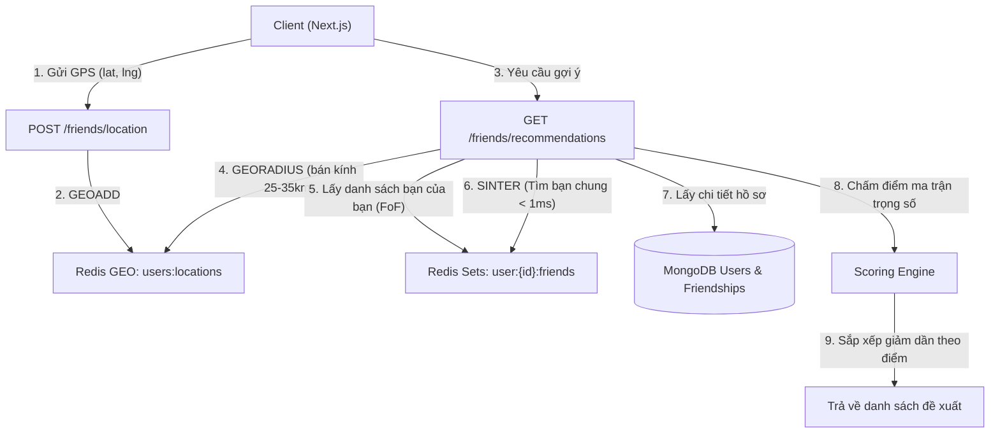

# TÀI LIỆU KỸ THUẬT HỆ THỐNG CHATAPP & THUẬT TOÁN GỢI Ý BẠN BÈ

> Tài liệu mô tả chi tiết kiến trúc kỹ thuật, giao thức truyền tải tin nhắn nhị phân (Binary MQTT/Protobuf) theo mô hình Facebook Messenger, và thuật toán gợi ý bạn bè thông minh đa chiều kết hợp **Redis Geospatial**, **Redis Sets**, và **MongoDB**.

---

## MỤC LỤC
1. [Tổng Quan Hệ Thống](#1-tổng-quan-hệ-thống)
2. [Giao Thức Nhị Phân Binary MQTT & Protobuf (Facebook Messenger Style)](#2-giao-thức-nhị-phân-binary-mqtt--protobuf)
   - [2.1. Tại sao dùng Binary thay vì JSON thông thường?](#21-tại-sao-dùng-binary-thay-vì-json-thông-thường)
   - [2.2. Cấu trúc Message Protobuf](#22-cấu-trúc-message-protobuf)
   - [2.3. Luồng kết nối & Truyền thông tin nhắn](#23-luồng-kết-nối--truyền-thông-tin-nhắn)
   - [2.4. Trạng thái Đang soạn tin nhắn (Typing Indicator)](#24-trạng-thái-đang-soạn-tin-nhắn-typing-indicator)
   - [2.5. Hộp chat nổi đa nhiệm phong cách Facebook](#25-hộp-chat-nổi-đa-nhiệm-phong-cách-facebook)
   - [2.6. Thông báo Lời mời kết bạn Realtime trên Header](#26-thông-báo-lời-mời-kết-bạn-realtime-trên-header-không-cần-chuyển-tab)
3. [Thuật Toán Gợi Ý Bạn Bè Thông Minh](#3-thuật-toán-gợi-ý-bạn-bè-thông-minh)
   - [3.1. Bài toán và Mục tiêu](#31-bài-toán-và-mục-tiêu)
   - [3.2. Kiến trúc dữ liệu đa tầng (Redis + MongoDB)](#32-kiến-trúc-dữ-liệu-đa-tầng-redis--mongodb)
   - [3.3. Công thức tính điểm ưu tiên (Weighted Scoring Engine)](#33-công-thức-tính-điểm-ưu-tiên-weighted-scoring-engine)
   - [3.4. Cơ chế chống nick Clone / Acc rác](#34-cơ-chế-chống-nick-clone--acc-rác)
4. [Đặc Tả API Danh Mục Bạn Bè & Vị Trí](#4-đặc-tả-api-danh-mục-bạn-bè--vị-trí)
5. [Hướng Dẫn Cài Đặt & Chạy Thử](#5-hướng-dẫn-cài-đặt--chạy-thử)

---

## 1. TỔNG QUAN HỆ THỐNG

- **Backend**: NestJS (TypeScript), Mongoose (MongoDB), IORedis (Redis 7), Aedes MQTT Broker tích hợp (chạy cổng WebSocket 8883 / MQTT 1883), Socket.IO fallback.
- **Frontend**: Next.js 14 / React 18, Zustand State Management, Material UI (MUI), Lucide Icons, MQTT.js, Protobuf.js.
- **Cơ sở dữ liệu**:
  - **MongoDB**: Lưu trữ hồ sơ người dùng (`User`), tin nhắn vĩnh viễn (`Message`), cuộc trò chuyện (`Conversation`), trạng thái quan hệ bạn bè (`Friendship`).
  - **Redis**: 
    - `GEO`: Lưu trữ tọa độ địa lý kinh độ/vĩ độ của người dùng (`users:locations`).
    - `SET`: Lưu danh bạ bạn bè chính thức của từng người dùng (`user:<id>:friends`) để giao nhau tìm bạn chung tức thì.
    - `STRING` (with TTL): Cache trạng thái online, vị trí thời gian cập nhật.

---

## 2. GIAO THỨC NHỊ PHÂN BINARY MQTT & PROTOBUF

### 2.1. Tại sao dùng Binary thay vì JSON thông thường?
Theo nghiên cứu kiến trúc của Facebook Messenger:
1. **Tiết kiệm băng thông (70% - 80%)**: Dữ liệu JSON chứa nhiều tên trường lặp đi lặp lại (`"senderId": "..."`, `"content": "..."`). Protobuf mã hóa trường thành các thẻ số (Field Tag) 1-2 byte, payload nhị phân gọn gàng tối đa.
2. **Tối ưu tốc độ Serialization/Deserialization**: Parse JSON trên thiết bị tốn chu kỳ CPU và bộ nhớ. Protobuf giải mã nhị phân trực tiếp trên bộ đệm bộ nhớ (ArrayBuffer / Buffer) với hiệu năng cao gấp nhiều lần.
3. **Tiết kiệm pin & Băng thông 3G/4G/5G**: Gói tin MQTT Keep-Alive siêu nhẹ (chỉ 2 byte), hoạt động tin cậy cả khi mạng chập chờn.

### 2.2. Cấu trúc Message Protobuf
Được định nghĩa thống nhất giữa NestJS Backend và Next.js Frontend (`chat.proto.ts`):

```protobuf
syntax = "proto3";

package chat;

enum MessageType {
  TEXT = 0;
  IMAGE = 1;
  FILE = 2;
  SYSTEM = 3;
}

message ChatMessageProto {
  string messageId = 1;
  string conversationId = 2;
  string senderId = 3;
  string senderName = 4;
  string content = 5;
  int64 timestamp = 6;
  MessageType type = 7;
}

message TypingEventProto {
  string conversationId = 1;
  string userId = 2;
  string userName = 3;
  bool isTyping = 4;
  string receiverId = 5;
}
```

### 2.3. Luồng kết nối & Truyền thông tin nhắn
1. **Frontend kết nối MQTT WebSocket**:
   - URL: `ws://localhost:8883` (Aedes broker nhúng trong NestJS) hoặc `ws://localhost:9001` (Mosquitto).
   - Topic đăng ký:
     - `chat/binary/users/<userId>/inbox`: Nhận tin nhắn đến.
     - `chat/binary/users/<userId>/typing`: Nhận tín hiệu đang gõ tin nhắn.
2. **Gửi tin nhắn**:
   - Client tạo đối tượng `ChatMessageProto`, serialize sang `Uint8Array`.
   - Publish lên topic: `chat/binary/messages` với QoS 1.
3. **Backend xử lý**:
   - `ChatGateway` lắng nghe broker MQTT nội bộ, decode `ChatMessageProto.decode(rawBuffer)`.
   - Lưu vào MongoDB `messages` collection và cập nhật `lastMessage` của conversation.
   - Publish nhị phân tới topic inbox của người nhận `chat/binary/users/<receiverId>/inbox`.

### 2.4. Trạng thái Đang soạn tin nhắn (Typing Indicator)
**Giải quyết triệt để lỗi người dùng đang gõ bị mất sau vài giây**:
- **Cơ chế Heartbeat (Nhịp tim 2.5s)**: Khi người dùng gõ phím liên tục, client gửi định kỳ tín hiệu `isTyping = true` mỗi 2.5 giây thay vì chỉ gửi 1 lần duy nhất lúc nhấn phím đầu tiên.
- **Cửa sổ ngừng gõ (Composing Window 5.0s)**: Sau khi ngừng nhấn phím 5 giây, client mới gửi `isTyping = false`.
- **Bộ đếm tự hủy an toàn (Receiver Auto-expire 6.5s)**: Bên phía người nhận duy trì bộ đếm 6.5 giây. Nếu quá 6.5s không nhận được heartbeat mới (ví dụ người gửi bị mất mạng đột ngột), trạng thái gõ mới tự tắt.

### 2.5. Hộp chat nổi đa nhiệm phong cách Facebook
- Tích hợp tại Trang chủ `Home.tsx` qua `FloatingChatDock.tsx` và `FloatingChatBox.tsx`.
- Cho phép mở nhiều hộp chat cùng lúc ở góc dưới bên phải màn hình.
- Có thể thu nhỏ thành bóng tròn avatar thu nhỏ, phóng to hộp chat, hoặc đóng lại dễ dàng mà không làm gián đoạn việc duyệt nội dung trên feed.

### 2.6. Thông báo Lời mời kết bạn Realtime trên Header (Không cần chuyển Tab)
- **Nút hiển thị trên Header (Desktop & Mobile)**:
  - Nút icon `UserPlus` kèm huy hiệu màu đỏ (`Badge`) báo số lượng lời mời kết bạn đang chờ (`receivedRequests.length`).
  - Tự động đồng bộ số lượng tức thì qua Socket.IO event `friend:request_received` và `friend:accepted`.
- **Menu Popover tương tác trực tiếp**:
  - Khi nhấp vào nút trên Header, một hộp thoại nổi (Popover) mở ngay bên dưới mà không làm chuyển trang, không reload hay gây giật layout (`disableScrollLock`).
  - Người dùng có thể xem danh sách người gửi kèm avatar, tên, email, thời gian gửi.
  - Hỗ trợ nút **"Xác nhận"** (Chấp nhận kết bạn) và **"Xóa"** (Từ chối) xử lý ngay lập tức trong 1 cú click.

---

## 3. THUẬT TOÁN GỢI Ý BẠN BÈ THÔNG MINH

### 3.1. Bài toán và Mục tiêu
Khi người dùng truy cập mục **Tìm bạn bè** hoặc nhấn **"Bật định vị & Gợi ý quanh đây"**, hệ thống cần xuất ra danh sách những người thích hợp nhất để kết bạn theo các nguyên tắc:
1. **Ưu tiên 1**: Cùng vị trí địa lý / Ở gần khu vực hiện tại.
2. **Ưu tiên 2**: Có nhiều bạn chung (Mutual Friends).
3. **Ưu tiên 3**: Tài khoản uy tín, có mạng lưới xã hội thật (Nhiều bạn bè, hồ sơ đầy đủ).
4. **Loại trừ**: Bản thân, những người đã là bạn bè, những người đã gửi/nhận lời mời đang chờ phản hồi.
5. **Cơ chế chống Nick Clone / Acc Rác**: Phạt nặng tài khoản ảo có 0-1 bạn bè, vừa lập < 48 giờ, không có avatar.
6. **Xếp sau cùng**: Người lạ không có mối liên hệ nào.

---

### 3.2. Kiến trúc dữ liệu đa tầng (Redis + MongoDB)



#### 1. Redis Geospatial (Tọa độ người dùng)
- **Key**: `users:locations`
- **Lệnh cập nhật**: `GEOADD users:locations <longitude> <latitude> <userId>`
- **Lệnh quét bán kính**:
  ```bash
  GEORADIUS users:locations <lng> <lat> 25 km WITHDIST ASC
  ```
- **Tốc độ truy vấn**: Cấu trúc Geohash bên trong Redis cho phép tìm kiếm hàng chục ngàn người dùng quanh bán kính trong thời gian **< 2 miligiây**.

#### 2. Redis Sets (Mạng lưới bạn bè & Bạn chung)
- **Key**: `user:<userId>:friends` (Lưu danh sách ID của bạn bè đã kết bạn).
- **TTL**: 86400 giây (24 giờ, tự động đồng bộ lại khi có kết bạn/hủy kết bạn).
- **Lệnh tìm bạn chung giữa User A và Candidate B**:
  ```bash
  SINTER user:A:friends user:B:friends
  ```
- **Tốc độ**: Thuật toán giao tập hợp trong bộ nhớ RAM của Redis trả về kết quả số bạn chung trong **< 0.5 miligiây**.

---

### 3.3. Công thức tính điểm ưu tiên (Weighted Scoring Engine)

Tổng điểm của một ứng viên $B$ đối với người dùng hiện tại $A$ được xác định bởi:

$$\text{Total Score} = \text{Score}_{\text{mutual}} + \text{Score}_{\text{geo}} + \text{Score}_{\text{trust}}$$

#### A. Điểm Bạn Chung ($\text{Score}_{\text{mutual}}$) - Trọng số cao nhất
Mỗi người bạn chung là bằng chứng rõ ràng nhất của mối quan hệ đời thực:
- Mỗi bạn chung: **+35 điểm**.
- Giới hạn tối đa: **140 điểm** (tương đương $\ge 4$ bạn chung).

$$\text{Score}_{\text{mutual}} = \min(N_{\text{mutual}} \times 35, 140)$$

#### B. Điểm Vị Trí Địa Lý ($\text{Score}_{\text{geo}}$) - Redis GEORADIUS
Được tính toán dựa trên khoảng cách địa lý thực tế $d$ (đơn vị: km):

$$\text{Score}_{\text{geo}} = 
\begin{cases} 
+50 \text{ điểm} & \text{nếu } d \le 3\text{ km (Cực gần, cùng phường/khu phố)} \\
+30 \text{ điểm} & \text{nếu } 3\text{ km} < d \le 10\text{ km (Cùng quận/huyện)} \\
+15 \text{ điểm} & \text{nếu } 10\text{ km} < d \le 25\text{ km (Cùng thành phố/khu vực lân cận)} \\
+5 \text{ điểm} & \text{nếu } d > 25\text{ km} \\
0 \text{ điểm} & \text{nếu không có dữ liệu tọa độ}
\end{cases}$$

#### C. Điểm Uy Tín & Hồ Sơ ($\text{Score}_{\text{trust}}$)
Dựa trên mức độ hoạt động và tính xác thực của tài khoản:
- **Số lượng bạn bè hiện có của ứng viên**:
  - $\ge 20$ bạn bè: **+25 điểm** (Mạng lưới kết nối rộng rãi).
  - $5 - 19$ bạn bè: **+15 điểm** (Người dùng bình thường, đang hoạt động).
  - $2 - 4$ bạn bè: **+5 điểm**.
  - **$0 - 1$ bạn bè: TRỪ 30 ĐIỂM (-30)** *(Nghi vấn clone / acc rác!)*.
- **Độ hoàn thiện thông tin cá nhân**:
  - Có Avatar cá nhân (không phải ảnh mặc định): **+10 điểm** (Không có avatar: **-10 điểm**).
  - Có cập nhật Tiểu sử (Bio): **+10 điểm**.
  - Có số điện thoại xác minh: **+5 điểm**.
- **Tuổi thọ tài khoản**:
  - Tạo trên 30 ngày: **+15 điểm**.
  - Tạo trên 7 ngày: **+10 điểm**.
  - **Mới tạo dưới 48 giờ: TRỪ 20 ĐIỂM (-20)** *(Ngăn chặn spam nick mới)*.

---

### 3.4. Cơ chế chống nick Clone / Acc rác

| Tiêu chí | Điểm cộng / phạt | Mục đích kỹ thuật |
| :--- | :---: | :--- |
| **0 hoặc 1 bạn bè** | **-30 điểm** | Các nick clone mới lập thường chưa có bạn bè, sẽ lập tức bị kéo xuống cuối danh sách. |
| **Tài khoản mới tạo < 48h** | **-20 điểm** | Chặn các chiến dịch tạo hàng loạt acc ảo đi spam kết bạn. |
| **Không có ảnh đại diện (No Avatar)** | **-10 điểm** | Khuyến khích người dùng có danh tính rõ ràng. |
| **Nhiều bạn bè & Có bạn chung** | **+50 đến +140 điểm** | Đảm bảo người dùng nhìn thấy bạn bè của mình và các thành viên uy tín trong cộng đồng trước tiên. |

---

## 4. ĐẶC TẢ API DANH MỤC BẠN BÈ & VỊ TRÍ

### 1. Cập nhật vị trí địa lý của người dùng
- **Endpoint**: `POST /friends/location`
- **Headers**: `Authorization: Bearer <token>`
- **Request Body**:
  ```json
  {
    "latitude": 10.776889,
    "longitude": 106.700806
  }
  ```
- **Response** (`200 OK`):
  ```json
  {
    "success": true,
    "message": "Đã cập nhật vị trí địa lý thành công"
  }
  ```

### 2. Lấy danh sách gợi ý bạn bè thông minh
- **Endpoint**: `GET /friends/recommendations`
- **Query Parameters**:
  - `limit` (tùy chọn, mặc định 20): Số lượng người gợi ý.
  - `radiusKm` (tùy chọn, mặc định 25): Bán kính quét xung quanh (km).
  - `lat`, `lng` (tùy chọn): Tọa độ hiện tại nếu client muốn cập nhật và lấy cùng lúc.
- **Response** (`200 OK`):
  ```json
  {
    "success": true,
    "recommendations": [
      {
        "_id": "660c1d2e8f1b2c001a123456",
        "name": "Nguyễn Văn A",
        "email": "vana@example.com",
        "avatar": "https://...",
        "bio": "Lập trình viên fullstack",
        "distanceKm": 1.45,
        "mutualFriendsCount": 3,
        "friendsCount": 24,
        "score": 195,
        "recommendationReason": "3 bạn chung • Cách 1.5 km",
        "relationStatus": "none"
      }
    ]
  }
  ```

### 3. Gửi lời mời kết bạn
- **Endpoint**: `POST /friends/request`
- **Request Body**:
  ```json
  {
    "recipientId": "660c1d2e8f1b2c001a123456"
  }
  ```
- **Đặc điểm**: Nếu người nhận đã gửi lời mời cho người gửi trước đó, hệ thống tự động đổi trạng thái sang `accepted` (kết bạn ngay lập tức mà không cần xác nhận lần 2).

---

## 5. HƯỚNG DẪN CÀI ĐẶT & CHẠY THỬ

### Yêu cầu tiên quyết:
- Node.js $\ge$ 18.
- MongoDB chạy tại `mongodb://localhost:27017` (hoặc MongoDB Atlas trong file `.env`).
- Redis Server chạy tại `localhost:6379`.

### Các bước khởi động:
1. **Khởi chạy Backend**:
   ```bash
   cd backend
   npm run start:dev
   ```
   *Backend sẽ khởi động NestJS API tại cổng 3000, đồng thời kích hoạt Aedes MQTT WebSocket Broker tại cổng 8883.*

2. **Khởi chạy Frontend**:
   ```bash
   cd frontend
   npm run dev
   ```
   *Frontend chạy tại `http://localhost:5173` hoặc `http://localhost:3000` (tùy cổng Next.js).*

3. **Thử nghiệm tính năng Gợi ý bạn bè**:
   - Truy cập trang chủ, mở thanh danh bạ bên phải (hoặc màn hình Bạn bè).
   - Chọn tab **"Tìm bạn"**.
   - Bấm nút **"📍 Bật định vị & Gợi ý quanh đây"** và cấp quyền vị trí cho trình duyệt.
   - Hệ thống sẽ gọi `POST /friends/location`, lưu vị trí vào Redis Geospatial và trả về danh sách ứng viên có điểm số cao nhất hiển thị đầy đủ thẻ **"X bạn chung"**, **"Cách X km"**, và nút **"Kết bạn"**.
